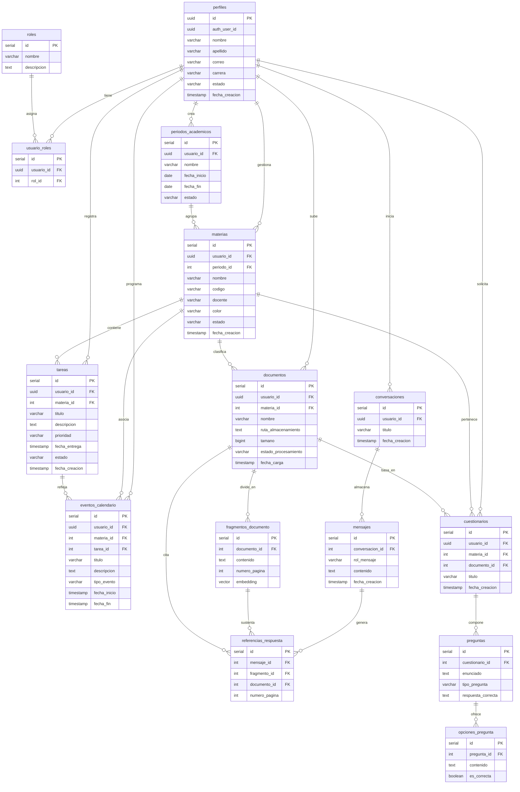

# Base de datos de MINGO

**Versión:** 2.0  
**Fecha:** 2026-11-07  
**Motor:** PostgreSQL administrado por Supabase  
**Extensiones:** `pgvector` para búsqueda semántica  
**Fuente del modelo:** diagrama PlantUML entregado por el equipo (15 entidades)  
**Seguridad:** Row Level Security (RLS) obligatorio en todas las tablas

> Este documento refleja **la base de datos actual del proyecto** según el diagrama del equipo. Reemplaza la propuesta anterior basada en UUID para todas las tablas. Las recomendaciones de implementación están separadas de lo que el diagrama define, para no confundir el modelo con las mejoras futuras.

## 1. Resumen

La base de datos se organiza en ocho grupos:

| Grupo | Tablas |
|---|---|
| A. Usuarios y acceso | `perfiles`, `roles`, `usuario_roles` |
| B. Organización académica | `periodos_academicos`, `materias` |
| C. Actividades | `tareas`, `eventos_calendario` |
| D. Biblioteca documental | `documentos`, `fragmentos_documento` |
| E. Conversaciones e IA | `conversaciones`, `mensajes`, `referencias_respuesta` |
| F. Evaluación | `cuestionarios`, `preguntas`, `opciones_pregunta` |

**Total del diagrama:** 15 tablas y 23 relaciones.

### Identificadores

| Tipo de tabla | Clave primaria | Motivo |
|---|---|---|
| `perfiles` | `UUID` | Es el mismo identificador de `auth.users.id` de Supabase Auth. |
| Tablas de dominio | `SERIAL` (entero autoincremental) | Modelo definido por el equipo para el resto de entidades. |

Regla de integración:

- `perfiles.id` = `auth.users.id` (UUID).
- Todas las columnas `usuario_id` son `UUID` y referencian `perfiles.id`.
- Las demás claves foráneas son enteras y referencian el `id SERIAL` de su tabla.

## 2. Diagrama entidad-relación



## 3. Diccionario de tablas

### 3.1. `perfiles`

Extiende la información del usuario autenticado en Supabase.

| Campo | Tipo | Nulo | Clave | Descripción |
|---|---|---|:---:|---|
| `id` | `UUID` | No | PK | Igual a `auth.users.id`. |
| `auth_user_id` | `UUID` | No | FK → `auth.users.id` | Referencia explícita al usuario de Supabase Auth. Debe ser único. |
| `nombre` | `VARCHAR` | No | | Nombre del estudiante. |
| `apellido` | `VARCHAR` | No | | Apellido del estudiante. |
| `correo` | `VARCHAR` | No | | Correo de contacto. |
| `carrera` | `VARCHAR` | Sí | | Carrera universitaria. |
| `estado` | `VARCHAR` | No | | `activo` o `inactivo`. Una cuenta `inactivo` no puede iniciar sesión. |
| `fecha_creacion` | `TIMESTAMP` | No | | Fecha de creación del perfil. |

Reglas:

- `id` y `auth_user_id` deben contener el mismo UUID.
- El perfil se crea automáticamente con un trigger al registrarse en Supabase Auth.
- El perfil se crea con `estado = 'activo'`. Solo el backend con la service role key (HU02) puede cambiarlo.
- El backend rechaza con `403` cualquier token cuyo perfil esté `inactivo`.
- No se guarda contraseña ni token en esta tabla.

### 3.2. `roles`

Catálogo de roles del sistema.

| Campo | Tipo | Nulo | Clave | Descripción |
|---|---|---|:---:|---|
| `id` | `SERIAL` | No | PK | Identificador del rol. |
| `nombre` | `VARCHAR` | No | | `administrador` o `estudiante`. |
| `descripcion` | `TEXT` | Sí | | Descripción del rol. |

### 3.3. `usuario_roles`

Relación N:M entre perfiles y roles.

| Campo | Tipo | Nulo | Clave | Descripción |
|---|---|---|:---:|---|
| `id` | `SERIAL` | No | PK | Identificador de la asignación. |
| `usuario_id` | `UUID` | No | FK → `perfiles.id` | Usuario que recibe el rol. |
| `rol_id` | `INT` | No | FK → `roles.id` | Rol asignado. |

Regla: no puede existir dos veces el mismo par (`usuario_id`, `rol_id`).

### 3.4. `periodos_academicos`

Periodos o semestres del estudiante.

| Campo | Tipo | Nulo | Clave | Descripción |
|---|---|---|:---:|---|
| `id` | `SERIAL` | No | PK | Identificador del periodo. |
| `usuario_id` | `UUID` | No | FK → `perfiles.id` | Propietario del periodo. |
| `nombre` | `VARCHAR` | No | | Ejemplo: `2026-2`. |
| `fecha_inicio` | `DATE` | No | | Inicio del periodo. |
| `fecha_fin` | `DATE` | No | | Fin del periodo. |
| `estado` | `VARCHAR` | No | | `activo`, `cerrado` o `archivado`. |

Regla: `fecha_fin` no puede ser anterior a `fecha_inicio`.

### 3.5. `materias`

Asignaturas que cursa el estudiante.

| Campo | Tipo | Nulo | Clave | Descripción |
|---|---|---|:---:|---|
| `id` | `SERIAL` | No | PK | Identificador de la materia. |
| `usuario_id` | `UUID` | No | FK → `perfiles.id` | Propietario de la materia. |
| `periodo_id` | `INT` | No | FK → `periodos_academicos.id` | Periodo al que pertenece. |
| `nombre` | `VARCHAR` | No | | Nombre de la asignatura. |
| `codigo` | `VARCHAR` | Sí | | Código académico. |
| `docente` | `VARCHAR` | Sí | | Nombre del docente. |
| `color` | `VARCHAR` | Sí | | Color hexadecimal para la interfaz. |
| `estado` | `VARCHAR` | No | | `activa` o `archivada`. |
| `fecha_creacion` | `TIMESTAMP` | No | | Fecha de creación. |

Reglas:

- El `periodo_id` debe pertenecer al mismo `usuario_id`.
- El código no debería repetirse dentro del mismo usuario y periodo.

### 3.6. `tareas`

Actividades y evaluaciones del estudiante.

| Campo | Tipo | Nulo | Clave | Descripción |
|---|---|---|:---:|---|
| `id` | `SERIAL` | No | PK | Identificador de la tarea. |
| `usuario_id` | `UUID` | No | FK → `perfiles.id` | Propietario de la tarea. |
| `materia_id` | `INT` | No | FK → `materias.id` | Materia relacionada. |
| `titulo` | `VARCHAR` | No | | Título de la actividad. |
| `descripcion` | `TEXT` | Sí | | Detalle de la actividad. |
| `prioridad` | `VARCHAR` | No | | `baja`, `media` o `alta`. |
| `fecha_entrega` | `TIMESTAMP` | Sí | | Fecha límite. |
| `estado` | `VARCHAR` | No | | `pendiente`, `en_progreso` o `completada`. |
| `fecha_creacion` | `TIMESTAMP` | No | | Fecha de registro. |

Reglas:

- La materia debe pertenecer al mismo usuario.
- Una tarea completada no debería volver a `pendiente` sin registrar el cambio.

### 3.7. `eventos_calendario`

Eventos del calendario académico.

| Campo | Tipo | Nulo | Clave | Descripción |
|---|---|---|:---:|---|
| `id` | `SERIAL` | No | PK | Identificador del evento. |
| `usuario_id` | `UUID` | No | FK → `perfiles.id` | Propietario del evento. |
| `materia_id` | `INT` | No | FK → `materias.id` | Materia asociada. |
| `tarea_id` | `INT` | No | FK → `tareas.id` | Tarea que origina el evento. |
| `titulo` | `VARCHAR` | No | | Título del evento. |
| `descripcion` | `TEXT` | Sí | | Descripción. |
| `tipo_evento` | `VARCHAR` | No | | `examen`, `entrega`, `clase`, `estudio`, `personal` u `otro`. |
| `fecha_inicio` | `TIMESTAMP` | No | | Inicio del evento. |
| `fecha_fin` | `TIMESTAMP` | Sí | | Fin del evento. |

Reglas:

- `fecha_fin` no puede ser anterior a `fecha_inicio`.
- La materia y la tarea deben pertenecer al usuario.
- Si se elimina la tarea, el evento puede conservarse con `tarea_id = NULL` (ver sección 10).

### 3.8. `documentos`

Metadatos de los documentos académicos.

| Campo | Tipo | Nulo | Clave | Descripción |
|---|---|---|:---:|---|
| `id` | `SERIAL` | No | PK | Identificador del documento. |
| `usuario_id` | `UUID` | No | FK → `perfiles.id` | Propietario del documento. |
| `materia_id` | `INT` | No | FK → `materias.id` | Materia a la que pertenece. |
| `nombre` | `VARCHAR` | No | | Nombre visible del documento. |
| `ruta_almacenamiento` | `TEXT` | No | | Clave del objeto en S3. |
| `tamano` | `BIGINT` | No | | Tamaño en bytes. |
| `estado_procesamiento` | `VARCHAR` | No | | `pendiente`, `en_cola`, `procesando`, `procesado` o `error`. |
| `fecha_carga` | `TIMESTAMP` | No | | Fecha de carga. |

Reglas:

- La ruta en S3 debe empezar con `usuarios/<usuario_id>/`.
- El archivo real vive en S3; aquí solo se guardan metadatos.
- Al eliminar el documento se eliminan sus fragmentos y el objeto de S3.

### 3.9. `fragmentos_documento`

Fragmentos de texto y embeddings para RAG.

| Campo | Tipo | Nulo | Clave | Descripción |
|---|---|---|:---:|---|
| `id` | `SERIAL` | No | PK | Identificador del fragmento. |
| `documento_id` | `INT` | No | FK → `documentos.id` | Documento de origen. |
| `contenido` | `TEXT` | No | | Texto del fragmento. |
| `numero_pagina` | `INT` | Sí | | Página o diapositiva de origen. |
| `embedding` | `VECTOR` | Sí | | Vector semántico del fragmento. |

Reglas:

- La dimensión del vector debe coincidir con el modelo de embeddings (por defecto `vector(1536)`).
- No se generan embeddings de fragmentos sin cambios.
- El fragmento pertenece al usuario a través de su documento.

### 3.10. `conversaciones`

Conversaciones del estudiante con el asistente.

| Campo | Tipo | Nulo | Clave | Descripción |
|---|---|---|:---:|---|
| `id` | `SERIAL` | No | PK | Identificador de la conversación. |
| `usuario_id` | `UUID` | No | FK → `perfiles.id` | Propietario de la conversación. |
| `titulo` | `VARCHAR` | No | | Título de la conversación. |
| `fecha_creacion` | `TIMESTAMP` | No | | Fecha de inicio. |

### 3.11. `mensajes`

Mensajes de cada conversación.

| Campo | Tipo | Nulo | Clave | Descripción |
|---|---|---|:---:|---|
| `id` | `SERIAL` | No | PK | Identificador del mensaje. |
| `conversacion_id` | `INT` | No | FK → `conversaciones.id` | Conversación a la que pertenece. |
| `rol_mensaje` | `VARCHAR` | No | | `usuario`, `asistente` o `sistema`. |
| `contenido` | `TEXT` | No | | Texto del mensaje. |
| `fecha_creacion` | `TIMESTAMP` | No | | Fecha del mensaje. |

### 3.12. `referencias_respuesta`

Fuentes documentales usadas por una respuesta del asistente.

| Campo | Tipo | Nulo | Clave | Descripción |
|---|---|---|:---:|---|
| `id` | `SERIAL` | No | PK | Identificador de la referencia. |
| `mensaje_id` | `INT` | No | FK → `mensajes.id` | Mensaje del asistente. |
| `fragmento_id` | `INT` | No | FK → `fragmentos_documento.id` | Fragmento utilizado. |
| `documento_id` | `INT` | No | FK → `documentos.id` | Documento citado. |
| `numero_pagina` | `INT` | Sí | | Página citada. |

Regla: el documento y el fragmento deben pertenecer al mismo usuario de la conversación. Esta validación se hace en el servicio y se refuerza con RLS.

### 3.13. `cuestionarios`

Cuestionarios generados o registrados por el estudiante.

| Campo | Tipo | Nulo | Clave | Descripción |
|---|---|---|:---:|---|
| `id` | `SERIAL` | No | PK | Identificador del cuestionario. |
| `usuario_id` | `UUID` | No | FK → `perfiles.id` | Propietario. |
| `materia_id` | `INT` | No | FK → `materias.id` | Materia relacionada. |
| `documento_id` | `INT` | No | FK → `documentos.id` | Documento base. |
| `titulo` | `VARCHAR` | No | | Título del cuestionario. |
| `fecha_creacion` | `TIMESTAMP` | No | | Fecha de creación. |

### 3.14. `preguntas`

Preguntas de un cuestionario.

| Campo | Tipo | Nulo | Clave | Descripción |
|---|---|---|:---:|---|
| `id` | `SERIAL` | No | PK | Identificador de la pregunta. |
| `cuestionario_id` | `INT` | No | FK → `cuestionarios.id` | Cuestionario al que pertenece. |
| `enunciado` | `TEXT` | No | | Texto de la pregunta. |
| `tipo_pregunta` | `VARCHAR` | No | | `opcion_multiple`, `verdadero_falso` o `abierta`. |
| `respuesta_correcta` | `TEXT` | Sí | | Respuesta esperada. |

### 3.15. `opciones_pregunta`

Opciones de las preguntas de selección.

| Campo | Tipo | Nulo | Clave | Descripción |
|---|---|---|:---:|---|
| `id` | `SERIAL` | No | PK | Identificador de la opción. |
| `pregunta_id` | `INT` | No | FK → `preguntas.id` | Pregunta a la que pertenece. |
| `contenido` | `TEXT` | No | | Texto de la opción. |
| `es_correcta` | `BOOLEAN` | No | | Indica si es la respuesta correcta. |

Regla: en preguntas de opción múltiple debe existir al menos una opción correcta.

## 4. Relaciones e integridad

| Relación | Cardinalidad | Regla de borrado recomendada |
|---|---|---|
| `perfiles` → `usuario_roles` | 1:N | `ON DELETE CASCADE` |
| `roles` → `usuario_roles` | 1:N | `ON DELETE RESTRICT` |
| `perfiles` → `periodos_academicos` | 1:N | `ON DELETE CASCADE` |
| `periodos_academicos` → `materias` | 1:N | `ON DELETE RESTRICT` |
| `perfiles` → `materias` | 1:N | `ON DELETE CASCADE` |
| `materias` → `tareas` | 1:N | `ON DELETE CASCADE` |
| `perfiles` → `tareas` | 1:N | `ON DELETE CASCADE` |
| `materias` → `eventos_calendario` | 1:N | `ON DELETE SET NULL` |
| `tareas` → `eventos_calendario` | 1:N | `ON DELETE SET NULL` |
| `perfiles` → `eventos_calendario` | 1:N | `ON DELETE CASCADE` |
| `materias` → `documentos` | 1:N | `ON DELETE SET NULL` |
| `perfiles` → `documentos` | 1:N | `ON DELETE CASCADE` |
| `documentos` → `fragmentos_documento` | 1:N | `ON DELETE CASCADE` |
| `perfiles` → `conversaciones` | 1:N | `ON DELETE CASCADE` |
| `conversaciones` → `mensajes` | 1:N | `ON DELETE CASCADE` |
| `mensajes` → `referencias_respuesta` | 1:N | `ON DELETE CASCADE` |
| `fragmentos_documento` → `referencias_respuesta` | 1:N | `ON DELETE CASCADE` |
| `documentos` → `referencias_respuesta` | 1:N | `ON DELETE CASCADE` |
| `perfiles` → `cuestionarios` | 1:N | `ON DELETE CASCADE` |
| `materias` → `cuestionarios` | 1:N | `ON DELETE SET NULL` |
| `documentos` → `cuestionarios` | 1:N | `ON DELETE SET NULL` |
| `cuestionarios` → `preguntas` | 1:N | `ON DELETE CASCADE` |
| `preguntas` → `opciones_pregunta` | 1:N | `ON DELETE CASCADE` |

> El diagrama marca `materia_id` y `tarea_id` en `eventos_calendario`, y `materia_id`/`documento_id` en `cuestionarios`, como obligatorios. Para el funcionamiento real se recomienda permitir `NULL` en las relaciones opcionales (ver sección 10).

## 5. Convenciones

| Elemento | Convención |
|---|---|
| Tablas | `snake_case`, en plural. |
| Columnas | `snake_case`. |
| Clave primaria de `perfiles` | `UUID`, igual a `auth.users.id`. |
| Clave primaria de dominio | `SERIAL` entero. |
| Fechas | `TIMESTAMPTZ` en la implementación real (el diagrama usa `TIMESTAMP`). |
| Booleanos | `BOOLEAN NOT NULL DEFAULT false`. |
| Estados | `VARCHAR` con `CHECK`, nunca texto libre. |
| Borrado | Cascada solo en relaciones de propiedad clara; en referencias opcionales usar `SET NULL`. |
| Auditoría | `fecha_creacion` con `DEFAULT now()`. |
| Nombres de FK | `<tabla>_id`. |

## 6. DDL de referencia

> El DDL es una propuesta de implementación fiel al diagrama. Los tipos `TIMESTAMP` se implementan como `TIMESTAMPTZ` y los `SERIAL` pueden cambiarse por `GENERATED BY DEFAULT AS IDENTITY` sin alterar el contrato lógico.

```sql
create extension if not exists vector;

-- Implementación ejecutable de HU01: supabase/migrations/0001_hu01_auth.sql

-- A. Usuarios y acceso
create table public.perfiles (
  id uuid primary key references auth.users(id) on delete cascade,
  auth_user_id uuid not null unique references auth.users(id) on delete cascade,
  nombre varchar(100) not null default '',
  apellido varchar(100) not null default '',
  correo varchar(255) not null unique,
  carrera varchar(120),
  estado varchar(20) not null default 'activo'
    check (estado in ('activo', 'inactivo')),
  fecha_creacion timestamptz not null default now(),
  constraint perfiles_auth_user_id_coincide check (auth_user_id = id)
);

create table public.roles (
  id serial primary key,
  nombre varchar(50) not null unique,
  descripcion text
);

create table public.usuario_roles (
  id serial primary key,
  usuario_id uuid not null references public.perfiles(id) on delete cascade,
  rol_id integer not null references public.roles(id) on delete restrict,
  unique (usuario_id, rol_id)
);

-- B. Organización académica
create table public.periodos_academicos (
  id serial primary key,
  usuario_id uuid not null references public.perfiles(id) on delete cascade,
  nombre varchar(100) not null,
  fecha_inicio date not null,
  fecha_fin date not null,
  estado varchar(20) not null default 'activo'
    check (estado in ('activo', 'cerrado', 'archivado')),
  check (fecha_fin >= fecha_inicio)
);

create table public.materias (
  id serial primary key,
  usuario_id uuid not null references public.perfiles(id) on delete cascade,
  periodo_id integer not null references public.periodos_academicos(id) on delete restrict,
  nombre varchar(120) not null,
  codigo varchar(30),
  docente varchar(120),
  color varchar(7) default '#2563eb'
    check (color is null or color ~ '^#[0-9a-fA-F]{6}$'),
  estado varchar(20) not null default 'activa'
    check (estado in ('activa', 'archivada')),
  fecha_creacion timestamptz not null default now(),
  unique (usuario_id, periodo_id, codigo)
);

-- C. Actividades
create table public.tareas (
  id serial primary key,
  usuario_id uuid not null references public.perfiles(id) on delete cascade,
  materia_id integer not null references public.materias(id) on delete cascade,
  titulo varchar(200) not null,
  descripcion text,
  prioridad varchar(10) not null default 'media'
    check (prioridad in ('baja', 'media', 'alta')),
  fecha_entrega timestamptz,
  estado varchar(20) not null default 'pendiente'
    check (estado in ('pendiente', 'en_progreso', 'completada')),
  fecha_creacion timestamptz not null default now()
);

create table public.eventos_calendario (
  id serial primary key,
  usuario_id uuid not null references public.perfiles(id) on delete cascade,
  materia_id integer references public.materias(id) on delete set null,
  tarea_id integer references public.tareas(id) on delete set null,
  titulo varchar(200) not null,
  descripcion text,
  tipo_evento varchar(20) not null default 'otro'
    check (tipo_evento in ('examen', 'entrega', 'clase', 'estudio', 'personal', 'otro')),
  fecha_inicio timestamptz not null,
  fecha_fin timestamptz,
  check (fecha_fin is null or fecha_fin >= fecha_inicio)
);

-- D. Biblioteca documental
create table public.documentos (
  id serial primary key,
  usuario_id uuid not null references public.perfiles(id) on delete cascade,
  materia_id integer references public.materias(id) on delete set null,
  nombre varchar(255) not null,
  ruta_almacenamiento text not null,
  tamano bigint not null check (tamano > 0),
  estado_procesamiento varchar(20) not null default 'pendiente'
    check (estado_procesamiento in ('pendiente', 'en_cola', 'procesando', 'procesado', 'error')),
  fecha_carga timestamptz not null default now()
);

create table public.fragmentos_documento (
  id serial primary key,
  documento_id integer not null references public.documentos(id) on delete cascade,
  contenido text not null,
  numero_pagina integer check (numero_pagina is null or numero_pagina > 0),
  embedding vector(1536)
);

-- E. Conversaciones e IA
create table public.conversaciones (
  id serial primary key,
  usuario_id uuid not null references public.perfiles(id) on delete cascade,
  titulo varchar(200) not null default 'Nueva conversación',
  fecha_creacion timestamptz not null default now()
);

create table public.mensajes (
  id serial primary key,
  conversacion_id integer not null references public.conversaciones(id) on delete cascade,
  rol_mensaje varchar(20) not null
    check (rol_mensaje in ('usuario', 'asistente', 'sistema')),
  contenido text not null,
  fecha_creacion timestamptz not null default now()
);

create table public.referencias_respuesta (
  id serial primary key,
  mensaje_id integer not null references public.mensajes(id) on delete cascade,
  fragmento_id integer not null references public.fragmentos_documento(id) on delete cascade,
  documento_id integer not null references public.documentos(id) on delete cascade,
  numero_pagina integer check (numero_pagina is null or numero_pagina > 0)
);

-- F. Evaluación
create table public.cuestionarios (
  id serial primary key,
  usuario_id uuid not null references public.perfiles(id) on delete cascade,
  materia_id integer references public.materias(id) on delete set null,
  documento_id integer references public.documentos(id) on delete set null,
  titulo varchar(200) not null,
  fecha_creacion timestamptz not null default now()
);

create table public.preguntas (
  id serial primary key,
  cuestionario_id integer not null references public.cuestionarios(id) on delete cascade,
  enunciado text not null,
  tipo_pregunta varchar(30) not null
    check (tipo_pregunta in ('opcion_multiple', 'verdadero_falso', 'abierta')),
  respuesta_correcta text
);

create table public.opciones_pregunta (
  id serial primary key,
  pregunta_id integer not null references public.preguntas(id) on delete cascade,
  contenido text not null,
  es_correcta boolean not null default false
);
```

## 7. Índices y restricciones

```sql
create index usuario_roles_usuario_idx on public.usuario_roles (usuario_id);
create index usuario_roles_rol_idx on public.usuario_roles (rol_id);

create index periodos_usuario_idx on public.periodos_academicos (usuario_id);

create index materias_usuario_idx on public.materias (usuario_id);
create index materias_periodo_idx on public.materias (periodo_id);

create index tareas_usuario_estado_idx on public.tareas (usuario_id, estado);
create index tareas_materia_idx on public.tareas (materia_id);
create index tareas_fecha_entrega_idx on public.tareas (fecha_entrega);

create index eventos_usuario_fecha_idx on public.eventos_calendario (usuario_id, fecha_inicio);
create index eventos_materia_idx on public.eventos_calendario (materia_id);
create index eventos_tarea_idx on public.eventos_calendario (tarea_id);

create index documentos_usuario_idx on public.documentos (usuario_id);
create index documentos_materia_idx on public.documentos (materia_id);
create index documentos_estado_idx on public.documentos (estado_procesamiento);

create index fragmentos_documento_idx on public.fragmentos_documento (documento_id);

create index conversaciones_usuario_idx on public.conversaciones (usuario_id);
create index mensajes_conversacion_idx on public.mensajes (conversacion_id, fecha_creacion);

create index referencias_mensaje_idx on public.referencias_respuesta (mensaje_id);
create index referencias_fragmento_idx on public.referencias_respuesta (fragmento_id);
create index referencias_documento_idx on public.referencias_respuesta (documento_id);

create index cuestionarios_usuario_idx on public.cuestionarios (usuario_id);
create index cuestionarios_materia_idx on public.cuestionarios (materia_id);
create index cuestionarios_documento_idx on public.cuestionarios (documento_id);

create index preguntas_cuestionario_idx on public.preguntas (cuestionario_id);
create index opciones_pregunta_idx on public.opciones_pregunta (pregunta_id);
```

Restricciones recomendadas:

- `perfiles.correo` único.
- `usuario_roles (usuario_id, rol_id)` único.
- `roles.nombre` único.
- `materias (usuario_id, periodo_id, codigo)` único cuando `codigo` no es nulo.
- Una sola opción correcta por pregunta de opción múltiple (validar en servicio; opcionalmente con índice parcial).
- `tamano > 0` en documentos.
- `fecha_fin >= fecha_inicio` en periodos y eventos.

## 8. Row Level Security (RLS)

**Toda tabla debe tener RLS activado.** Sin política, el acceso se deniega.

```sql
alter table public.perfiles enable row level security;
alter table public.roles enable row level security;
alter table public.usuario_roles enable row level security;
alter table public.periodos_academicos enable row level security;
alter table public.materias enable row level security;
alter table public.tareas enable row level security;
alter table public.eventos_calendario enable row level security;
alter table public.documentos enable row level security;
alter table public.fragmentos_documento enable row level security;
alter table public.conversaciones enable row level security;
alter table public.mensajes enable row level security;
alter table public.referencias_respuesta enable row level security;
alter table public.cuestionarios enable row level security;
alter table public.preguntas enable row level security;
alter table public.opciones_pregunta enable row level security;
```

### 8.1. Patrón para tablas con `usuario_id`

```sql
create policy "materias_propias" on public.materias
for all
using (auth.uid() = usuario_id)
with check (auth.uid() = usuario_id);
```

Aplicar el mismo patrón a:

`periodos_academicos`, `materias`, `tareas`, `eventos_calendario`, `documentos`, `conversaciones`, `cuestionarios`.

Casos especiales:

```sql
-- El perfil se crea con el trigger; el usuario solo puede leerlo y actualizar sus datos.
create policy "perfiles_select_propio" on public.perfiles
for select
using (auth.uid() = id);

create policy "perfiles_update_propio" on public.perfiles
for update
using (auth.uid() = id)
with check (auth.uid() = id);

-- El usuario solo puede ver sus propios roles.
-- La asignación de roles se hace desde el backend con service_role y validación de administrador.
create policy "usuario_roles_select_propio" on public.usuario_roles
for select
using (auth.uid() = usuario_id);

-- Catálogo de roles visible para usuarios autenticados.
create policy "roles_lectura" on public.roles
for select
to authenticated
using (true);
```

> **Importante:** no crear una política `for all` sobre `usuario_roles`, porque permitiría que un estudiante se asignara el rol `administrador`. Las escrituras de roles solo las hace el backend con `service_role` después de verificar el rol del solicitante.

### 8.2. Patrón para tablas hijas

```sql
create policy "fragmentos_propios" on public.fragmentos_documento
for all
using (
  exists (
    select 1 from public.documentos d
    where d.id = fragmentos_documento.documento_id
      and d.usuario_id = auth.uid()
  )
)
with check (
  exists (
    select 1 from public.documentos d
    where d.id = fragmentos_documento.documento_id
      and d.usuario_id = auth.uid()
  )
);
```

Aplicar a:

- `fragmentos_documento` → `documentos`
- `mensajes` → `conversaciones`
- `referencias_respuesta` → `mensajes` → `conversaciones`
- `preguntas` → `cuestionarios`
- `opciones_pregunta` → `preguntas` → `cuestionarios`

### 8.3. Reglas de RLS

- El frontend usa la clave `anon`.
- El backend usa `service_role` solo en operaciones administrativas y **siempre** filtra por propietario en el repository.
- El administrador no obtiene acceso automático a documentos, conversaciones ni contenido privado.
- Un recurso ajeno responde `404`.
- Probar cada tabla con dos usuarios distintos.
- Las funciones `security definer` requieren revisión y `search_path` fijo.

## 9. pgvector y búsqueda semántica

```sql
create extension if not exists vector;

alter table public.fragmentos_documento
  add column if not exists embedding vector(1536);

create index fragmentos_embedding_hnsw_idx
  on public.fragmentos_documento
  using hnsw (embedding vector_cosine_ops);
```

Función de búsqueda filtrada por propietario:

```sql
create or replace function public.match_fragmentos(
  query_embedding vector(1536),
  match_threshold float default 0.70,
  match_count int default 8,
  p_documento_id int default null
)
returns table (
  id int,
  documento_id int,
  contenido text,
  numero_pagina int,
  similitud float
)
language sql
stable
as $$
  select
    f.id,
    f.documento_id,
    f.contenido,
    f.numero_pagina,
    1 - (f.embedding <=> query_embedding) as similitud
  from public.fragmentos_documento f
  join public.documentos d on d.id = f.documento_id
  where d.usuario_id = auth.uid()
    and f.embedding is not null
    and (p_documento_id is null or f.documento_id = p_documento_id)
    and 1 - (f.embedding <=> query_embedding) >= match_threshold
  order by f.embedding <=> query_embedding
  limit least(match_count, 20);
$$;

grant execute on function public.match_fragmentos to authenticated;
```

Reglas:

- La dimensión debe coincidir con `AI_EMBEDDING_DIMENSIONS` (1536 por defecto).
- `match_count` máximo: 20.
- Nunca buscar sin filtrar por `usuario_id`.
- Guardar `documento_id` y `numero_pagina` para las citas.

## 10. Ajustes recomendados antes de implementar

Estos cambios no alteran el modelo del diagrama, pero evitan problemas reales:

1. **`TIMESTAMPTZ` en lugar de `TIMESTAMP`.** Guardar en UTC y convertir en el frontend.
2. **`GENERATED BY DEFAULT AS IDENTITY` en lugar de `SERIAL`.** Es la forma recomendada en PostgreSQL moderno; el tipo sigue siendo entero.
3. **Permitir `NULL` en relaciones opcionales:**
   - `eventos_calendario.materia_id` y `tarea_id`;
   - `documentos.materia_id`;
   - `cuestionarios.materia_id` y `documento_id`.
4. **`ON DELETE SET NULL`** en esas relaciones para no perder el evento o cuestionario si se elimina la materia o el documento.
5. **`ON DELETE CASCADE`** en fragmentos, mensajes, referencias, preguntas y opciones.
6. **`correo` único** en `perfiles`.
7. **`usuario_roles (usuario_id, rol_id)` único.**
8. **Checks de estado** en todas las columnas enumeradas.
9. **Índices en todas las claves foráneas.**
10. **`fecha_actualizacion`** en `perfiles`, `materias`, `tareas` y `cuestionarios` si se necesita auditoría de cambios.
11. **Trigger de creación de perfil** al registrarse en Supabase Auth.
12. **Validar en el servicio** que `periodo_id`, `materia_id`, `documento_id` y `tarea_id` pertenecen al usuario, además de RLS.

Trigger de perfil:

```sql
create or replace function public.handle_new_user()
returns trigger
language plpgsql
security definer set search_path = public
as $$
begin
  insert into public.perfiles (id, auth_user_id, correo, nombre, apellido)
  values (
    new.id,
    new.id,
    coalesce(new.email, ''),
    coalesce(new.raw_user_meta_data->>'nombre', ''),
    coalesce(new.raw_user_meta_data->>'apellido', '')
  )
  on conflict (id) do nothing;
  return new;
end;
$$;

create trigger on_auth_user_created
after insert on auth.users
for each row execute function public.handle_new_user();
```

## 11. Tablas y campos pendientes (Sprint 3 y posteriores)

El diagrama actual cubre el núcleo académico, documental, de IA y de evaluación. Para completar las 18 historias de usuario faltan estas estructuras, que deben agregarse con migraciones cuando se implementen:

| Estructura | Historias | Uso |
|---|---|---|
| `unidades` y `unidad_id` en `tareas`/`documentos` | HU03, HU04, HU07 | Organización por unidades dentro de una materia. |
| `planes_estudio` | HU15 | Planes de estudio. |
| `sesiones_estudio` | HU15 | Sesiones del plan. |
| `intentos_cuestionario` | HU13, HU16 | Intentos y puntuación. |
| `respuestas_usuario` | HU13, HU16 | Respuestas y resultado por pregunta. |
| `notificaciones` | HU18 | Notificaciones y recordatorios. |
| `objetivos_estudio` | HU17 | Objetivos académicos. |
| `preferencias_usuario` | HU18 | Zona horaria, idioma y canales. |
| `preguntas.explicacion` | HU13, HU16 | Explicación de la respuesta. |
| `cuestionarios.cantidad_preguntas` y `descripcion` | HU13 | Configuración del cuestionario. |
| `documentos.nombre_archivo`, `tipo_archivo` | HU07, HU08 | Metadatos del archivo. |
| `tareas.tipo`, `fecha_asignacion` | HU04 | Tipo de actividad y fecha de asignación. |
| `eventos_calendario.recordatorio` | HU05, HU18 | Anticipación del recordatorio. |
| `mensajes.modelo_utilizado` | HU12 | Modelo usado en la respuesta. |
| `conversaciones.tipo_conversacion`, `fecha_actualizacion` | HU12 | Clasificación y última actividad. |
| `perfiles.foto_perfil`, `universidad`, `semestre`, `estado` | HU01, HU02 | Perfil completo. |

> Estas estructuras no se incluyen en el DDL de la sección 6 porque no forman parte del diagrama actual. Se agregan en migraciones posteriores, sin romper lo existente.

## 12. Migraciones

- Usar **Supabase CLI** y migraciones versionadas en `supabase/migrations/`.
- Nunca modificar el esquema de producción desde el panel sin migración.
- Flujo:

```bash
npx supabase init
npx supabase link --project-ref <PROJECT_REF>
npx supabase migration new crear_esquema_inicial
# pegar el DDL de la sección 6 + índices + RLS
npx supabase db push
```

- Cada migración debe ser idempotente cuando sea posible.
- Las políticas RLS se crean en la misma migración que la tabla.
- Los cambios destructivos requieren respaldo y aprobación.
- Seed de roles:

```sql
insert into public.roles (nombre, descripcion)
values
  ('administrador', 'Administra la plataforma'),
  ('estudiante', 'Usuario principal de MINGO')
on conflict (nombre) do nothing;
```

- Seed de prueba: usuario A con 2 materias y 3 tareas; usuario B con 1 materia; documento con texto conocido.

## 13. Diferencias con otros documentos

| Documento | Ajuste realizado |
|---|---|
| `docs/api.md` | Los IDs de recursos de dominio son enteros (`SERIAL`); el ID de usuario sigue siendo UUID. |
| `docs/convenciones.md` | Se actualizó la convención de claves primarias y validación de IDs. |
| `docs/seguridad.md` | Se aclaró que los UUID se validan en campos de usuario y los IDs de dominio son enteros positivos. |
| `tecnologias.md` | La sección 5.2 describe el diseño inicial con más campos y tablas; este documento refleja el diagrama actual del equipo y deja lo faltante en la sección 11. |

## 14. Checklist antes de crear una tabla

- [ ] ¿La tabla está en el diagrama o en la sección de pendientes?
- [ ] ¿Tiene clave primaria (`UUID` en `perfiles`, `SERIAL` en dominio)?
- [ ] ¿Tiene `usuario_id` cuando corresponde?
- [ ] ¿Todas las claves foráneas tienen índice?
- [ ] ¿Tiene RLS activado y políticas?
- [ ] ¿Las fechas son `TIMESTAMPTZ`?
- [ ] ¿Los estados tienen `CHECK`?
- [ ] ¿El borrado en cascada es seguro?
- [ ] ¿Se agregó la migración versionada?
- [ ] ¿Se probó con dos usuarios distintos?
- [ ] ¿Se actualizó este documento?

## 15. Changelog

| Fecha | Cambio |
|---|---|
| 2026-11-07 | Versión 2.0: modelo reemplazado por el diagrama PlantUML del equipo (15 tablas, PK UUID en `perfiles` y `SERIAL` en dominio). |
| 2026-11-07 | Versión 1.0: propuesta inicial basada en `tecnologias.md`. |
