# Desarrollo y creación del frontend de la aplicación web propuesta

**Proyecto:** MINGO — Plataforma académica inteligente para estudiantes de la Universidad Privada Domingo Savio (UPDS)
**Componente documentado:** aplicación web (frontend) en Angular
**Repositorio:** <https://github.com/dgschahvqvc17/MINGO-UPDS>
**Rama de trabajo:** `feature/HU09-procesar-documentos-academicos`
**Fecha de la última verificación:** 14 de noviembre de 2026

---

## Índice

1. [Descripción general del frontend](#1-descripción-general-del-frontend)
2. [Estructura y organización de las interfaces](#2-estructura-y-organización-de-las-interfaces)
3. [Diseño de la página principal](#3-diseño-de-la-página-principal)
4. [Implementación del menú y navegación](#4-implementación-del-menú-y-navegación)
5. [Desarrollo de formularios](#5-desarrollo-de-formularios)
6. [Visualización de registros mediante tablas o listados](#6-visualización-de-registros-mediante-tablas-o-listados)
7. [Integración del frontend con el backend](#7-integración-del-frontend-con-el-backend)
8. [Validación de formularios](#8-validación-de-formularios)
9. [Mensajes de confirmación y manejo de errores](#9-mensajes-de-confirmación-y-manejo-de-errores)
10. [Adaptabilidad a dispositivos](#10-adaptabilidad-a-dispositivos)
11. [Evidencias de funcionamiento](#11-evidencias-de-funcionamiento)
12. [Repositorio GitHub actualizado](#12-repositorio-github-actualizado)
13. [Conclusiones](#13-conclusiones)
14. [Anexos](#14-anexos)

---

## 1. Descripción general del frontend

### 1.1. Contexto de la aplicación

MINGO es una plataforma académica que concentra, en una sola interfaz, la organización del semestre de un estudiante universitario: materias, tareas, calendario, biblioteca de documentos, centro de estudio y un asistente con inteligencia artificial sobre los materiales del propio usuario. El frontend es una **aplicación de una sola página (SPA)** construida con Angular y consumidora de una API REST en Express, autenticada con Supabase Auth y protegida por roles.

El frontend no contiene lógica de negocio crítica: valida en el cliente para dar retroalimentación inmediata, pero **la autoridad final es el backend** (validación con Zod, verificación de propiedad de los recursos y políticas RLS en PostgreSQL). Esta separación se aplica en todo el proyecto.

### 1.2. Tecnologías reales utilizadas

Las versiones corresponden a `frontend/package.json` y a las dependencias instaladas al momento de esta verificación:

| Tecnología | Versión | Uso en el proyecto |
|---|---|---|
| Angular | `^21.2.0` (compilado `21.2.26`) | Framework de la SPA, componentes standalone, signals y router |
| TypeScript | `~5.9.2` | Tipado estricto de toda la aplicación |
| Angular CLI / `@angular/build` | `^21.2.29` | Servidor de desarrollo y compilación |
| RxJS | `~7.8.0` | Peticiones HTTP, formularios reactivos y flujos asíncronos |
| Bootstrap | `^5.3.8` | Sistema de grid, utilidades, formularios y componentes base |
| Bootstrap Icons | `^1.13.2` | Iconografía (`bi-*`) |
| `@supabase/supabase-js` | `^2.119.0` | Autenticación (correo y contraseña) y sesión |
| FullCalendar (`@fullcalendar/*`) | `^6.1.22` | Vista de calendario académico |
| `chart.js` + `ng2-charts` | `^4.6.1` / `^10.0.0` | Gráficos estadísticos |
| Vitest + jsdom | `^4.0.8` (instalado `4.1.12`) / `^28.0.0` | Pruebas unitarias |
| Prettier | `^3.8.1` | Formato de código |

> **Importante:** este documento describe el estado real del repositorio. La versión anterior de este archivo mencionaba Angular 17, Angular Material, Tailwind, Jest y Playwright, herramientas que **no** forman parte del proyecto.

### 1.3. Principios de diseño aplicados

1. **Componentes standalone**: no se usan `NgModule` en ninguna feature; cada componente declara sus propios imports.
2. **`ChangeDetectionStrategy.OnPush`**: estrategia de detección de cambios en las páginas y componentes nuevos, lo que reduce el trabajo del framework.
3. **Signals para estado local y derivado**: `signal()` para el estado mutable y `computed()` para los valores derivados; RxJS se reserva para HTTP y flujos asíncronos.
4. **Carga diferida por ruta**: todas las páginas se cargan con `loadComponent`.
5. **Separación por capas**: `core/` (infraestructura), `shared/` (reutilizable), `features/` (dominio), `layout/` (estructura visual).
6. **Accesibilidad**: etiquetas asociadas a campos, `aria-describedby`, `role="alert"`, `role="status"`, foco visible y navegación por teclado.
7. **Tema oscuro propio**: variables CSS con prefijo `--mingo-*` sobre Bootstrap, sin depender de una librería de componentes visuales.
8. **Mobile-first**: el diseño se construye desde la columna única y se amplía con el grid de Bootstrap y media queries propias.

### 1.4. Comandos de trabajo

Tomados de `frontend/package.json`:

```json
{
  "scripts": {
    "env:generate": "node scripts/generate-env.mjs",
    "prestart": "npm run env:generate",
    "start": "ng serve",
    "prebuild": "npm run env:generate",
    "build": "ng build",
    "pretest": "npm run env:generate",
    "test": "ng test",
    "format": "prettier --write \"src/**/*.{ts,html,css}\""
  }
}
```

Ejecución típica:

```bash
cd frontend
npm start                      # servidor de desarrollo en http://localhost:4200
npm run build                  # compilación de producción
npm test -- --watch=false      # pruebas unitarias una sola vez
npm run format                 # formato con Prettier
```

### 1.5. Configuración de entorno sin secretos en el repositorio

Angular no lee archivos `.env` de forma nativa. Por eso el proyecto usa `scripts/generate-env.mjs`, que lee `frontend/.env` y genera dos archivos TypeScript **ignorados por git**:

```js
// frontend/scripts/generate-env.mjs (extracto)
const envPath = path.join(frontendRoot, '.env');
const environmentsDirectory = path.join(frontendRoot, 'src', 'environments');

function loadEnvFile() {
  if (existsSync(envPath)) {
    process.loadEnvFile(envPath);
  }
  // ...
}
```

El contrato de configuración es explícito y tipado:

```ts
// frontend/src/environments/environment.model.ts
export interface Environment {
  production: boolean;
  apiUrl: string;
  supabaseUrl: string;
  supabaseAnonKey: string;
}
```

Reglas aplicadas:

- Solo la **anon key** de Supabase llega al navegador; la `service_role` permanece en el backend.
- Si faltan variables, la aplicación no falla: la pantalla de login muestra un aviso y deshabilita el flujo real.
- El prefijo `apiUrl: '/api'` permite usar el proxy de desarrollo (`proxy.conf.json`) y, en producción, el mismo origen o el dominio de la API.

---

## 2. Estructura y organización de las interfaces

### 2.1. Estructura real de carpetas

```text
frontend/
├── scripts/
│   └── generate-env.mjs            Genera environment.generated.ts desde .env
├── public/                          Recursos estáticos públicos
├── src/
│   ├── environments/
│   │   ├── environment.model.ts     Contrato de configuración
│   │   ├── environment.ts           Reexporta el archivo generado
│   │   └── environment.production.ts
│   ├── styles.css                   Tema global, variables CSS y utilidades
│   ├── index.html
│   ├── main.ts                      Bootstrap de Angular
│   └── app/
│       ├── app.ts                   Componente raíz
│       ├── app.config.ts            Router + HttpClient + interceptor
│       ├── app.routes.ts            Rutas públicas y protegidas
│       ├── core/
│       │   ├── guards/              auth.guard.ts, role.guard.ts
│       │   ├── interceptors/        auth.interceptor.ts
│       │   ├── models/              Modelos de API y de dominio
│       │   ├── services/            Api, Auth, Supabase, Materia, Tarea, Documento...
│       │   └── utils/               http-error.ts y utilidades puras
│       ├── shared/
│       │   ├── components/          card, quick-links, ai-indicator, module-placeholder
│       │   ├── directives/          (reservado, .gitkeep)
│       │   └── pipes/               (reservado, .gitkeep)
│       ├── features/
│       │   ├── auth/                login
│       │   ├── dashboard/           panel principal
│       │   ├── materias/            listado, formulario y detalle
│       │   ├── tareas/              listado y formulario
│       │   ├── calendario/          calendario y formulario de eventos
│       │   ├── biblioteca/          documentos, carga, detalle y tarjeta
│       │   ├── centro-estudio/      planificación de estudio
│       │   ├── asistente-ia/        chat con RAG
│       │   ├── administracion/      usuarios, detalle y roles
│       │   └── card-demo/           demostración interna de tarjetas
│       ├── layout/
│       │   ├── shell.ts             Menú, topbar y contenedor
│       │   ├── shell.html
│       │   └── shell.css
│       └── ui-showcase.component.ts Página pública de demostración visual
```

### 2.2. Responsabilidad de cada capa

| Carpeta | Responsabilidad | Prohibido |
|---|---|---|
| `core/services` | Servicios singleton, acceso HTTP, sesión y mapeo de datos | Componentes visuales |
| `core/guards` | Decidir si una ruta puede activarse | Lógica de negocio |
| `core/interceptors` | Adjuntar el token y centralizar el transporte | Reglas de dominio |
| `core/models` | Tipos e interfaces compartidas | Lógica ejecutable |
| `shared/components` | Componentes reutilizables sin dependencia de una feature | Conocer servicios de dominio |
| `features/<área>` | Páginas, componentes, servicios y modelos del área | Importar de otra feature |
| `layout` | Shell visual: sidebar, topbar y `router-outlet` | Reglas de negocio |

La dirección de dependencias es siempre `layout/features → shared/core`, nunca al revés.

### 2.3. Convenciones de nombres

- Componentes en `PascalCase` con sufijo `Page` o `Component`: `DashboardPage`, `DocumentoCardComponent`.
- Archivos en `kebab-case`: `tarea-form.ts`, `documento-card.html`.
- Servicios en `PascalCase` con sufijo `Service`: `TareaService`, `AuthService`.
- Signals con sustantivo descriptivo: `tareas`, `isLoading`, `errorMessage`.
- Selectores con prefijo `app-`: `app-shell`, `app-tarea-form`.
- Identificadores en inglés; textos visibles y documentación en español; tablas y columnas en español `snake_case`.

### 2.4. Rutas y carga diferida

El enrutamiento se declara en `app.routes.ts` con dos zonas claramente separadas: rutas públicas y un árbol protegido bajo el shell.

```ts
// frontend/src/app/app.routes.ts (extracto)
export const routes: Routes = [
  {
    path: 'auth/login',
    loadComponent: () => import('./features/auth/login/login').then((m) => m.LoginPage),
  },
  {
    path: 'ui-showcase',
    loadComponent: () => import('./ui-showcase.component').then((m) => m.UiShowcaseComponent),
  },

  {
    path: '',
    canActivate: [authGuard],
    loadComponent: () => import('./layout/shell').then((m) => m.ShellComponent),
    children: [
      { path: '', pathMatch: 'full', redirectTo: 'dashboard' },
      { path: 'dashboard', loadComponent: () => import('./features/dashboard/dashboard').then((m) => m.DashboardPage) },
      {
        path: 'administracion',
        canActivate: [roleGuard],
        data: { roles: ['administrador'] },
        loadComponent: () => import('./features/administracion/administracion').then((m) => m.AdministracionPage),
      },
      { path: 'materias', loadComponent: () => import('./features/materias/materias').then((m) => m.MateriasPage) },
      { path: 'materias/nueva', loadComponent: () => import('./features/materias/materia-form/materia-form').then((m) => m.MateriaFormPage) },
      { path: 'tareas', loadComponent: () => import('./features/tareas/tareas').then((m) => m.TareasPage) },
      { path: 'tareas/nueva', title: 'Nueva tarea | MINGO', loadComponent: () => import('./features/tareas/tarea-form/tarea-form').then((m) => m.TareaFormPage) },
      { path: 'biblioteca', title: 'Biblioteca | MINGO', loadComponent: () => import('./features/biblioteca/biblioteca').then((m) => m.BibliotecaPage) },
      { path: 'biblioteca/:id', title: 'Detalle del documento | MINGO', loadComponent: () => import('./features/biblioteca/documento-detalle/documento-detalle').then((m) => m.DocumentoDetallePage) },
      // ... centro-estudio, asistente-ia, calendario y sus formularios
    ],
  },

  { path: '', redirectTo: 'auth/login', pathMatch: 'full' },
  { path: '**', redirectTo: 'auth/login' },
];
```

Decisiones relevantes:

- **Ruta comodín segura**: `**` redirige a `/auth/login`, no a una pantalla en blanco.
- **Títulos de página** en las rutas que el usuario puede identificar (`Nueva tarea | MINGO`).
- **Rutas administrativas** con `roleGuard` y `data.roles`, no ocultas solo por CSS.
- **Parámetros de consulta** para enlaces profundos: `/tareas?materia_id=<uuid>` y `/biblioteca?materia_id=<uuid>&subir=1`.

### 2.5. Configuración de la aplicación

```ts
// frontend/src/app/app.config.ts
import { ApplicationConfig, provideBrowserGlobalErrorListeners } from '@angular/core';
import { provideHttpClient, withInterceptors } from '@angular/common/http';
import { provideRouter } from '@angular/router';

import { routes } from './app.routes';
import { authInterceptor } from './core/interceptors/auth.interceptor';

export const appConfig: ApplicationConfig = {
  providers: [
    provideBrowserGlobalErrorListeners(),
    provideRouter(routes),
    provideHttpClient(withInterceptors([authInterceptor])),
  ],
};
```

No hay estado global externo (NgRx, Akita ni similares). El estado compartido vive en `AuthService` mediante signals y el resto es estado local de cada página.

### 2.6. Gestión de estado con signals y RxJS

| Necesidad | Herramienta usada | Ejemplo real |
|---|---|---|
| Estado local de página | `signal()` | `loading`, `error`, `documentos` |
| Valor derivado | `computed()` | `mostrarListaVacia`, `rangoMostrado`, `totalPaginas` |
| Datos expuestos de solo lectura | `asReadonly()` | `isLoading = this.cargandoSignal.asReadonly()` |
| Peticiones HTTP | RxJS `Observable` | `ApiService.get<T>()` |
| Conversión de observable a signal | `toSignal()` | URL activa en `ShellComponent` |
| Cancelación al destruir | `takeUntilDestroyed()` | Todas las suscripciones de páginas |
| Búsqueda con retardo | `Subject` + `debounceTime` | Biblioteca (300 ms) |

---

## 3. Diseño de la página principal

### 3.1. Estructura visual

La página principal es el `dashboard`, al que se llega tras iniciar sesión (los administradores además tienen acceso a `/administracion`). El shell organiza la pantalla así:

```text
+----------------------------------------------------------------------+
| Sidebar (280 px, fija)      | Topbar sticky (título de sección)      |
|-----------------------------|----------------------------------------|
| MINGO                       | [icono] Panel académico                |
| Principal                   |        Dashboard                       |
|  - Dashboard                |                        [avatar][rol]   |
|  - Materias                 |----------------------------------------|
|  - Tareas                   | Contenido de la ruta activa            |
|  - Calendario               |  - Saludo y fecha                      |
| Aprendizaje                 |  - 4 tarjetas de resumen               |
|  - Biblioteca               |  - Barra de progreso académico         |
|  - Centro de estudio        |  - Actividades | Exámenes              |
|  - Asistente IA             |  - Eventos | Notificaciones            |
| Sistema                     |  - Accesos rápidos                     |
|  - Administración (admin)   |                                        |
| Tarjeta del usuario         |                                        |
+----------------------------------------------------------------------+
```

### 3.2. Saludo, rol y contexto

`DashboardPage` deriva textos y datos del perfil sin duplicar lógica:

```ts
// frontend/src/app/features/dashboard/dashboard.ts (extracto)
readonly nombre = this.authService.fullName;
readonly rol = this.authService.role;

readonly rolTexto = computed(() =>
  this.rol() === 'administrador' ? 'Administrador' : 'Estudiante',
);

readonly saludo = computed(() => `${this.saludoDelDia()}, ${this.nombre() || 'estudiante'}`);

readonly enlacesRapidos = computed<readonly EnlaceRapido[]>(() =>
  this.rol() === 'administrador' ? ENLACES_ADMINISTRADOR : ENLACES_ESTUDIANTE,
);
```

El saludo depende de la hora (`Buenos días`, `Buenas tardes`, `Buenas noches`), y el mensaje de bienvenida cambia según la cantidad de tareas pendientes o el rol del usuario.

### 3.3. Bloques del panel

1. **Cabecera**: saludo, mensaje contextual, fecha larga en español, hora de última actualización, insignia de rol y botón **Actualizar** con estado deshabilitado mientras carga.
2. **Cuatro tarjetas de resumen** en `col-12 col-sm-6 col-xl-3`:
   - Materias registradas (activas y archivadas).
   - Tareas pendientes (pendientes + en progreso, con alerta de vencidas).
   - Tareas completadas (porcentaje de avance).
   - Exámenes próximos (30 días).
3. **Barra de progreso académico** con `role="progressbar"`, `aria-valuenow`, `aria-valuemin`, `aria-valuemax` y etiqueta descriptiva.
4. **Cuatro listas** con `@for` y `@empty`:
   - Actividades próximas a vencer.
   - Próximos exámenes.
   - Próximos eventos académicos.
   - Notificaciones recientes.
5. **Accesos rápidos** según rol: seis enlaces para estudiantes, cuatro para administradores.

### 3.4. Estados de carga, vacío y error

El panel nunca queda en blanco ni muestra información vieja como si fuera actual:

```html
<!-- frontend/src/app/features/dashboard/dashboard.html (extracto) -->
@if (errorMessage()) {
  <div class="alert alert-danger d-flex flex-wrap align-items-center justify-content-between gap-2" role="alert">
    <span>{{ errorMessage() }}</span>
    <button type="button" class="btn btn-sm btn-outline-danger" (click)="recargar()">Reintentar</button>
  </div>
}

@if (isLoading() && !resumen()) {
  <div class="app-card" role="status" aria-live="polite">
    <div class="card-body p-5 text-center">
      <span class="spinner-border spinner-border-sm text-primary me-2" aria-hidden="true"></span>
      Cargando tu panel académico...
    </div>
  </div>
} @else if (resumen()) {
  <!-- tarjetas, progreso y listas -->
}
```

La recarga está protegida contra solicitudes simultáneas:

```ts
recargar(): void {
  if (this.cargandoSignal()) {
    return;
  }
  this.cargar();
}
```

### 3.5. Datos que consume

El panel se alimenta de un único resumen del backend (`DashboardService.obtenerResumen()`), más los servicios de tareas y calendario para traducir tipos y fechas a texto. No se realizan llamadas HTTP desde la plantilla ni desde el HTML.

---

## 4. Implementación del menú y navegación

### 4.1. Modelo de navegación declarativo

El menú no se escribe en HTML repetido: se define como datos y se filtra por rol.

```ts
// frontend/src/app/layout/shell.ts (extracto)
const NAV_SECTIONS: NavSection[] = [
  {
    title: 'Principal',
    items: [
      { label: 'Dashboard', path: '/dashboard', icon: 'bi-grid-1x2' },
      { label: 'Materias', path: '/materias', icon: 'bi-journal-bookmark' },
      { label: 'Tareas', path: '/tareas', icon: 'bi-check2-square' },
      { label: 'Calendario', path: '/calendario', icon: 'bi-calendar3' },
    ],
  },
  {
    title: 'Aprendizaje',
    items: [
      { label: 'Biblioteca', path: '/biblioteca', icon: 'bi-folder2-open' },
      { label: 'Centro de estudio', path: '/centro-estudio', icon: 'bi-mortarboard' },
      { label: 'Asistente IA', path: '/asistente-ia', icon: 'bi-stars', ai: true },
    ],
  },
  {
    title: 'Sistema',
    items: [
      { label: 'Administracion', path: '/administracion', icon: 'bi-shield-lock', adminOnly: true },
    ],
  },
];
```

El filtrado por rol es derivado, no imperativo:

```ts
readonly isAdmin = computed(() => this.role() === 'administrador');

readonly navSections = computed(() =>
  NAV_SECTIONS.map((section) => ({
    ...section,
    items: section.items.filter((item) => !item.adminOnly || this.isAdmin()),
  })).filter((section) => section.items.length > 0),
);
```

Ventaja: si una sección queda sin elementos para el rol actual, no se muestra el título vacío.

### 4.2. Sidebar responsive

- **Escritorio (≥992 px)**: sidebar fija de `280px`; un botón la colapsa a `84px` y el contenido se desplaza (`margin-left: 84px`). En modo riel se conservan los iconos y se oculta el texto, con `title` como ayuda.
- **Móvil y tablet (<992 px)**: la sidebar se convierte en panel fuera de pantalla (off-canvas). Se abre con el botón de menú, se cierra con el botón de cierre, al tocar el fondo oscuro o al pulsar **Escape**.
- El estado activo se marca con `routerLinkActive="active"` sobre cada enlace.

```html
<!-- frontend/src/app/layout/shell.html (extracto) -->
<aside class="sidebar" [class.open]="menuOpen()" [class.collapsed]="collapsed()" aria-label="Navegacion principal">
  <nav class="sidebar-nav">
    @for (section of navSections(); track section.title) {
      <div class="nav-section">
        <span class="nav-section-title">{{ section.title }}</span>
        @for (item of section.items; track item.path) {
          <a class="nav-item" [routerLink]="item.path" routerLinkActive="active"
             [attr.title]="collapsed() ? item.label : null" (click)="closeMenu()">
            <span class="nav-icon"><i class="bi {{ item.icon }}" aria-hidden="true"></i></span>
            <span class="nav-label">{{ item.label }}</span>
            @if (item.ai) { <span class="nav-ai">IA</span> }
          </a>
        }
      </div>
    }
  </nav>
</aside>
```

El cierre con teclado se declara en el contenedor raíz:

```html
<div class="app-layout" [class.is-collapsed]="collapsed()" (document:keydown.escape)="closeMenu()">
```

### 4.3. Topbar y contexto de sección

La barra superior es `position: sticky` y muestra el icono y el nombre de la sección activa, calculados a partir de la URL:

```ts
private readonly currentUrl = toSignal(
  this.router.events.pipe(
    filter((event): event is NavigationEnd => event instanceof NavigationEnd),
    map((event) => event.urlAfterRedirects),
  ),
  { initialValue: this.router.url },
);

private readonly activeNavItem = computed(() => {
  const url = this.currentUrl() ?? '';
  return NAV_SECTIONS.flatMap((section) => section.items)
    .find((item) => url.startsWith(item.path));
});

readonly sectionTitle = computed(() => this.activeNavItem()?.label ?? 'Panel académico');
readonly sectionIcon = computed(() => this.activeNavItem()?.icon ?? 'bi-mortarboard');
```

### 4.4. Protección de rutas

`authGuard` exige sesión de Supabase **y** perfil validado por el backend; si falla, conserva el destino original en `returnUrl`:

```ts
// frontend/src/app/core/guards/auth.guard.ts
export const authGuard: CanActivateFn = async (_route, state) => {
  const authService = inject(AuthService);
  const router = inject(Router);

  if (await authService.ensureProfile()) {
    return true;
  }

  return router.createUrlTree(['/auth/login'], {
    queryParams: { returnUrl: state.url },
  });
};
```

`roleGuard` restringe por los roles declarados en la propia ruta:

```ts
// frontend/src/app/core/guards/role.guard.ts (extracto)
const allowedRoles = (route.data['roles'] as RolUsuario[] | undefined) ?? [];
const profile = await authService.ensureProfile();

if (!profile) {
  return router.createUrlTree(['/auth/login']);
}

if (allowedRoles.length === 0 || allowedRoles.includes(profile.role)) {
  return true;
}

return router.createUrlTree([authService.homeRoute()]);
```

### 4.5. Navegación programática

- Tras guardar una tarea: `this.router.navigate(['/tareas'])`.
- Tras iniciar sesión: `this.router.navigateByUrl(target)`, respetando `returnUrl` si empieza con `/`.
- Tras cerrar sesión: `await this.authService.signOut(); await this.router.navigate(['/auth/login']);`.
- Los `returnUrl` externos o malformados se descartan; solo se aceptan rutas internas, lo que evita redirecciones abiertas.

---

## 5. Desarrollo de formularios

### 5.1. Patrón general

Todos los formularios del proyecto siguen el mismo patrón:

1. **Reactive Forms tipados**: `FormBuilder` o `NonNullableFormBuilder`; nunca `ngModel` en formularios de dominio.
2. **Estado en signals**: `loading`, `guardando`, `error`.
3. **Suscripción con `takeUntilDestroyed`** para no dejar observables vivos.
4. **Anti doble envío**: si `guardando()` es verdadero, el método retorna antes de llamar a la API.
5. **`markAllAsTouched()`** cuando el formulario es inválido, para que los mensajes aparezcan.
6. **Navegación al listado** tras el éxito, sin estado duplicado.

### 5.2. Formulario de inicio de sesión

```ts
// frontend/src/app/features/auth/login/login.ts (extracto)
readonly form = this.formBuilder.group({
  email: ['', [Validators.required, Validators.email]],
  password: ['', [Validators.required, Validators.minLength(8)]],
});

async submit(): Promise<void> {
  if (this.loading()) {
    return;
  }

  if (this.form.invalid) {
    this.form.markAllAsTouched();
    return;
  }

  this.loading.set(true);
  this.error.set(null);

  try {
    const { email, password } = this.form.getRawValue();
    await this.authService.signIn(email, password);

    const returnUrl = this.route.snapshot.queryParamMap.get('returnUrl');
    const target = returnUrl?.startsWith('/') ? returnUrl : this.authService.homeRoute();
    await this.router.navigateByUrl(target);
  } catch (error) {
    this.error.set(error instanceof Error ? error.message : 'No fue posible iniciar sesion.');
  } finally {
    this.loading.set(false);
  }
}
```

La plantilla asocia cada campo con su etiqueta, su mensaje y su estado de validez:

```html
<!-- frontend/src/app/features/auth/login/login.html (extracto) -->
<label class="form-label" for="email">Correo electronico</label>
<input
  id="email"
  type="email"
  class="form-control"
  formControlName="email"
  autocomplete="email"
  [class.is-invalid]="form.controls.email.touched && form.controls.email.invalid"
  aria-describedby="email-error"
/>
@if (form.controls.email.touched && form.controls.email.invalid) {
  <div id="email-error" class="invalid-feedback d-block">
    @if (form.controls.email.errors?.['required']) {
      El correo es obligatorio.
    } @else {
      Ingrese un correo valido.
    }
  </div>
}
```

### 5.3. Formulario de tareas

Es el formulario más completo y sirve de referencia para el resto.

```ts
// frontend/src/app/features/tareas/tarea-form/tarea-form.ts (extracto)
readonly form = this.fb.nonNullable.group(
  {
    materia_id: ['', [Validators.required]],
    titulo: ['', [Validators.required, Validators.minLength(3), Validators.maxLength(200)]],
    descripcion: ['', [Validators.maxLength(LARGO_MAXIMO_DESCRIPCION)]],
    tipo: ['tarea' as TipoTarea, [Validators.required]],
    prioridad: ['media' as PrioridadTarea, [Validators.required]],
    fecha_asignacion: [this.fechaHoy(), [Validators.required]],
    fecha_entrega: [''],
    estado: ['pendiente' as EstadoTarea, [Validators.required]],
  },
  { validators: [validarRangoFechas] },
);
```

Detalles de implementación:

- `materia_id` se carga desde la API; si el usuario solo tiene una materia, se selecciona automáticamente.
- Si no hay materias, el formulario no se muestra completo: aparece un aviso con enlace a **Registrar materia** y el botón de envío queda deshabilitado.
- La descripción muestra un contador `caracteres/2000` calculado con `computed()`.
- Las fechas se convierten a ISO antes de enviarlas, sin depender de la zona horaria del navegador:

```ts
const valores = this.form.getRawValue();
const payload: CrearTareaInput = {
  materia_id: valores.materia_id,
  titulo: valores.titulo.trim(),
  descripcion: valores.descripcion.trim() || null,
  tipo: valores.tipo,
  prioridad: valores.prioridad,
  fecha_asignacion: this.tareaService.aFechaAsignacionIso(valores.fecha_asignacion),
  fecha_entrega: valores.fecha_entrega
    ? this.tareaService.aFechaEntregaIso(valores.fecha_entrega)
    : null,
  estado: valores.estado,
};
```

- El mismo componente sirve para crear y editar (`/tareas/nueva` y `/tareas/:id/editar`), cambiando el título y el texto del botón con `computed()`.

### 5.4. Otros formularios

| Formulario | Ruta | Validaciones principales |
|---|---|---|
| Materia | `/materias/nueva`, `/materias/:id/editar` | Nombre 2–100, código 1–20 con patrón `^[A-Z0-9\-]+$`, semestre `^\d{4}-[12]$`, color `^#[0-9A-F]{6}$`, descripción ≤ 500 |
| Tarea | `/tareas/nueva`, `/tareas/:id/editar` | Materia requerida, título 3–200, descripción ≤ 2000, fechas coherentes |
| Evento de calendario | `/calendario/nuevo`, `/calendario/:id/editar` | Título, tipo, fechas de inicio y fin |
| Carga de documento | `/biblioteca?subir=1` | Materia, tipo permitido y tamaño máximo antes de firmar la URL |

### 5.5. Accesibilidad de los formularios

- Cada control tiene `id` y `label` con `for`.
- Los mensajes de error se enlazan con `aria-describedby`.
- Los campos obligatorios se marcan visualmente con un asterisco y se validan con `Validators.required`; los formularios usan `novalidate` para que los mensajes sean los del proyecto y no los del navegador.
- Los botones declaran `type="button"` o `type="submit"` de forma explícita.
- El botón de envío muestra un `spinner-border` con `aria-hidden` y cambia su texto a **Guardando...**.

---

## 6. Visualización de registros mediante tablas o listados

### 6.1. Criterio de selección

No todas las entidades se muestran igual. El criterio aplicado es:

| Entidad | Representación | Motivo |
|---|---|---|
| Tareas | Tarjetas en `col-md-6 col-xl-4` | Cada tarea tiene muchos atributos visuales (materia, prioridad, estado, vencimiento) |
| Documentos | Tarjetas con icono por extensión | Se reconoce el tipo de archivo de un vistazo |
| Materias | Tarjetas con color y progreso | El color identifica la materia en el resto de la app |
| Eventos | Calendario (FullCalendar) + listas del panel | La dimensión temporal es la principal |
| Usuarios (admin) | Tabla con acciones | Comparación y gestión masiva |

### 6.2. Listado de tareas

La página `TareasPage` combina cuatro bloques:

1. **Estadísticas**: total, pendientes, en progreso y vencidas.
2. **Próximas a vencer**: los próximos 7 días, con enlace a cada tarea.
3. **Filtros**: texto, materia, prioridad, estado, orden y casilla *Solo vencidas*.
4. **Listado paginado** con tarjetas y acciones.

El estado de los filtros se guarda en un signal y se envía al backend:

```ts
// frontend/src/app/features/tareas/tareas.ts (extracto)
readonly filtros = signal<TareaFiltros>({ sort: 'fecha_entrega', order: 'asc' });
readonly paginacion = signal({ limit: LIMITE_POR_PAGINA, offset: 0, total: 0 });

readonly rangoMostrado = computed(() => {
  const { offset, limit, total } = this.paginacion();

  if (total === 0) {
    return 'Sin tareas para mostrar';
  }

  const inicio = offset + 1;
  const fin = Math.min(offset + limit, total);

  return `Mostrando ${inicio}-${fin} de ${total} tareas`;
});
```

La paginación es de servidor: se envían `limit` y `offset` y se conserva el `total` devuelto en `meta`. La página se calcula, no se guarda:

```ts
readonly paginaActual = computed(() =>
  Math.floor(this.paginacion().offset / this.paginacion().limit) + 1,
);

readonly totalPaginas = computed(() =>
  Math.max(1, Math.ceil(this.paginacion().total / this.paginacion().limit)),
);
```

### 6.3. Biblioteca de documentos

Es el listado con más matices porque un documento atraviesa estados de procesamiento asíncrono.

```ts
// frontend/src/app/features/biblioteca/biblioteca.ts (extracto)
private readonly solicitudDocumentos = new Subject<void>();
private readonly busquedaDocumentos = new Subject<void>();
private readonly seguimientos = new Map<string, Subscription>();

// Búsqueda con retardo para no saturar la API
this.busquedaDocumentos
  .pipe(debounceTime(ESPERA_BUSQUEDA_MS), takeUntilDestroyed(this.destroyRef))
  .subscribe(() => this.cargarDocumentos());
```

Características:

- **Filtros**: materia, estado de procesamiento y texto libre, con `debounceTime(300)`.
- **Paginación** de 12 elementos con rango «Mostrando X-Y de Z documentos».
- **Seguimiento del procesamiento**: al enviar un documento a la cola, se consulta su estado cada 3 segundos, con un máximo de 20 intentos y `takeWhile` para detenerse al terminar.
- **Cancelación limpia**: todas las suscripciones se desuscriben en `destroyRef.onDestroy`.
- **Acciones por documento**: descargar (URL prefirmada temporal), procesar/reprocesar y eliminar.

```ts
private seguirProcesamiento(documentoId: string): void {
  this.seguimientos.get(documentoId)?.unsubscribe();

  const seguimiento = timer(0, INTERVALO_SEGUIMIENTO_MS)
    .pipe(
      switchMap(() =>
        this.documentoService.obtenerEstado(documentoId).pipe(catchError(() => EMPTY)),
      ),
      take(MAXIMO_INTENTOS_SEGUIMIENTO),
      takeWhile((estado) => this.documentoService.estaEnProceso(estado.estado_procesamiento), true),
      takeUntilDestroyed(this.destroyRef),
    )
    .subscribe({
      next: (estado) => this.aplicarEstado(estado),
      complete: () => this.seguimientos.delete(documentoId),
    });

  this.seguimientos.set(documentoId, seguimiento);
}
```

### 6.4. Componente de tarjeta con `input()` y `output()`

La tarjeta de documento es un componente de presentación puro: recibe datos y emite eventos, sin llamar a la API.

```ts
// frontend/src/app/features/biblioteca/components/documento-card/documento-card.ts (extracto)
readonly documento = input.required<Documento>();
readonly descargando = input(false);
readonly eliminando = input(false);
readonly procesando = input(false);

readonly descargar = output<Documento>();
readonly eliminar = output<Documento>();
readonly procesar = output<Documento>();

readonly confirmandoEliminar = signal(false);

confirmarEliminar(): void {
  this.confirmandoEliminar.set(false);
  this.eliminar.emit(this.documento());
}
```

La confirmación de borrado es **en línea**, dentro de la propia tarjeta, no un `confirm()` del navegador. Así el usuario ve qué documento está a punto de eliminar y puede cancelar.

### 6.5. Estados visuales de los documentos

| Estado | Texto | Clase | Significado |
|---|---|---|---|
| `pendiente` | Pendiente | `doc-badge--muted` | Cargado, sin procesar |
| `en_cola` | En cola | `doc-badge--info` | Enviado a la cola |
| `procesando` | Procesando | `doc-badge--info` | Worker trabajando |
| `procesado` | Procesado | `doc-badge--success` | Fragmentos y embeddings listos |
| `error` | Error | `doc-badge--danger` | Falló; se puede reprocesar |

Solo se permite encolar cuando no hay un trabajo en curso:

```ts
estaEnProceso(estado: EstadoDocumento): boolean {
  return estado === 'en_cola' || estado === 'procesando';
}

puedeProcesar(estado: EstadoDocumento): boolean {
  return !this.estaEnProceso(estado);
}
```

### 6.6. Estados obligatorios de toda lista

Todas las listas implementan los mismos cuatro estados, con signals derivados:

```ts
readonly tieneResultados = computed(() => this.documentos().length > 0);
readonly mostrarCargando = computed(() => this.loading() && this.documentos().length === 0);
readonly mostrarError = computed(() => !this.loading() && this.error() !== null);
readonly mostrarListaVacia = computed(
  () => !this.loading() && !this.error() && !this.tieneResultados(),
);
```

La plantilla usa `@if` en ese orden y `@for` con `track` estable por `id`:

```html
@if (mostrarCargando()) {
  <div class="mat-state" role="status" aria-live="polite">
    <span class="spinner-border" aria-hidden="true"></span>
    <p>Cargando tus tareas académicas...</p>
  </div>
}

@if (mostrarError()) {
  <div class="alert alert-danger" role="alert">
    <span class="flex-grow-1">{{ error() }}</span>
    <button type="button" class="btn btn-sm btn-outline-danger" (click)="cargarTareas()">Reintentar</button>
  </div>
}

@if (mostrarListaVacia()) {
  <div class="mat-state mat-state--empty" role="status">
    <h3>No hay tareas registradas</h3>
    <p>{{ filtrosActivos() ? 'Ninguna tarea coincide con los filtros aplicados.' : 'Comienza registrando tu primera tarea académica.' }}</p>
  </div>
}

@if (tieneResultados() && !loading()) {
  <div class="row g-4">
    @for (tarea of tareas(); track tarea.id) { ... }
  </div>
}
```

El listado vacío distingue entre «no hay datos» y «los filtros no devuelven resultados», que son situaciones distintas para el usuario.

---

## 7. Integración del frontend con el backend

### 7.1. Cliente HTTP tipado

Toda la comunicación pasa por `ApiService`, que centraliza la URL base, los parámetros y el desempaquetado del sobre de respuesta.

```ts
// frontend/src/app/core/services/api.service.ts (extracto)
@Injectable({ providedIn: 'root' })
export class ApiService {
  private readonly http = inject(HttpClient);
  private readonly baseUrl = environment.apiUrl;

  get<T>(path: string, params?: QueryParams): Observable<T> {
    return this.http
      .get<ApiResponse<T>>(this.buildUrl(path), { params: this.buildParams(params) })
      .pipe(map((response) => response.data));
  }

  getWithMeta<T, M>(path: string, params?: QueryParams): Observable<{ data: T; meta: M }> {
    return this.http
      .get<ApiResponse<T> & { meta: M }>(this.buildUrl(path), { params: this.buildParams(params) })
      .pipe(map((response) => ({ data: response.data, meta: response.meta })));
  }

  private buildParams(params?: QueryParams): HttpParams {
    let httpParams = new HttpParams();

    for (const [key, value] of Object.entries(params ?? {})) {
      if (value !== undefined && value !== null && value !== '') {
        httpParams = httpParams.set(key, String(value));
      }
    }

    return httpParams;
  }
}
```

Detalle importante: `buildParams` **descarta** valores vacíos. Un filtro sin seleccionar no se envía como `?estado=`; simplemente no se envía.

### 7.2. Contrato de respuesta

El backend responde siempre con el mismo sobre:

```json
{
  "success": true,
  "data": [
    {
      "id": "3f6c1b1d-9b2a-4b1e-8c0c-1e9f2b6a7d10",
      "nombre": "Calculo Diferencial",
      "codigo": "MAT-101",
      "estado": "activo"
    }
  ],
  "meta": {
    "paginacion": { "limit": 12, "offset": 0, "total": 1 }
  }
}
```

Y en error:

```json
{
  "success": false,
  "error": {
    "message": "Documento no encontrado.",
    "details": { "source": "params", "issues": [] }
  }
}
```

El frontend nunca asume que un `data` existe: las listas usan `?? []` cuando el dato es opcional.

### 7.3. Servicios por dominio

Cada entidad tiene su servicio en `core/services`:

| Servicio | Responsabilidad |
|---|---|
| `ApiService` | Transporte y sobre de respuesta |
| `AuthService` | Sesión, perfil, rol y token |
| `SupabaseService` | Cliente de Supabase y verificación de configuración |
| `MateriaService` | Listado, detalle y CRUD de materias |
| `TareaService` | Listado paginado, estadísticas, próximas, CRUD y textos de estado |
| `CalendarioService` | Eventos y textos de tipo |
| `DocumentoService` | Listado, carga con URL prefirmada, descarga, procesamiento y estado |
| `DashboardService` | Resumen agregado del panel |

Los componentes nunca construyen URLs ni llaman a `HttpClient` directamente.

### 7.4. Sesión y perfil

`AuthService` mantiene dos signals: la sesión de Supabase y el perfil devuelto por el backend.

```ts
// frontend/src/app/core/services/auth.service.ts (extracto)
private readonly sessionSignal = signal<Session | null>(null);
private readonly profileSignal = signal<UsuarioSesion | null>(null);

readonly session = this.sessionSignal.asReadonly();
readonly profile = this.profileSignal.asReadonly();
readonly user = computed(() => this.sessionSignal()?.user ?? null);
readonly isAuthenticated = computed(() => Boolean(this.sessionSignal()));
readonly role = computed<RolUsuario>(() => this.profileSignal()?.role ?? 'estudiante');
readonly fullName = computed(() => {
  const profile = this.profileSignal();
  return profile ? `${profile.nombre} ${profile.apellido}`.trim() : '';
});
```

`ensureProfile()` deduplica solicitudes concurrentes y cierra la sesión si el backend rechaza la cuenta (por ejemplo, si está deshabilitada). Así un guard no dispara tres veces `/auth/me` al cargar una ruta con varios hijos.

### 7.5. Interceptor de autenticación

El token solo se adjunta a las solicitudes dirigidas a la API propia; nunca a terceros.

```ts
// frontend/src/app/core/interceptors/auth.interceptor.ts
export const authInterceptor: HttpInterceptorFn = (req, next) => {
  const authService = inject(AuthService);

  if (!req.url.startsWith(environment.apiUrl)) {
    return next(req);
  }

  return from(authService.getAccessToken()).pipe(
    switchMap((token) => {
      if (!token) {
        return next(req);
      }

      return next(
        req.clone({
          setHeaders: { Authorization: `Bearer ${token}` },
        }),
      );
    }),
  );
};
```

### 7.6. Traducción de errores HTTP

El backend devuelve `{ success: false, error: { message } }`, pero la red puede fallar de otras formas. `mensajeDeErrorHttp` normaliza los casos:

```ts
// frontend/src/app/core/utils/http-error.ts
export function mensajeDeErrorHttp(error: unknown, mensajePorDefecto: string): string {
  if (error instanceof Error && error.message) {
    return error.message;
  }

  const cuerpo = error as { error?: unknown; message?: unknown };
  const detalle = cuerpo.error;

  if (typeof detalle === 'string' && detalle.trim()) {
    return detalle;
  }

  if (detalle && typeof detalle === 'object') {
    const interno = detalle as { error?: { message?: unknown }; message?: unknown };
    const mensaje = interno.error?.message ?? interno.message;

    if (typeof mensaje === 'string' && mensaje.trim()) {
      return mensaje;
    }
  }

  return typeof cuerpo.message === 'string' && cuerpo.message.trim()
    ? cuerpo.message
    : mensajePorDefecto;
}
```

Cada llamada aporta un mensaje por defecto adecuado al contexto («No se pudieron cargar las tareas.»), de modo que un error inesperado nunca deja al usuario sin explicación.

### 7.7. Desarrollo y CORS

- En desarrollo, `npm start` sirve en `http://localhost:4200` y el proxy (`proxy.conf.json`) redirige `/api` a `http://localhost:4000`, evitando CORS.
- En producción, el frontend se sirve como estático y la API se expone por el mismo dominio o por uno permitido explícitamente en el backend.
- El backend conserva su propia validación de origen; el frontend no relaja nada por su cuenta.

---

## 8. Validación de formularios

### 8.1. Doble validación deliberada

| Nivel | Objetivo | Herramienta |
|---|---|---|
| Cliente | Retroalimentación inmediata y evitar envíos inútiles | Reactive Forms + validadores |
| Servidor | Autoridad final, seguridad e integridad | Zod en el backend |

El cliente puede equivocarse o ser manipulado; por eso el backend repite todas las validaciones y además verifica propiedad y roles.

### 8.2. Validadores usados

| Validador | Ejemplo | Mensaje |
|---|---|---|
| `required` | Materia, título, fecha de asignación | «Este campo es obligatorio.» |
| `email` | Correo del login | «Ingrese un correo valido.» |
| `minLength` | Contraseña ≥ 8, título ≥ 3 | «Mínimo N caracteres.» |
| `maxLength` | Título ≤ 200, descripción ≤ 2000 | «Máximo N caracteres.» |
| `pattern` | Código de materia, semestre, color hexadecimal | Mensaje específico del campo |
| Validador de grupo | `validarRangoFechas` | «La fecha de entrega no puede ser anterior a la de asignación.» |

### 8.3. Validador personalizado de rango de fechas

```ts
// frontend/src/app/features/tareas/tarea-form/tarea-form.ts (extracto)
function validarRangoFechas(control: AbstractControl): ValidationErrors | null {
  const asignacion = control.get('fecha_asignacion')?.value;
  const entrega = control.get('fecha_entrega')?.value;

  if (!asignacion || !entrega) {
    return null;
  }

  return entrega >= asignacion ? null : { rangoFechas: true };
}
```

Se registra a nivel de grupo, porque depende de dos controles. El error se muestra en el campo de entrega, que es donde el usuario debe corregir:

```html
<input id="fecha_entrega" type="date" class="form-control" formControlName="fecha_entrega"
       [class.is-invalid]="tieneErrorRango()"
       [attr.aria-describedby]="tieneErrorRango() ? 'fecha-entrega-error' : null" />

@if (tieneErrorRango()) {
  <div id="fecha-entrega-error" class="invalid-feedback d-block">
    La fecha de entrega no puede ser anterior a la de asignación.
  </div>
}
```

### 8.4. Mensajes solo cuando corresponde

Un error no se muestra mientras el usuario escribe por primera vez. Se comprueba `touched` o `dirty`:

```ts
tieneError(nombre: string, tipo: string): boolean {
  const control = this.form.get(nombre);
  return control ? control.hasError(tipo) && (control.touched || control.dirty) : false;
}
```

Esto evita el antipatrón de un formulario recién abierto lleno de mensajes rojos.

### 8.5. Validación de archivos antes de subir

En la carga de documentos, el tipo y el tamaño se validan **antes** de pedir la URL prefirmada. Así no se gasta una firma ni se sube un archivo que el backend rechazará. Los límites coinciden con los del backend y con los del bucket (20 MB por objeto).

---

## 9. Mensajes de confirmación y manejo de errores

### 9.1. Tipos de mensaje y su función

| Tipo | Componente visual | Rol ARIA | Uso |
|---|---|---|---|
| Éxito | `alert alert-success` | `role="status"` | Acción completada (guardar, eliminar, cambiar estado) |
| Error de carga | `alert alert-danger` + **Reintentar** | `role="alert"` | Fallo de una petición principal |
| Error de acción | `alert alert-danger` con cierre | `role="alert"` | Fallo de una acción concreta sin tumbar la vista |
| Advertencia | `alert alert-warning` | `role="alert"` | Falta un requisito (por ejemplo, sin materias) |
| Error de campo | `invalid-feedback` | asociado por `aria-describedby` | Validación de un control |

### 9.2. Mensajes de éxito

Tras cambiar el estado de una tarea:

```ts
next: () => {
  this.mensajeExito.set(`Estado de "${tarea.titulo}" actualizado.`);
  this.cargarTareas();
  this.cargarEstadisticas();
  this.cargarProximas();
},
```

```html
@if (mensajeExito()) {
  <div class="alert alert-success d-flex align-items-center gap-2" role="status">
    <i class="bi bi-check-circle-fill" aria-hidden="true"></i>
    <div class="flex-fill">{{ mensajeExito() }}</div>
    <button type="button" class="btn-icon" aria-label="Cerrar mensaje" (click)="cerrarMensaje()">
      <i class="bi bi-x-lg" aria-hidden="true"></i>
    </button>
  </div>
}
```

El mensaje desaparece cuando el usuario lo cierra o cuando aplica nuevos filtros, para no quedar como información obsoleta.

### 9.3. Errores de carga con recuperación

Un error de carga no bloquea la aplicación: muestra qué pasó y ofrece **Reintentar** sin recargar la página.

```ts
error: (error: unknown) => {
  this.error.set(mensajeDeErrorHttp(error, 'No se pudieron cargar las tareas.'));
  this.loading.set(false);
},
```

### 9.4. Confirmación de acciones destructivas

Se usan dos estrategias, ambas con confirmación explícita:

- **Documentos**: confirmación en línea dentro de la tarjeta (`confirmandoEliminar`), con botones **Cancelar** y **Eliminar**. Es la opción preferida porque muestra el nombre del archivo y el contexto.
- **Tareas**: `confirm()` del navegador con el título de la tarea. Es aceptable en el listado, aunque la meta es migrarlo al patrón en línea.

Ninguna acción destructiva se ejecuta con un solo clic.

### 9.5. Errores de autenticación

`AuthService` traduce los mensajes de Supabase a español:

```ts
private translateError(message: string): string {
  const normalized = message.toLowerCase();

  if (normalized.includes('invalid login credentials')) {
    return 'Correo o contrasena incorrectos.';
  }

  if (normalized.includes('email not confirmed')) {
    return 'Debe confirmar su correo electronico antes de iniciar sesion.';
  }

  return message;
}
```

No se muestra el mensaje crudo del proveedor si puede confundir al usuario, y nunca se revela si el correo existe o no.

### 9.6. Errores HTTP y su tratamiento en la interfaz

| Código | Situación | Respuesta de la interfaz |
|---|---|---|
| `400` | Datos inválidos | Mensaje del backend, campos marcados |
| `401` | Token ausente o expirado | Cierre de sesión y redirección a login con `returnUrl` |
| `403` | Rol insuficiente | `roleGuard` redirige al panel del rol |
| `404` | Recurso inexistente o ajeno | Mensaje genérico, sin revelar existencia |
| `409` | Conflicto de estado (por ejemplo, reprocesar en curso) | Mensaje del backend en `errorAccion` |
| `429` | Límite de solicitudes | Mensaje de espera, sin reintentos automáticos |
| `500` | Error interno | Mensaje genérico; el detalle queda en el servidor |
| `0` | Sin conexión | «No se pudo conectar con el servidor.» |

### 9.7. Qué nunca se muestra

- `stack` de errores, rutas internas del servidor o nombres de tablas.
- Tokens, claves o `service_role`.
- Contenido de documentos o prompts en mensajes de error.
- Datos personales de otros usuarios.

---

## 10. Adaptabilidad a dispositivos

### 10.1. Estrategia

El diseño parte de **una columna** y crece con el grid de Bootstrap. Las reglas propias cubren lo que el grid no resuelve: la sidebar, los objetivos táctiles, el movimiento reducido y la impresión.

### 10.2. Breakpoints reales

Se usan los de Bootstrap más ajustes propios:

| Rango | Comportamiento |
|---|---|
| `< 576 px` | Una columna, sidebar off-canvas, tarjetas a ancho completo, botones de 44 px |
| `≥ 576 px` | Tarjetas de resumen en dos columnas |
| `≥ 768 px` | Formularios en dos bloques, metadatos del usuario visibles en la topbar |
| `≥ 992 px` | Sidebar fija de 280 px; riel colapsable de 84 px; contenido con margen |
| `≥ 1200 px` | Listas del panel en 7/5 y accesos rápidos en tres columnas |
| `≥ 1400 px` | Ajustes de espaciado |

El título de página escala con `clamp()` para no romper en pantallas pequeñas:

```css
/* frontend/src/styles.css (extracto) */
.page-title {
  font-size: clamp(1.5rem, 2.5vw, 2.25rem);
}
```

### 10.3. Sidebar: fija, colapsable y off-canvas

```css
/* frontend/src/app/layout/shell.css (extracto) */
.sidebar {
  width: 280px;
}

@media (min-width: 992px) {
  .sidebar {
    transform: none;
    visibility: visible;
  }

  .main-area {
    margin-left: 280px;
  }

  .app-layout.is-collapsed .main-area {
    margin-left: 84px;
  }

  .sidebar.collapsed {
    width: 84px;
  }
}
```

En móvil, el panel se desliza y se acompaña de un fondo oscuro (`sidebar-backdrop`) que cierra el menú al tocarlo.

### 10.4. Objetivos táctiles y zoom en iOS

```css
@media (hover: none) and (pointer: coarse) {
  .btn,
  .btn-icon {
    min-height: 44px;
    min-width: 44px;
  }

  .form-control,
  .form-select {
    font-size: 16px; /* Evita el zoom automatico de iOS al enfocar */
  }
}
```

### 10.5. Accesibilidad visual y preferencias del usuario

```css
@media (prefers-reduced-motion: reduce) {
  *, *::before, *::after {
    animation-duration: 0.01ms !important;
    animation-iteration-count: 1 !important;
    transition-duration: 0.01ms !important;
    scroll-behavior: auto !important;
  }
}

@media (prefers-contrast: high) {
  :root {
    --mingo-border: #475569;
    --mingo-primary: #1d4ed8;
  }

  .app-card, .btn {
    border-width: 2px;
  }
}

@media print {
  .sidebar, .topbar, .btn, .ai-promo, .btn-icon {
    display: none !important;
  }

  .main-area {
    margin-left: 0 !important;
  }
}
```

Además, el tema oscuro se mantiene aunque el sistema operativo esté en modo claro, porque es un requisito del producto y está definido en las reglas del proyecto.

### 10.6. Prevención de desbordes

- `min-width: 0` en contenedores flexibles para que los textos largos no empujen el layout.
- `text-truncate` y `title` en títulos de tareas y nombres de archivo.
- `flex-wrap` en barras de acciones y metadatos.
- Tablas dentro de contenedores con desplazamiento horizontal en pantallas pequeñas.

### 10.7. Alcance y pendiente

La aplicación es responsive en todas las pantallas implementadas. **No** está implementado el plan de adaptabilidad «100 %» (10 pasos, ~12–14 h) que se discutió como mejora: incluye auditorías con lector de pantalla, pruebas en dispositivos físicos y ajustes finos de contraste. Este documento no afirma que ese plan esté ejecutado.

---

## 11. Evidencias de funcionamiento

### 11.1. Compilación de producción

Comando ejecutado el 14 de noviembre de 2026:

```bash
cd frontend
npm run build
```

Resultado real (resumen de la salida):

```text
[env] Configuracion del frontend generada desde frontend/.env.

> mingo-frontend@1.0.0 build
> ng build

Initial chunk files          | Names     | Raw size    | Estimated transfer size
styles-KEGEDUED.css          | styles    | 359.92 kB   | 39.71 kB
chunk-7MKQBULT.js            | -         | 228.01 kB   | 50.79 kB
chunk-BGG2M7VP.js            | -         | 162.85 kB   | 47.21 kB
chunk-CWPDMRYZ.js            | -         | 138.36 kB   | 34.92 kB
scripts-TTWY4XDY.js          | scripts   |  80.45 kB   | 21.60 kB
main-CPL23QR5.js             | main      |   3.69 kB   |  1.12 kB
                             | Initial total | 974.42 kB | 195.89 kB

Lazy chunk files (extracto)
chunk-HCVZCNXB.js            | calendario     | 300.55 kB | 74.11 kB
chunk-5ODY7Z6D.js            | biblioteca     |  37.53 kB |  9.18 kB
chunk-DR6CPEFV.js            | tareas         |  24.36 kB |  6.28 kB
chunk-W5IZXF4S.js            | dashboard      |  22.86 kB |  5.83 kB
chunk-QE3EX53K.js            | administracion |  19.64 kB |  5.23 kB
chunk-RKEBP3PA.js            | login          |  14.34 kB |  4.07 kB
chunk-ERT72MNE.js            | shell          |  14.24 kB |  3.89 kB

Application bundle generation complete. [10.967 seconds]
Output location: C:\Users\asus\Desktop\MINGO\frontend\dist\frontend
```

Lectura de los datos:

- El **total inicial** es de 974.42 kB en bruto y 195.89 kB estimados de transferencia, aceptable para una SPA con Bootstrap, iconos y el cliente de Supabase.
- Las páginas pesadas están **fuera** del paquete inicial: `calendario` (FullCalendar) y `biblioteca` se descargan solo al entrar.
- No hubo advertencias de presupuesto de tamaño en esta compilación.

### 11.2. Pruebas unitarias

Frontend, ejecutado el 14 de noviembre de 2026:

```bash
cd frontend
npm test -- --watch=false
```

```text
 RUN  v4.1.12 C:/Users/asus/Desktop/MINGO/frontend

 Test Files  9 passed (9)
      Tests  67 passed (67)
   Duration  7.19s
```

Backend, ejecutado el 14 de noviembre de 2026:

```bash
cd backend
npm run lint
npm test
```

- `npm run lint`: sin errores.
- `npm test`: **221 pruebas** en **21 suites**, todas aprobadas.

Las pruebas cubren servicios (`ApiService`, `AuthService`, tareas, calendario, documentos, administración de usuarios), el login, los guards, los esquemas de validación y las rutas de administración. Durante esta verificación se añadieron tres suites de regresión: `modelos-validacion.test.js` (límites de paginación), `usuario.routes.test.js` (middleware de validación y paso de `next`) y `usuario-admin.repository.test.js` (repositorio de administración con un cliente de Supabase simulado). No se declara un porcentaje de cobertura porque el proyecto no lo mide de forma automática.

### 11.3. Capturas de funcionamiento incluidas

Las capturas son **reales**: se tomaron el 14 de noviembre de 2026 contra la aplicación en ejecución (backend en `:4000` y frontend en `:4200`), con Chrome en modo headless controlado por el protocolo DevTools y sesiones autenticadas de Supabase. No hay maquetas ni imágenes de referencia.

| # | Captura | Ruta | Resolución | Cuenta |
|---|---|---|---|---|
| 1 | Inicio de sesión en escritorio | `/auth/login` | 1440 × 960 | pública |
| 2 | Inicio de sesión en móvil | `/auth/login` | 390 × 844 | pública |
| 3 | Catálogo visual del sistema de diseño | `/ui-showcase` | 1440 × 960 | pública |
| 4 | Catálogo visual en móvil | `/ui-showcase` | 390 × 844 | pública |
| 5 | Panel principal con datos académicos | `/dashboard` | 1440 × 960 | estudiante |
| 6 | Listado de tareas con filtros | `/tareas` | 1440 × 960 | estudiante |
| 7 | Validación del formulario de tarea | `/tareas/nueva` | 1440 × 960 | estudiante |
| 8 | Biblioteca en escritorio | `/biblioteca` | 1440 × 960 | estudiante |
| 9 | Confirmación de eliminación de documento | `/biblioteca` | 1440 × 960 | pendiente |
| 10 | Sidebar colapsada | `/dashboard` | 1440 × 960 | estudiante |
| 11 | Menú off-canvas | `/dashboard` | 390 × 844 | estudiante |
| 12 | Administración de usuarios | `/administracion` | 1440 × 960 | administrador |
| 13 | Panel principal en móvil | `/dashboard` | 390 × 844 | estudiante |
| 14 | Biblioteca en móvil | `/biblioteca` | 390 × 844 | estudiante |

#### 11.3.1. Inicio de sesión (escritorio)


Se observa el panel dividido: a la izquierda, la propuesta de valor con las tres capacidades principales; a la derecha, el formulario con etiquetas, validación y botón de acceso. La insignia «Potenciado con IA y RAG» y el pie «Sesión protegida / MINGO v1.0» forman parte del componente real.

#### 11.3.2. Inicio de sesión (móvil)


En 390 px de ancho, el panel izquierdo se oculta (`d-none d-lg-flex`) y el formulario ocupa la pantalla con márgenes internos reducidos. Es la misma ruta y el mismo componente, sin una versión aparte.

#### 11.3.3. Sistema de diseño (escritorio)

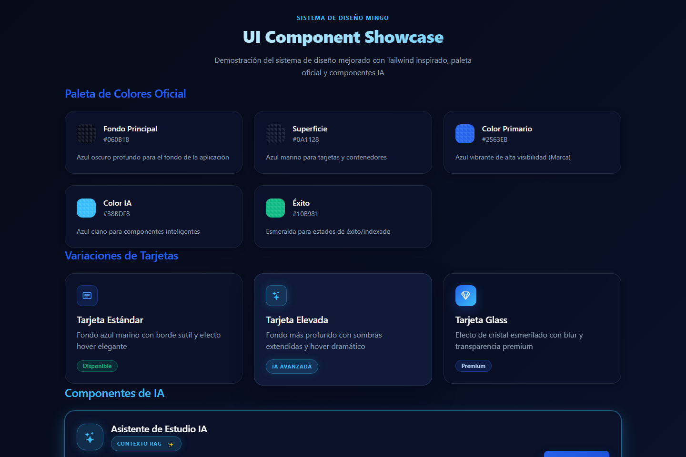

La ruta pública `/ui-showcase` reúne tarjetas, botones, insignias, campos, indicadores de IA y estados. Sirve como referencia visual para mantener consistencia entre features.

#### 11.3.4. Sistema de diseño (móvil)

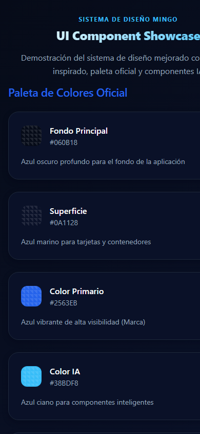

El catálogo reordena sus bloques a una columna y demuestra que los componentes compartidos son adaptables sin cambios de código.

#### 11.3.5. Panel principal con datos (escritorio)

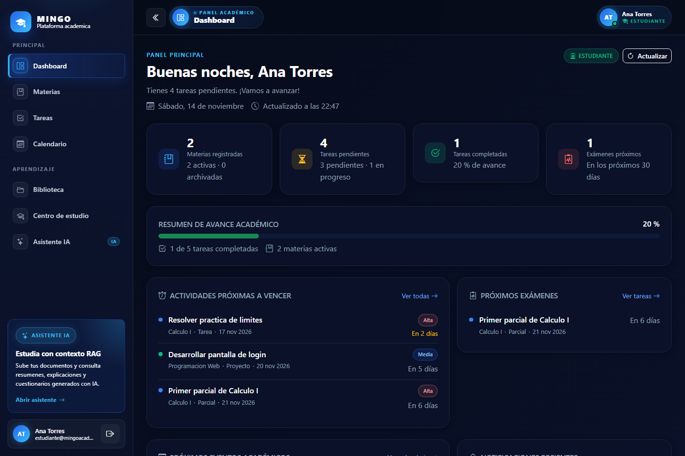

Sesión de la cuenta estudiante con datos académicos reales creados por la API: **2 materias**, **5 tareas** (3 pendientes, 1 en progreso y 1 completada) y **1 evento de estudio** (además de los eventos automáticos de entrega que genera cada tarea). El panel muestra el saludo personalizado, las cuatro tarjetas de resumen, el avance académico (20 %), las actividades próximas a vencer, los exámenes, los eventos y los accesos rápidos.

#### 11.3.6. Listado de tareas con filtros

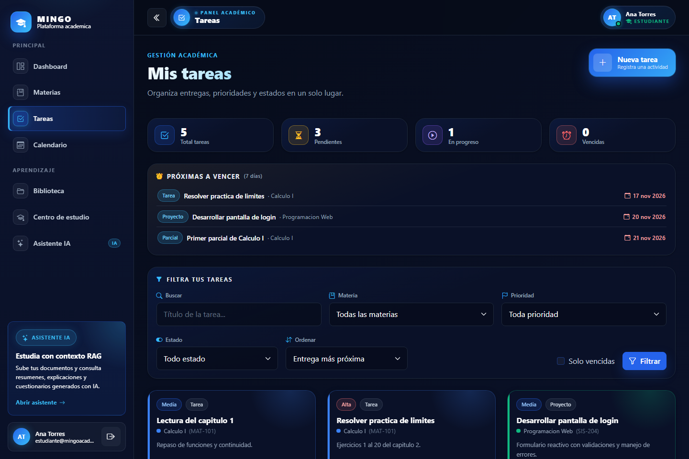

El listado muestra las **5 tareas** con su materia, tipo, prioridad, fecha de entrega y estado. Arriba se ven los contadores (5 totales, 3 pendientes, 1 en progreso, 0 vencidas) y la franja de próximas a vencer; debajo, el formulario de filtros por texto, materia, prioridad, estado, orden y «solo vencidas».

#### 11.3.7. Validación del formulario de tarea

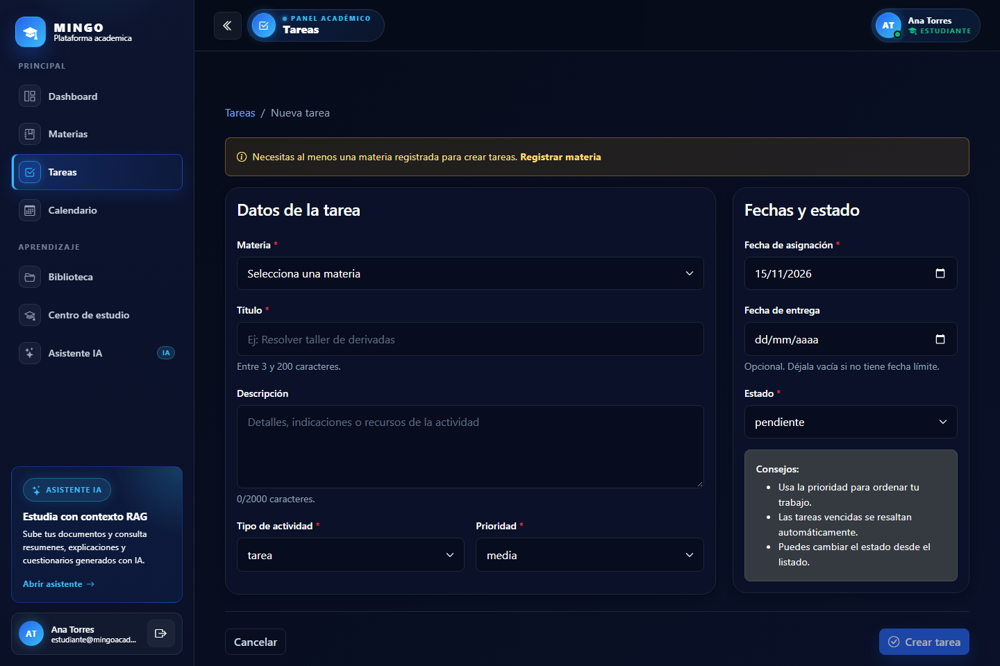

Se envió el formulario vacío y la aplicación marcó los campos obligatorios (**Materia** y **Título**) con sus mensajes en español. El botón permanece disponible, pero la operación no se ejecuta mientras el formulario sea inválido: la validación del cliente es experiencia de usuario y el backend vuelve a validar con Zod.

#### 11.3.8. Biblioteca en escritorio

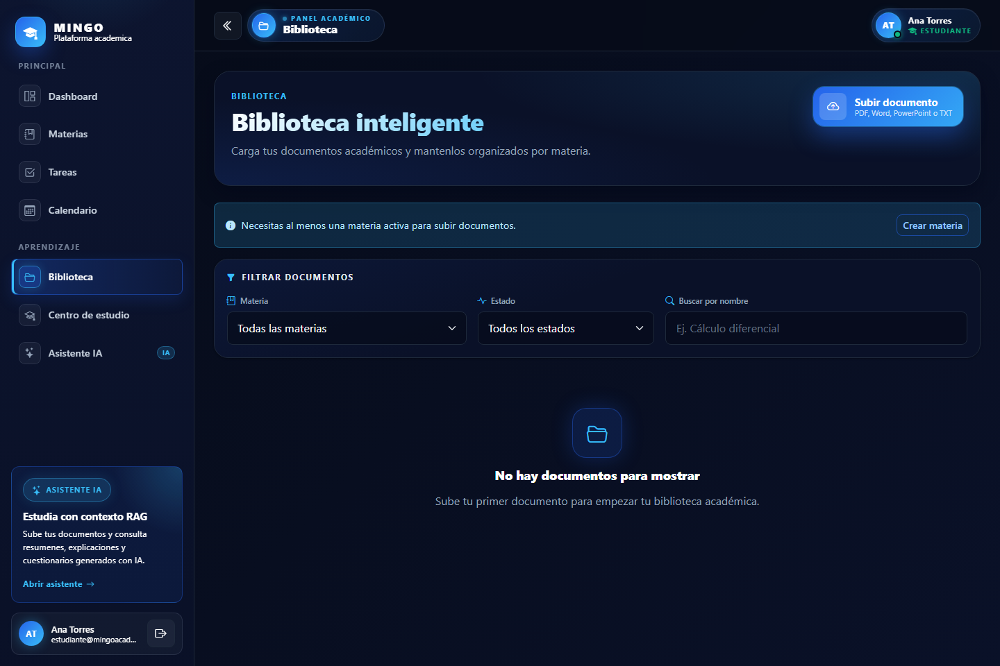

La cuenta de demostración no tiene documentos procesados, así que la captura muestra el **estado vacío real** de la biblioteca, con el mensaje informativo y la acción para subir material. No se simularon tarjetas ni documentos inexistentes.

#### 11.3.9. Sidebar colapsada

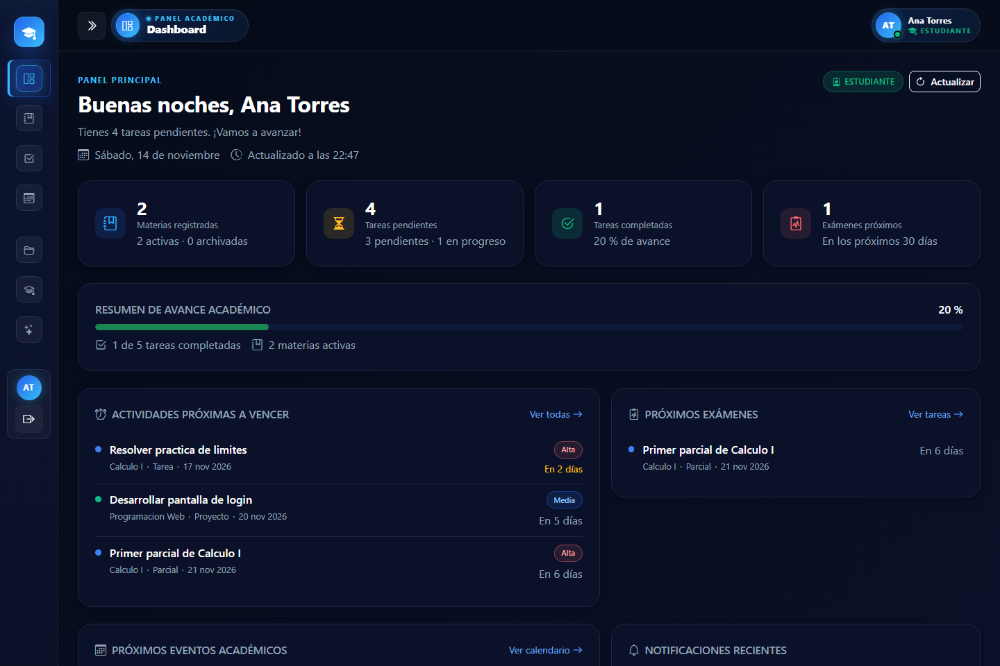

Al pulsar el botón «Contraer menú lateral», la barra pasa a su versión estrecha y deja más espacio al contenido. Es el mismo componente con una señal de estado, no una pantalla distinta.

#### 11.3.10. Menú off-canvas en móvil

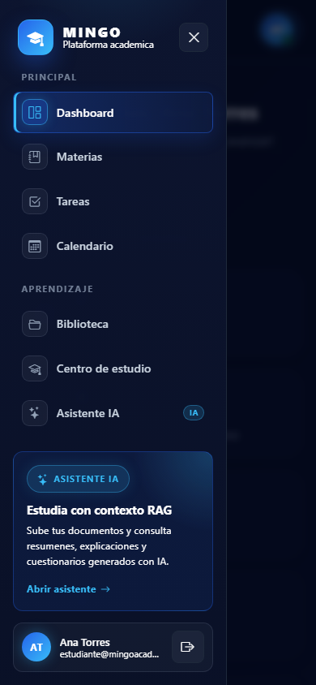

Con el viewport en 390 px, el botón «Abrir menú» despliega la navegación sobre el contenido. El botón de cierre y el foco se mantienen accesibles.

#### 11.3.11. Administración de usuarios

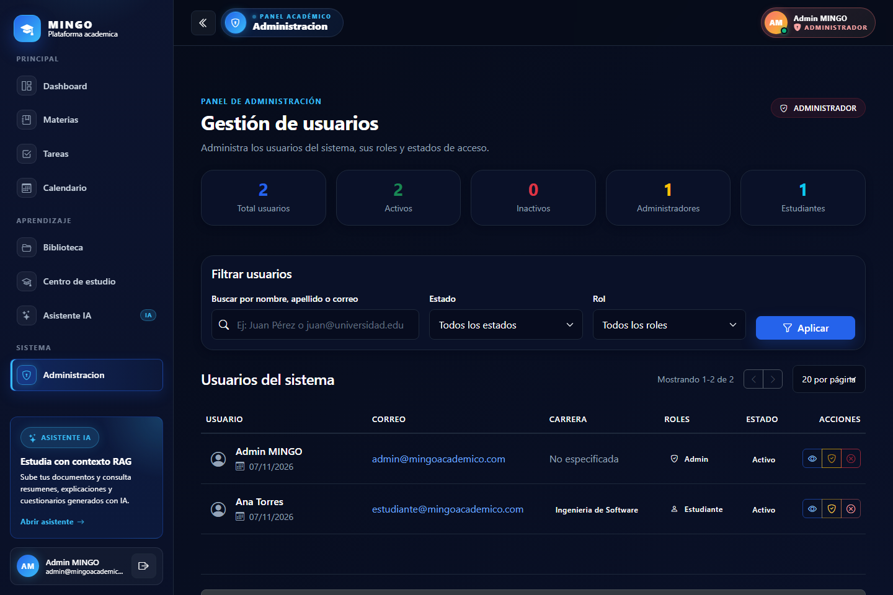

Sesión con la cuenta administradora. El panel muestra las estadísticas reales (2 usuarios, 2 activos, 0 inactivos, 1 administrador y 1 estudiante) y la tabla con ambos perfiles, sus roles y su estado. Los filtros y la paginación están disponibles; las notas de seguridad recuerdan que no se puede modificar el propio rol ni eliminar al último administrador.

#### 11.3.12. Panel principal en móvil

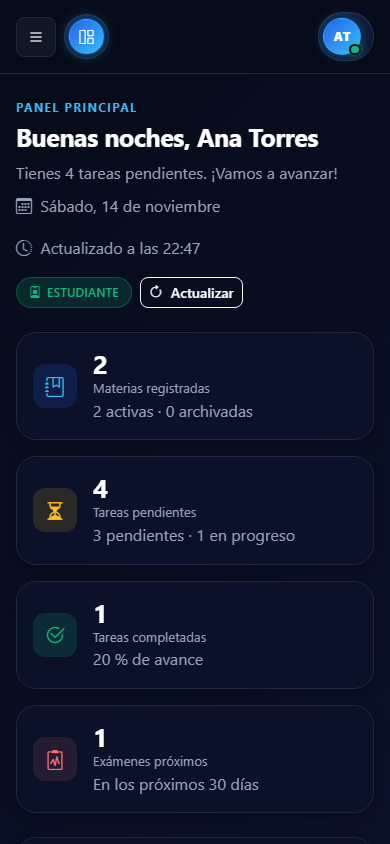

La misma información del panel se reordena en una columna: tarjetas de resumen, avance, actividades y accesos rápidos. No hay tablas ni anchos fijos que obliguen a desplazamiento horizontal.

#### 11.3.13. Biblioteca en móvil

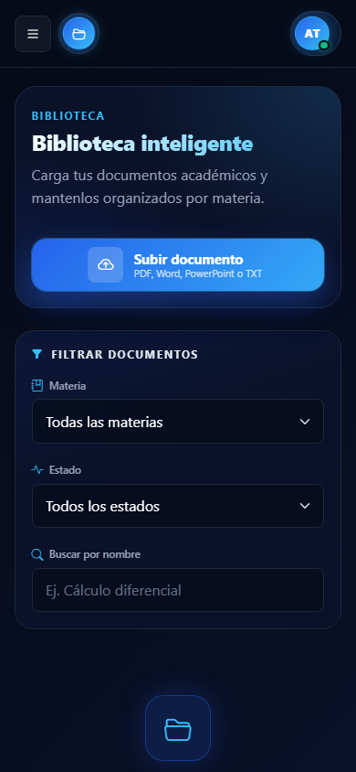

La biblioteca conserva su estado vacío y su acción principal en 390 px. El encabezado y los controles se apilan sin perder etiquetas ni áreas táctiles.

### 11.4. Cómo se generaron las capturas autenticadas

Las cuentas de prueba son `estudiante@mingoacademico.com` y `admin@mingoacademico.com`. Sus contraseñas se comparten por el canal interno del equipo y **no se versionan** en el repositorio.

Procedimiento real:

1. Levantar backend (`cd backend && npm start`) y frontend (`cd frontend && npm start`).
2. Abrir Chrome headless con `--remote-debugging-port` y controlarlo por el protocolo DevTools mediante el `WebSocket` nativo de Node 24, sin agregar dependencias.
3. Iniciar sesión escribiendo en el formulario real (`#email`, `#password`) y esperar a que la ruta cambie. No se inyectan tokens a mano.
4. Navegar a cada ruta, esperar a que el componente esté montado y a que terminen las peticiones, y capturar con `Page.captureScreenshot`.
5. Verificar por DOM, no solo por imagen: texto visible, alertas, número de tarjetas y campos inválidos.

Orden de trabajo: primero la cuenta **administradora** (para la captura 12) y después la **estudiante**, de modo que las vistas compartidas (`/dashboard`, `/tareas`, `/biblioteca`) quedaran con datos académicos reales.

Datos de demostración creados por la API en la cuenta estudiante:

| Dato | Cantidad | Detalle |
|---|---|---|
| Materias | 2 | Calculo I (MAT-101) y Programacion Web (SIS-204) |
| Tareas | 5 | 3 pendientes, 1 en progreso y 1 completada; incluye un parcial |
| Eventos | 6 | 1 evento de estudio y 5 eventos automáticos «Entrega: …» generados por las tareas |

El script de demostración es idempotente: consulta antes de crear y elimina duplicados si una ejecución anterior los generó.

#### 11.4.1. Defectos encontrados y corregidos al generar las evidencias

Las capturas autenticadas destaparon defectos que impedían usar el sistema con datos reales. Se corrigieron en esta misma sesión:

| # | Defecto | Archivo | Corrección |
|---|---|---|---|
| 1 | El listado de materias rechazaba `limit=100`, valor que el frontend ya usaba. | `backend/src/models/materia.model.js` | `limit` pasó de `.max(50)` a `.max(100)`, alineado con `docs/api.md`. |
| 2 | Las rutas de administración llamaban al middleware de validación con una forma que no existe (`{ schema, source }`). | `backend/src/routes/usuario.routes.js` | Se pasó `{ query }`, `{ params }` o `{ body }` según la fuente. |
| 3 | Los seis handlers de administración no declaraban ni propagaban `next`. | `backend/src/routes/usuario.routes.js` | Los handlers reciben `next` y lo pasan al controlador. |
| 4 | El repositorio de administración usaba `this.db.query` (API de `pg`), pero recibe un cliente de Supabase; `GET /api/usuarios` respondía `500`. | `backend/src/repositories/usuario-admin.repository.js` | Reescrito con el cliente de Supabase: consultas, join `!inner` al filtrar por rol, saneo de búsqueda y compensación manual de roles. |
| 5 | El servicio del frontend descartaba `meta` y la pantalla quedaba en «Cargando usuarios...». | `frontend/src/app/core/services/usuario-admin.service.ts` | `listarUsuarios` usa `getWithMeta` y combina `data` con `meta` (paginación y estadísticas). |

Verificación posterior: `GET /api/usuarios?limit=20` responde **200** con 2 usuarios y estadísticas correctas, y la tabla del panel renderiza ambos perfiles. El backend quedó con **221 pruebas en 21 suites** y el frontend con **67 pruebas en 9 suites**.

#### 11.4.2. Captura pendiente: confirmación de eliminación

La captura **09** no se generó porque la cuenta de demostración no tiene documentos y subir uno exige S3 (URL prefirmada) y SQS (cola de procesamiento). Esos recursos están fuera de la lista blanca operativa autorizada para esta sesión y no se crearon. La biblioteca se documenta con su estado vacío real en las capturas 8 y 14.

### 11.5. Limitaciones de las evidencias

- La captura 09 (confirmación de eliminación) queda pendiente hasta disponer de un documento procesado.
- Las capturas de biblioteca muestran el estado vacío; no hay documentos porque la carga requiere S3 y SQS.
- No se ejecutaron pruebas E2E automatizadas: el proyecto no incluye Playwright ni Cypress.
- No se ejecutó una auditoría Lighthouse formal; no se afirman puntajes de rendimiento.
- No se midió cobertura de código ni se declaran porcentajes.
- El panel de administración se verificó con dos cuentas reales; no se ejerció la paginación más allá de una página porque solo existen dos perfiles.

---

## 12. Repositorio GitHub actualizado

### 12.1. Ubicación y ramas

```text
origin  https://github.com/dgschahvqvc17/MINGO-UPDS.git (fetch)
origin  https://github.com/dgschahvqvc17/MINGO-UPDS.git (push)
```

| Rama | Función |
|---|---|
| `main` | Rama desplegable |
| `develop` | Integración |
| `feature/<HU>-<descripcion>` | Trabajo por historia de usuario |
| `fix/<descripcion>` | Correcciones |
| `docs/<descripcion>` | Documentación |
| `chore/<descripcion>` / `refactor/<descripcion>` | Mantenimiento y refactorización |

Rama actual durante la redacción: `feature/HU09-procesar-documentos-academicos`.

### 12.2. Historial real de integración

```text
5b5ace7 Merge pull request #8 from dgschahvqvc17/feature/HU08-administrar-biblioteca-documentos
8e48600 docs(api): documentar detalle, descarga y filtros de documentos
f9da7dd feat(biblioteca): administrar biblioteca de documentos (HU08)
67cf4e2 Merge pull request #7 from dgschahvqvc17/feature/HU07-cargar-documentos-academicos
5b8f9fd docs(aws): aprobar presupuesto unico de un dolar
606987b feat(infra): CORS del bucket para subida directa
fb4a563 docs(hu07): actualizar contrato de API y esquema de documentos
fdb50a3 feat(biblioteca): implementar carga de documentos HU07
```

Se observa el flujo esperado: una rama por historia, un pull request por integración y commits separados para código, documentación e infraestructura.

### 12.3. Convención de commits

Formato: `<tipo>(<alcance>): <descripcion>`.

| Tipo | Uso |
|---|---|
| `feat` | Funcionalidad nueva |
| `fix` | Corrección de error |
| `docs` | Documentación |
| `test` | Pruebas |
| `refactor` | Reestructuración sin cambio de comportamiento |
| `chore` | Configuración, dependencias, tareas varias |

Alcances usados: `biblioteca`, `api`, `aws`, `infra`, `hu07`, `hu08`, `hu09`, `frontend`, `backend`, `docs`.

### 12.4. Estado del árbol de trabajo

En el momento de redactar este documento, la rama `feature/HU09-procesar-documentos-academicos` contiene cambios **sin confirmar**:

- Backend HU09: `container.js`, controlador, repositorios, rutas, servicio y pruebas de documentos; carpeta `src/lambda/` nueva.
- Backend de administración: `usuario-admin.repository.js` reescrito con el cliente de Supabase, `usuario.routes.js` corregido, y ajustes de validación en `materia.model.js` y `usuario.model.js`.
- Frontend: `usuario-admin.service.ts` y su prueba actualizados; servicio de documentos, biblioteca, tarjeta y detalle de documento y sus pruebas.
- Pruebas nuevas: `usuario-admin.repository.test.js`, `usuario.routes.test.js` y `modelos-validacion.test.js`.
- Infraestructura: `infra/template.yaml`.
- Documentación: este documento, `docs/capturas/` con 13 capturas reales y los documentos `docs/base-datos.md`, `docs/ia-rag.md` y `docs/plan-pruebas.md`.

Además, la base de datos de desarrollo contiene datos de demostración de la cuenta estudiante (2 materias, 5 tareas y 6 eventos), creados por la API para las capturas. No son cambios de código ni se despliegan a producción.

Estos cambios **no se han confirmado ni enviado** al repositorio.

### 12.5. Cómo verificar el estado

```bash
git status
git log --oneline -8
git remote -v
git diff --stat
```

---

## 13. Conclusiones

### 13.1. Lo logrado

1. **Una arquitectura clara y sostenible**: capas separadas (`core`, `shared`, `features`, `layout`), rutas con carga diferida y un shell que concentra el menú y el contexto. Añadir una feature nueva implica crear su carpeta, su servicio y su ruta, sin tocar las existentes.
2. **Interfaces consistentes**: el sistema visual con variables CSS `--mingo-*`, Bootstrap y un catálogo público (`/ui-showcase`) permite que todas las pantallas compartan lenguaje visual.
3. **Estado predecible**: los signals eliminan el estado duplicado y los valores derivados se calculan, no se sincronizan a mano. RxJS queda donde aporta: HTTP y flujos con cancelación.
4. **Integración segura con el backend**: un único cliente HTTP tipado, un interceptor que adjunta el token solo a la API propia y traducción uniforme de errores.
5. **Formularios con retroalimentación real**: validación inmediata, mensajes accesibles y bloqueo de doble envío; el backend sigue siendo la autoridad.
6. **Listados completos**: filtros, orden, paginación de servidor y los cuatro estados (carga, vacío, error y con datos) en todas las listas, incluido el seguimiento del procesamiento asíncrono de documentos.
7. **Adaptabilidad verificable**: grid mobile-first, sidebar que pasa de fija a off-canvas, objetivos táctiles de 44 px y respeto por las preferencias de movimiento y contraste.

### 13.2. Limitaciones actuales

- La captura de la confirmación de eliminación de un documento (09) queda pendiente: exige un documento procesado y la carga requiere S3 y SQS, recursos no autorizados en esta sesión.
- Las capturas de biblioteca muestran el estado vacío real; no se simularon documentos.
- No hay pruebas E2E ni auditoría Lighthouse registrada.
- La cobertura de pruebas no se mide automáticamente.
- El plan de adaptabilidad «100 %» no está implementado.
- En HU09, un fallo duro del worker deja el documento en `procesando` y el reproceso responde `409`; está documentado como limitación conocida.

### 13.3. Trabajo futuro

1. Incorporar pruebas E2E del flujo crítico (login, crear tarea, subir documento, consultar asistente).
2. Medir cobertura y fijar un umbral para servicios y validaciones.
3. Migrar el borrado de tareas a confirmación en línea, como ya hace la biblioteca.
4. Completar el plan de adaptabilidad con pruebas en dispositivos físicos y lectores de pantalla.
5. Resolver el reproceso de documentos atascados en `procesando`.
6. Rotar las credenciales señaladas en las notas de seguridad del proyecto antes de cualquier despliegue.

---

## 14. Anexos

### 14.1. Glosario

| Término | Definición |
|---|---|
| **Componente standalone** | Componente Angular que declara sus propios imports y no pertenece a un `NgModule`. |
| **Signal** | Contenedor reactivo de un valor; al cambiar, notifica a quienes lo leen. |
| **Computed** | Signal derivado que se recalcula solo cuando cambian sus dependencias. |
| **Guard** | Función que decide si una ruta puede activarse. |
| **Interceptor** | Función que transforma las solicitudes o respuestas HTTP de forma centralizada. |
| **Lazy loading** | Carga de código solo cuando se necesita (`loadComponent`). |
| **OnPush** | Estrategia de detección de cambios que reduce el trabajo del framework. |
| **RLS** | Row Level Security: políticas de PostgreSQL que restringen filas por usuario. |
| **RAG** | Retrieval-Augmented Generation: respuestas del modelo apoyadas en fragmentos recuperados de los documentos del usuario. |
| **Embedding** | Vector numérico que representa el significado de un fragmento de texto. |
| **URL prefirmada** | Enlace temporal que autoriza una operación concreta en S3 sin exponer credenciales. |
| **Debounce** | Retardo que evita ejecutar una acción en cada pulsación. |

### 14.2. Acrónimos

| Acrónimo | Significado |
|---|---|
| **API** | Application Programming Interface |
| **SPA** | Single Page Application |
| **JWT** | JSON Web Token |
| **CORS** | Cross-Origin Resource Sharing |
| **REST** | Representational State Transfer |
| **HU** | Historia de Usuario |
| **PR** | Pull Request |
| **UI** | User Interface |
| **UX** | User Experience |
| **WCAG** | Web Content Accessibility Guidelines |
| **RLS** | Row Level Security |
| **RAG** | Retrieval-Augmented Generation |
| **S3** | Amazon Simple Storage Service |
| **CI** | Continuous Integration |

### 14.3. Referencias

- Documentación oficial de Angular: <https://angular.dev>
- Guía de signals: <https://angular.dev/guide/signals>
- Formularios reactivos: <https://angular.dev/guide/forms/reactive-forms>
- Bootstrap 5: <https://getbootstrap.com/docs/5.3/>
- Bootstrap Icons: <https://icons.getbootstrap.com>
- Supabase Auth: <https://supabase.com/docs/guides/auth>
- FullCalendar: <https://fullcalendar.io/docs>
- Vitest: <https://vitest.dev>
- Documentación interna del proyecto:
  - `docs/arquitectura.md`
  - `docs/buenas-practicas.md`
  - `docs/buenas-practicas-frontend.md`
  - `docs/api.md`
  - `docs/seguridad.md`
  - `docs/plan-pruebas.md`
  - `docs/entornos-y-despliegue.md`

### 14.4. Checklist de verificación del frontend

- [x] Componentes standalone y `OnPush` en páginas y componentes nuevos.
- [x] `inject()` para dependencias y signals para estado local.
- [x] Sin lógica de negocio en componentes: delegada en servicios.
- [x] Servicios tipados que usan `ApiService`.
- [x] Suscripciones cerradas con `takeUntilDestroyed` o `async`.
- [x] Rutas lazy y protegidas con `authGuard` / `roleGuard`.
- [x] Formularios reactivos tipados con validaciones y mensajes.
- [x] Estados de carga, vacío y error en todas las listas.
- [x] `@for` con `track` por identificador estable.
- [x] Sin `innerHTML` con contenido de usuario o de IA.
- [x] Accesibilidad: etiquetas, `aria-describedby`, roles, foco y `alt`.
- [x] Sin secretos ni claves privadas en el cliente.
- [x] Responsive con Bootstrap y reglas propias por breakpoint.
- [x] `npm run build` y `npm test -- --watch=false` en verde.
- [x] Capturas reales de las pantallas privadas con sesión de estudiante y de administrador (13 de 14).
- [x] Panel de administración de usuarios operativo: listado, estadísticas y roles con datos reales.
- [ ] Captura 09 (confirmación de eliminación de documento) hasta disponer de S3 y SQS.
- [ ] Pruebas E2E y auditoría Lighthouse (no implementadas).

### 14.5. Estructura de este documento

| Sección | Contenido |
|---|---|
| 1 | Contexto, tecnologías reales, principios, comandos y entorno |
| 2 | Carpetas, capas, convenciones, rutas lazy y configuración |
| 3 | Diseño del panel principal, bloques y estados |
| 4 | Menú declarativo, sidebar responsive, topbar y guards |
| 5 | Patrón de formularios y ejemplos de login y tareas |
| 6 | Criterio de listados, filtros, paginación y estados de documentos |
| 7 | ApiService, contrato, servicios, sesión, interceptor y errores |
| 8 | Validación en cliente y servidor, validadores y accesibilidad |
| 9 | Mensajes de éxito, error, confirmaciones y tabla HTTP |
| 10 | Breakpoints, sidebar adaptativa, táctil y preferencias |
| 11 | Evidencias de build, pruebas y capturas reales y pendientes |
| 12 | Repositorio, ramas, commits y estado del árbol |
| 13 | Conclusiones, limitaciones y trabajo futuro |
| 14 | Glosario, acrónimos, referencias y checklist |

---

**Fin del documento.**
