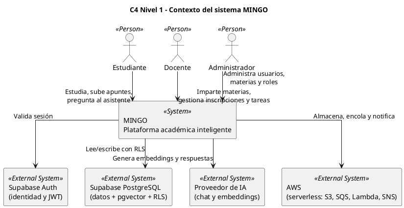
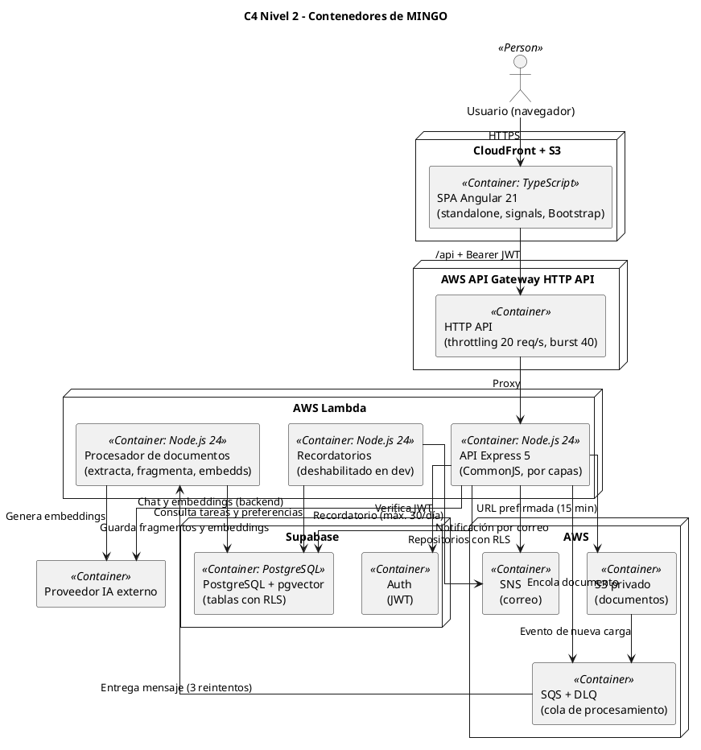
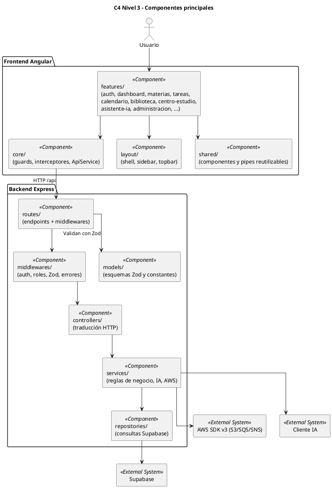
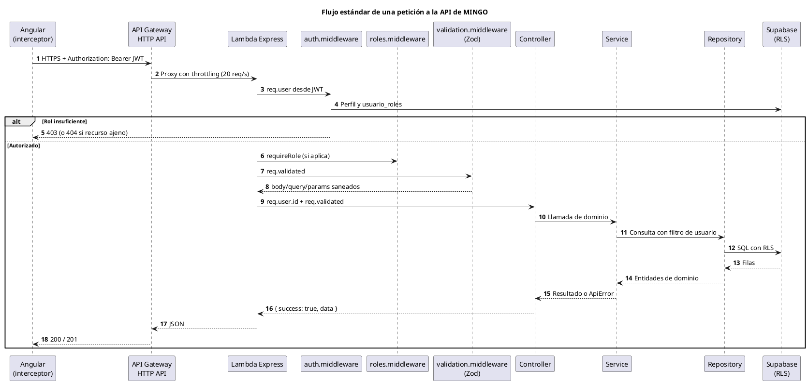
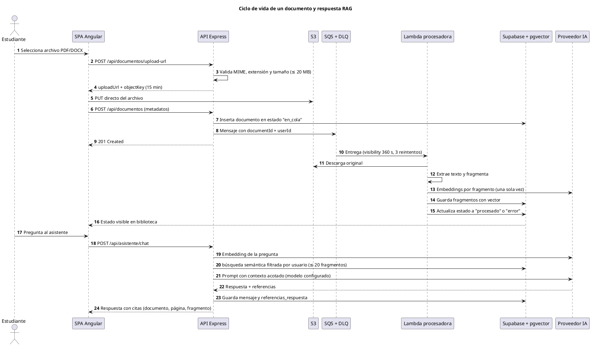
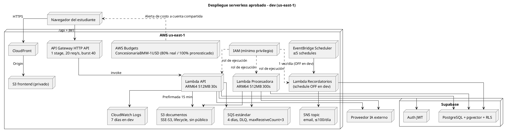
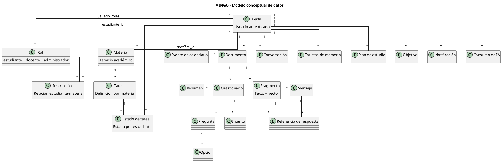
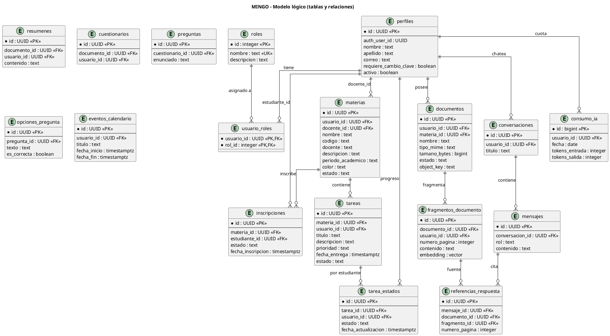
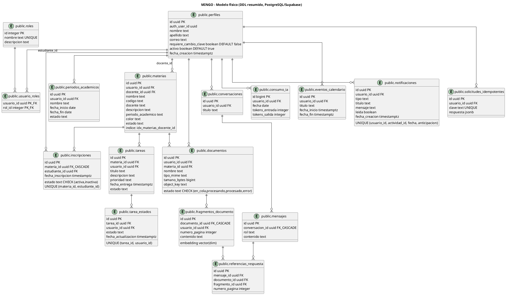
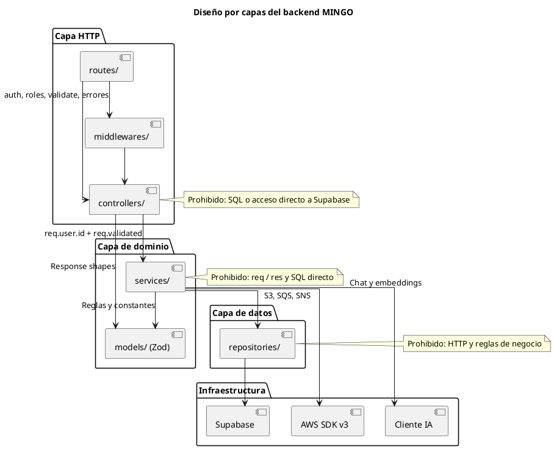

# MINGO — Documentación técnica y funcional integral

**Versión del documento:** 1.0
**Fecha de emisión:** 25 de noviembre de 2026
**Proyecto:** Plataforma académica inteligente MINGO
**Repositorio:** https://github.com/dgschahvqvc17/MINGO-UPDS.git
**Rama de trabajo documentada:** `feature/roles-docente-inscripciones`
**Commit de referencia:** `f2f8419` (`docs(aws): precisar estado de politicas IAM`)
**Entorno de demostración:** `dev` (AWS `us-east-1`, perfil local `mingo-agente`)
**Aplicación desplegada:** https://d4qnw8e73f6co.cloudfront.net
**API (health check):** https://ioqyer0j8l.execute-api.us-east-1.amazonaws.com/api/health
**Estado del sistema:** operativo en `dev`; `prod` intacto y fuera de alcance de esta entrega.

> Este documento es la fuente única de referencia para comprender, operar, mantener y presentar MINGO.
> Contiene introducción, justificación, objetivos, alcance, requerimientos, modelado C4, modelo de datos
> (conceptual, lógico y físico), diseño MVC, módulos, evidencias de operaciones CRUD, plan de pruebas y
> resultados, correcciones aplicadas, enlaces, manual técnico, manual de usuario, conclusiones y anexos.
> Todos los diagramas están escritos como **código PlantUML** y pueden copiarse en cualquier editor
> compatible (PlantUML Web Server, VS Code, IntelliJ, etc.).
>
> **Seguridad de credenciales:** las contraseñas de las cuentas de demostración **no** aparecen en este
> documento. Se encuentran exclusivamente en `CREDENTIALS.md`, archivo ignorado por Git
> (`git check-ignore -v CREDENTIALS.md` → `.gitignore:37:CREDENTIALS.md`). Tampoco se incluyen tokens,
> claves de API, `service_role` ni ARNs sensibles.

---

## Índice

1. [Introducción](#1-introducción)
2. [Problema y justificación](#2-problema-y-justificación)
3. [Objetivos](#3-objetivos)
4. [Alcance](#4-alcance)
5. [Requerimientos funcionales y no funcionales](#5-requerimientos-funcionales-y-no-funcionales)
6. [Tecnologías utilizadas](#6-tecnologías-utilizadas)
7. [Arquitectura y modelado C4](#7-arquitectura-y-modelado-c4)
8. [Modelo de datos: conceptual, lógico y físico](#8-modelo-de-datos-conceptual-lógico-y-físico)
9. [Diseño MVC y capas del sistema](#9-diseño-mvc-y-capas-del-sistema)
10. [Módulos funcionales](#10-módulos-funcionales)
11. [API REST: contrato y convenciones](#11-api-rest-contrato-y-convenciones)
12. [Evidencias de funcionamiento (CRUD)](#12-evidencias-de-funcionamiento-crud)
13. [Plan de pruebas y resultados](#13-plan-de-pruebas-y-resultados)
14. [Correcciones e incidencias resueltas](#14-correcciones-e-incidencias-resueltas)
15. [Despliegue e infraestructura AWS](#15-despliegue-e-infraestructura-aws)
16. [Enlaces de la aplicación y del repositorio](#16-enlaces-de-la-aplicación-y-del-repositorio)
17. [Manual técnico](#17-manual-técnico)
18. [Manual de usuario](#18-manual-de-usuario)
19. [Conclusiones y recomendaciones](#19-conclusiones-y-recomendaciones)
20. [Anexos](#20-anexos)

---

## 1. Introducción

MINGO es una aplicación web académica inteligente dirigida a estudiantes universitarios. Reúne en un
solo lugar la gestión de materias, tareas, calendario, biblioteca documental, asistente de inteligencia
artificial con recuperación aumentada por generación (RAG), cuestionarios, tarjetas de memoria, planes
de estudio, objetivos, progreso y notificaciones.

La plataforma se construyó como un **monorepo** con tres grandes áreas:

- `frontend/`: SPA en Angular 21 con componentes standalone, signals y Bootstrap 5.
- `backend/`: API REST en Node.js 24 + Express 5 (CommonJS), organizada por capas
  (`routes → controllers → services → repositories`).
- `supabase/` e `infra/`: migraciones SQL de PostgreSQL con RLS y plantilla SAM de AWS serverless.

El sistema se ejecuta en un entorno `dev` desplegado y accesible públicamente, con una cuenta AWS
compartida, región única `us-east-1` y costo mensual observado en `$0` (noviembre:
`-0.0000000002 USD` unblended). La arquitectura respeta la regla de oro del proyecto:
**solo serverless, solo capa gratuita, cero recursos encendidos y cero excepciones sin aprobación**.

Esta documentación se elabora con información verificada del repositorio y de las ejecuciones reales
de pruebas y despliegue. No contiene datos secretos y está pensada para que cualquier persona del equipo
pueda entender el sistema desde cero, operarlo y presentarlo.

### 1.1. Características principales

| Característica | Descripción |
|---|---|
| Autenticación | Supabase Auth con JWT; roles leídos desde la base de datos, nunca desde el cliente. |
| Perfiles y roles | `estudiante`, `docente` y `administrador` en `roles` / `usuario_roles`. |
| Gestión académica | Materias con docente responsable, inscripciones activas/inactivas y tareas por materia con estado por estudiante. |
| Organización | Calendario con eventos y panel académico con métricas. |
| Biblioteca | Carga de documentos a S3 mediante URL prefirmada, estados de procesamiento, descarga y eliminación lógica. |
| IA y RAG | Fragmentos con embeddings en pgvector, búsqueda semántica y chat con citas. |
| Estudio | Cuestionarios, tarjetas de memoria, planes de estudio y seguimiento de objetivos. |
| Notificaciones | Historial en Supabase con RLS y envío opcional por SNS con tope diario. |
| Infraestructura | Lambda, API Gateway HTTP API, S3, SQS, EventBridge Scheduler, CloudFront, CloudWatch, IAM y Budgets. |

---

## 2. Problema y justificación

### 2.1. Situación inicial

Los estudiantes universitarios dispersan su actividad académica entre varias herramientas: correo,
mensajería, documentos sin indexar, calculadoras de notas, agendas y servicios de IA genérica. Esto
genera tres problemas concretos:

1. **Fragmentación de la información.** El material de estudio, las tareas y los recordatorios viven en
   lugares distintos y no se relacionan entre sí.
2. **Pérdida de contexto.** Cuando un estudiante pregunta a un asistente genérico sobre sus apuntes,
   debe volver a pegar el documento o confiar en respuestas sin evidencia.
3. **Costo y complejidad para resolver estos problemas.** Una solución tradicional con servidores permanentes,
   bases de datos provisionadas y balanceadores implicaría un gasto fijo mensual, incompatible con un
   proyecto académico sin presupuesto.

### 2.2. Justificación técnica

MINGO resuelve estos problemas con una combinación deliberada de decisiones:

- **Un solo punto de entrada:** una SPA que concentra todas las funcionalidades y usa un único contrato
  de API (`{ success, data }` / `{ success, error }`).
- **Datos con dueño:** cada tabla tiene política RLS; un recurso ajeno responde `404` para no revelar
  su existencia. El `usuario_id` siempre se toma del JWT.
- **IA con evidencia:** el asistente responde a partir de los fragmentos del propio usuario y devuelve
  citas de documento y página; si no hay información, lo indica en lugar de inventar.
- **Costo cero por diseño:** todo componente es serverless o administrado con capa gratuita. No hay
  EC2, RDS, NAT Gateway, balanceadores, cachés administradas ni concurrencia provisionada.
- **Mantenibilidad:** separación por capas en el backend y por `features` en el frontend, con
  validación Zod y errores centralizados.

### 2.3. Impacto esperado

| Dimensión | Antes | Después de MINGO |
|---|---|---|
| Acceso a apuntes | Archivos sueltos | Biblioteca indexada y buscable por semántica. |
| Respuestas de IA | Sin citas y sin contexto | Respuestas con citas a documentos propios. |
| Seguridad de datos | Depende del cliente | RLS + JWT + roles verificados en servidor. |
| Costo de infraestructura | Gasto fijo | `$0` cuando no hay uso; presupuesto de alerta compartido. |
| Trazabilidad | Sin registro | Historial de notificaciones, consumo de IA y estados de procesamiento. |

---

## 3. Objetivos

### 3.1. Objetivo general

Diseñar, implementar, desplegar y documentar una plataforma web académica inteligente que permita a
estudiantes y docentes organizar su actividad, subir material de estudio y obtener respuestas fiables
generadas por IA a partir de sus propios documentos, con seguridad por usuario y costo nulo en AWS.

### 3.2. Objetivos específicos

| ID | Objetivo | Criterio de logro verificado |
|---|---|---|
| O1 | Construir una SPA modular y responsiva. | Angular 21, 26 componentes cargados de forma diferida, build de producción correcto y 213/213 pruebas frontend. |
| O2 | Implementar una API REST por capas y validada. | 11 módulos montados bajo `/api`, Zod en entradas, 530/530 pruebas backend. |
| O3 | Aislar los datos por usuario y por rol. | RLS activo, recursos ajenos → `404`, verificación E2E con usuarios distintos. |
| O4 | Soportar el ciclo de vida completo de documentos. | Carga prefirmada a S3 → SQS → Lambda → fragmentos con embeddings → descarga. |
| O5 | Ofrecer respuestas de IA con citas y límites de cuota. | Chat `200` con documento en E2E; `consumo_ia` y máximo de fragmentos por consulta. |
| O6 | Desplegar en AWS con arquitectura serverless y $0 de costo. | Stack `mingo-hu09-dev` en `UPDATE_COMPLETE`, health `200`, costo de noviembre `-0.0000000002 USD`. |
| O7 | Dejar evidencias y documentación operativa. | E2E `PASS 20/20`, capturas en `docs/capturas/`, este documento y docs técnicos actualizados. |
| O8 | Preparar cuentas de demostración permanentes en `dev`. | Cuatro cuentas con roles asignados, verificación de login `PASS`, credenciales en `CREDENTIALS.md`. |

---

## 4. Alcance

### 4.1. Incluido en esta entrega

- Implementación completa de los módulos listados en la sección 10.
- Despliegue del frontend en CloudFront y de la API en Lambda + API Gateway HTTP API, entorno `dev`.
- Migraciones SQL ejecutadas en Supabase, incluidas `0018_roles_docente_inscripciones` y
  `0019_fix_recursion_materias`.
- Cuentas demo permanentes con roles `administrador`, `docente` (dos) y `estudiante`, con materias y
  una inscripción doble verificada.
- Pruebas unitarias, de integración, E2E contra la API real y verificación de secretos por hash.
- Documentación técnica: arquitectura, base de datos, API, plan de pruebas, IAM y este documento.

### 4.2. Fuera de alcance

- Integración directa con Moodle o servicios web institucionales.
- Notificaciones push nativas y aplicación móvil.
- Multi-región, alta disponibilidad empresarial o microservicios.
- Despliegue o modificación de `prod`: requiere autorización explícita separada.
- Creación de nuevos recursos AWS: los changesets ejecutados solo actualizaron código y parámetros de
  stacks existentes.
- Almacenamiento de credenciales en archivos versionados o en este documento.

### 4.3. Entorno de presentación

La demostración universitaria se realiza contra **`dev`**:

- Frontend: https://d4qnw8e73f6co.cloudfront.net
- API: https://ioqyer0j8l.execute-api.us-east-1.amazonaws.com/api
- Cuentas: las cuatro cuentas demo permanentes descritas en la sección 18.4.
- Estado de los stacks: `mingo-hu09-dev` y `mingo-frontend-dev` con `UPDATE_COMPLETE`.

`prod` no se despliega ni se modifica en esta entrega.

---

## 5. Requerimientos funcionales y no funcionales

### 5.1. Requerimientos funcionales

| ID | Requerimiento | Módulo | Épica / HU |
|---|---|---|---|
| RF-01 | Registrar usuario con rol `estudiante` por defecto. | Autenticación | HU01 |
| RF-02 | Iniciar y cerrar sesión con JWT de Supabase. | Autenticación | HU01 |
| RF-03 | Cambiar la clave cuando el perfil tiene `requiere_cambio_clave = true`. | Autenticación | HU02 |
| RF-04 | Crear, listar, buscar, editar y archivar materias; asignar docente responsable. | Materias | HU03 |
| RF-05 | Inscribir y dar de baja estudiantes en una materia; baja lógica con historial. | Materias | HU03 |
| RF-06 | Crear, editar, listar y completar tareas con estado por estudiante. | Tareas | HU04 |
| RF-07 | Gestionar eventos de calendario y visualizarlos por mes, semana y lista. | Calendario | HU05 |
| RF-08 | Mostrar un panel con métricas académicas del estudiante. | Dashboard | HU06 |
| RF-09 | Subir documentos mediante URL prefirmada y registrar metadatos. | Biblioteca | HU07 |
| RF-10 | Listar, filtrar, descargar y eliminar documentos. | Biblioteca | HU08 |
| RF-11 | Procesar documentos en segundo plano: extracción, fragmentación y embeddings. | Procesamiento | HU09 |
| RF-12 | Generar resúmenes de documentos. | Resúmenes | HU10 |
| RF-13 | Buscar fragmentos por similitud semántica. | Búsqueda | HU11 |
| RF-14 | Mantener conversaciones y responder con citas basadas en documentos propios. | Asistente IA | HU12 |
| RF-15 | Generar y responder cuestionarios con retroalimentación. | Evaluación | HU13, HU16 |
| RF-16 | Crear y estudiar tarjetas de memoria. | Estudio | HU14 |
| RF-17 | Proponer, editar y aceptar planes de estudio con sesiones en calendario. | Planificación | HU15 |
| RF-18 | Registrar objetivos y mostrar progreso. | Progreso | HU17 |
| RF-19 | Crear y consultar notificaciones con preferencias por canal. | Notificaciones | HU18 |
| RF-20 | Administrar usuarios y asignar roles desde el panel de administración. | Administración | HU01, HU02 |

### 5.2. Requerimientos no funcionales

| ID | Categoría | Requerimiento | Verificación |
|---|---|---|---|
| RNF-01 | Seguridad | Toda ruta privada exige `Authorization: Bearer <JWT>` válido. | Endpoint sin token → `401`; E2E. |
| RNF-02 | Seguridad | `usuario_id`, roles y estados nunca se aceptan del cliente. | Revisión de controladores; Zod elimina campos no declarados. |
| RNF-03 | Seguridad | RLS en todas las tablas; recurso ajeno responde `404`. | Pruebas con dos usuarios; migraciones 0018/0019. |
| RNF-04 | Seguridad | Sin secretos en frontend, logs, Git ni documentación. | Verificación por hash en Lambda; `.gitignore`. |
| RNF-05 | Validación | `body`, `query` y `params` validados con Zod. | Middleware `validate` y `req.validated`. |
| RNF-06 | Errores | Formato único `{ success:false, error:{ message, details? } }`. | Middleware central `error.middleware.js`. |
| RNF-07 | Rendimiento | Listas paginadas; máximo 20 fragmentos por consulta de IA. | Repositorios con `range`/`limit`; configuración RAG. |
| RNF-08 | Costo | Gasto AWS esperado `$0`; sin recursos ociosos. | Cost Explorer; presupuesto `ConcesionariaBMW-1USD`. |
| RNF-09 | Límites | Lambda 512 MB / ARM64 / 30 s API y 300 s processor; SQS 4 días, DLQ, 3 reintentos. | `infra/template.yaml`. |
| RNF-10 | Observabilidad | CloudWatch con retención 7 días en `dev` y 30 en `prod`; sin datos personales en logs. | Plantilla SAM. |
| RNF-11 | Accesibilidad | WCAG 2.1 AA: labels, foco visible, roles ARIA, navegación por teclado. | Pruebas frontend y revisión de plantillas. |
| RNF-12 | Responsividad | Interfaces adaptadas a escritorio y móvil. | Capturas `docs/capturas/02`, `11`, `13`, `14`. |
| RNF-13 | Mantenibilidad | Clean Code y SOLID; una responsabilidad por función; sin números mágicos. | `docs/buenas-practicas*.md`, lint. |
| RNF-14 | Calidad | Lint, pruebas y build en verde antes de entregar. | `530/530`, `213/213`, build OK. |
| RNF-15 | Disponibilidad | `/api/health` responde `200` en `dev`. | Verificación final del 25/11/2026. |

---

## 6. Tecnologías utilizadas

### 6.1. Resumen por capa

| Capa | Tecnología | Uso principal |
|---|---|---|
| Cliente | Angular 21 + TypeScript | SPA standalone, signals, RxJS, reactive forms. |
| Interfaz | Bootstrap 5 + Bootstrap Icons | Diseño responsivo, componentes visuales. |
| Calendario | FullCalendar 6 | Vistas mes/semana/lista de eventos. |
| Servidor | Node.js 24 + Express 5 (CommonJS) | API REST, middlewares, controladores. |
| Validación | Zod | Esquemas de `body`, `query` y `params`. |
| Seguridad HTTP | Helmet, CORS, express-rate-limit, cookie-parser | Cabeceras, origen permitido, límite de peticiones. |
| Base de datos | Supabase PostgreSQL + pgvector | Datos de dominio, embeddings y RLS. |
| Autenticación | Supabase Auth (JWT) | Sesión, registro, cambio de clave. |
| Almacenamiento | Amazon S3 | Documentos privados con URL prefirmada. |
| Colas | Amazon SQS + DLQ | Procesamiento asíncrono de documentos. |
| Cómputo | AWS Lambda (ARM64, 512 MB) | API Express, procesador y recordatorios. |
| Exposición | API Gateway HTTP API | Endpoint HTTPS con throttling. |
| Distribución | Amazon CloudFront + S3 | Entrega del frontend. |
| Programación | EventBridge Scheduler | Recordatorios (deshabilitado en `dev`). |
| Notificaciones | Amazon SNS | Correo electrónico con tope diario. |
| Observabilidad | CloudWatch Logs, AWS Budgets, Cost Explorer | Logs, alerta de $1 y revisión de costo. |
| IA | Proveedor externo compatible con OpenAI (`gemini-3.5-flash-lite` en `dev`) | Chat y embeddings. |
| Pruebas | Jest + Supertest, Vitest | Backend y frontend. |
| Infraestructura como código | AWS SAM / CloudFormation | `infra/template.yaml`. |
| CI/CD | GitHub Actions | Publicación y despliegue. |

### 6.2. Scripts y dependencias destacadas

**Backend (`backend/package.json`)**

| Script | Comando | Propósito |
|---|---|---|
| `dev` | `nodemon src/server.js` | Desarrollo local con recarga. |
| `start` | `node src/server.js` | Arranque local. |
| `test` | `jest --runInBand` | Pruebas unitarias e integración. |
| `lint` | `eslint .` | Análisis estático. |
| `migrate` | `node scripts/run-migrations.js` | Ejecución de migraciones. |

Dependencias principales: `express@^5`, `@supabase/supabase-js`, `zod`, `helmet`, `cors`, `morgan`,
`compression`, `express-rate-limit`, `@aws-sdk/client-s3`, `@aws-sdk/client-sqs`, `@aws-sdk/client-sns`,
`@aws-sdk/s3-request-presigner`, `openai` (cliente compatible), `pdf-parse`/extraction según módulo,
`jest` y `supertest` en desarrollo.

**Frontend (`frontend/package.json`)**

| Script | Comando | Propósito |
|---|---|---|
| `start` | `ng serve` | Servidor local de desarrollo. |
| `prebuild` / `build` | `node scripts/generate-env.mjs` / `ng build` | Genera entorno y compila producción. |
| `test` | `ng test` | Pruebas Vitest. |
| `format` | `prettier --write ...` | Formateo de código. |

Dependencias principales: `@angular/*@^21.2`, `@angular/cdk`, `@fullcalendar/*@^6.1`, `bootstrap`,
`bootstrap-icons`, `@supabase/supabase-js` (solo Auth), `rxjs`, `zone.js`, `vitest`.

### 6.3. Versiones y compatibilidad

| Elemento | Valor |
|---|---|
| Node.js | 24 (`engines` del backend). |
| npm | 11.6.2 (`packageManager` del frontend). |
| Express | 5 (manejo nativo de promesas rechazadas en controladores). |
| Angular | 21.2.x, componentes standalone. |
| PostgreSQL | Supabase (con extensión `vector`). |
| Región AWS | `us-east-1` (única región permitida). |

---

## 7. Arquitectura y modelado C4

Se presenta el modelado C4 en cuatro niveles, usando PlantUML estándar con estereotipos que mapean
directamente a los conceptos C4 (`Person`, `System`, `Container`, `Component`, `Code`).

### 7.1. C4 Nivel 1 — Contexto del sistema



### 7.2. C4 Nivel 2 — Contenedores



### 7.3. C4 Nivel 3 — Componentes (backend y frontend)



### 7.4. C4 Nivel 4 — Código (ejemplo representativo: materias e inscripciones)

```plantuml
@startuml C4_Codigo_Materia
title C4 Nivel 4 - Vista de código del módulo de materias

skinparam linetype ortho
skinparam shadowing false

class "materia.routes.js" as Routes <<Component>>
class "materia.controller.js" as Controller <<Component>>
class "materia.service.js" as Service <<Component>>
class "materia.repository.js" as Repository <<Component>>
class "materia.model.js\n(createMateriaSchema,\nmateriaIdSchema)" as Model <<Component>>
class "inscripcion.repository.js" as InscripcionRepo <<Component>>
class "ApiError" as ApiError <<Utils>>

Routes --> Model : validate({ body, params })
Routes --> Controller : GET/POST/PATCH
Controller --> Service : listForUser / createForUser
Service --> ApiError : notFound / forbidden
Service --> Repository : findById / create / update
Service --> InscripcionRepo : findByMateria / upsert / baja
Repository --> Supabase[(Supabase RLS)] : from('materias')

@enduml
```

### 7.5. Flujo de una petición HTTP



### 7.6. Flujo de procesamiento de documentos (RAG)



### 7.7. Diagrama de despliegue AWS



---

## 8. Modelo de datos: conceptual, lógico y físico

### 8.1. Modelo conceptual

Entidades principales y sus relaciones de negocio, independientes de la implementación.



### 8.2. Modelo lógico (entidad-relación con cardinalidades y claves)



**Notas del modelo lógico**

- `perfiles.id` coincide con `auth.users.id` (UUID). Es la clave usada como `usuario_id` en todo el sistema.
- `docente_id` en `materias` referencia a `perfiles` con `ON DELETE SET NULL`.
- `inscripciones.estado` es una lista cerrada: `activa` / `inactiva`. La baja es lógica, no física.
- `tarea_estados` separa la definición de la tarea del progreso individual de cada estudiante.
- Los IDs de dominio implementados (`materias`, `tareas`, `eventos_calendario`, `documentos`) son UUID.
  El frontend trata cualquier ID como cadena opaca.
- El diagrama resumido de `docs/base-datos.md` muestra 15 tablas y 23 relaciones; el modelo físico
  completo incluye además evaluación, tarjetas, planes, objetivos, notificaciones e idempotencia.

### 8.3. Modelo físico (estructura implementada)



**Convenciones físicas**

- `snake_case` en tablas y columnas; `UUID` con `gen_random_uuid()` por defecto.
- Todas las tablas tienen `ALTER TABLE ... ENABLE ROW LEVEL SECURITY`.
- Las políticas de `materias`, `inscripciones`, `tareas`, `tarea_estados`, `documentos` y
  `fragmentos_documento` usan funciones `SECURITY DEFINER` con `search_path = public` para evitar
  recursión entre políticas (ver migración `0019`).
- Los inserts sensibles se realizan con UUID generado en el servidor y sin `.select()`/`RETURNING`
  para no evaluar la política SELECT del insertador antes de que sea visible.
- Los artefactos derivados (resúmenes, conversaciones, cuestionarios, tarjetas y planes) son privados
  de quien los genera; sus políticas no se modificaron en `0018`.
- `embedding vector(dim)` donde `dim` es `AiEmbeddingDimensions` del despliegue (configurado en la
  plantilla SAM). `pgvector` permite consultas de similitud con índice.

### 8.4. Migraciones aplicadas

| Migración | Contenido principal |
|---|---|
| `0001_hu01_auth.sql` | `perfiles`, `roles`, `usuario_roles`, trigger `handle_new_user`. |
| `0002_hu04_tareas.sql` | `tareas` y estados. |
| `0003_hu05_calendario.sql` | `eventos_calendario`. |
| `0004_hu07_documentos.sql` | `documentos`. |
| `0005_hu09_fragmentos.sql` | `fragmentos_documento`. |
| `0006_hu09_reemplazo_fragmentos.sql` | Ajuste del esquema de fragmentos. |
| `0007_hu10_resumenes.sql` | `resumenes` y `consumo_ia`. |
| `0008_hu11_busqueda_semantica.sql` | Funciones de búsqueda vectorial. |
| `0009_hu12_chat.sql` | `conversaciones`, `mensajes`, `referencias_respuesta`. |
| `0010`–`0017` | Cuestionarios, tarjetas, planes, objetivos, notificaciones e idempotencia. |
| `0018_roles_docente_inscripciones.sql` | Rol `docente`, `requiere_cambio_clave`, `docente_id`, `inscripciones`, `tarea_estados`, RLS compartida y RPC actualizadas. Idempotente, no destructiva. |
| `0019_fix_recursion_materias.sql` | Funciones `SECURITY DEFINER` para romper la recursión `42P17` en políticas de `materias`. **Ya aplicada en `dev`.** |

> Verificación: RPC de prueba y `GET /api/materias` respondieron `200` tras aplicar `0019`. No falta
> ejecutar ninguna migración para la presentación.

---

## 9. Diseño MVC y capas del sistema

### 9.1. Backend por capas

El backend sigue estrictamente la cadena de dependencias
`routes → controllers → services → repositories → infrastructure`. Nunca al revés.



**Responsabilidades**

| Capa | Hace | No hace |
|---|---|---|
| `routes/` | Declara método, ruta y middlewares. | Lógica de negocio ni consultas. |
| `middlewares/` | Verifica JWT, roles, valida con Zod, centraliza errores. | Lógica de un módulo específico. |
| `controllers/` | Lee `req`, invoca al servicio, responde `{ success, data }`. | SQL, reglas complejas. |
| `services/` | Reglas de negocio, propiedad, cuotas, orquestación IA/AWS. | Conocer Express o escribir SQL. |
| `repositories/` | Consultas, mapeo `snake_case` → dominio, paginación. | Responder HTTP o decidir reglas. |
| `models/` | Esquemas Zod, tipos y constantes de dominio. | Acceder a infraestructura. |
| `utils/` | `ApiError`, `asyncHandler` y helpers puros. | Estado global mutable. |

### 9.2. MVC aplicado al frontend

```plantuml
@startuml MVC_Frontend
title MVC / MVVM en el frontend Angular

skinparam linetype ortho
skinparam shadowing false

actor "Usuario" as Usuario

package "View (Plantilla HTML)" {
  [Componente standalone + OnPush] as View
}
package "Controller/ViewModel" {
  [Signals: items, isLoading, errorMessage] as VM
}
package "Model" {
  [Interfaces de dominio\n(Tarea, Materia, Documento...)] as Model
  [Services: ApiService, TareaService, ...] as Service
}
[API REST MINGO] as API

Usuario --> View : Interacción
View --> VM : eventos (output/model)
VM --> Service : Observable
Service --> API : HTTP + JWT
API --> Service : JSON { success, data }
Service --> VM : next / error
VM --> View : signals actualizados
VM --> Model : Tipado

@enduml
```

- **Modelo:** interfaces TypeScript alineadas con la API y esquemas Zod en el servidor.
- **Vista:** componentes standalone con `ChangeDetectionStrategy.OnPush`, control de flujo `@if`/`@for`
  con `track`, y estados explícitos de carga, vacío y error.
- **Controlador:** la clase del componente expone signals y delega la lógica a servicios inyectados
  con `inject()`. Las suscripciones manuales usan `takeUntilDestroyed()`.

### 9.3. Estructura de carpetas relevante

```text
MINGO/
├── backend/
│   ├── src/
│   │   ├── config/          environment.js, supabase.js, aws.js
│   │   ├── models/          esquemas Zod y constantes
│   │   ├── controllers/     traducción HTTP
│   │   ├── services/        reglas de negocio (incluye services/ia/)
│   │   ├── repositories/    Supabase / AWS / IA
│   │   ├── middlewares/     auth, roles, validación, errores
│   │   ├── routes/          11 módulos montados + router agregador
│   │   ├── utils/           ApiError, asyncHandler, helpers
│   │   ├── app.js           app Express exportada para tests
│   │   └── server.js        arranque local
│   └── tests/               Jest + Supertest
├── frontend/
│   └── src/app/
│       ├── core/            guards, interceptores, modelos, servicios singleton
│       ├── shared/          componentes, pipes y directivas reutilizables
│       ├── features/        auth, dashboard, materias, tareas, calendario,
│       │                    biblioteca, centro-estudio, asistente-ia, etc.
│       └── layout/          shell, sidebar, topbar
├── supabase/migrations/     0001 … 0019
├── infra/                   template.yaml, iam/, seeds/
├── docs/                    api.md, arquitectura.md, base-datos.md, plan-pruebas.md, capturas/
├── CREDENTIALS.md           credenciales demo (ignorado por Git)
├── AGENTS.md                reglas obligatorias del repositorio
└── documentacion5.md        este documento
```

---

## 10. Módulos funcionales

| Módulo | HU | Rutas API | Rutas SPA | Responsable principal |
|---|---|---|---|---|
| Autenticación y perfiles | HU01, HU02 | `/api/auth/*`, `/api/usuarios/perfil` | `/auth/login`, `/cambiar-clave` | `auth.routes.js`, `usuario.routes.js` |
| Dashboard | HU06 | `/api/dashboard` | `/dashboard` | `dashboard.routes.js` |
| Materias e inscripciones | HU03 | `/api/materias/*` | `/materias`, `/materias/:id` | `materia.routes.js` |
| Tareas | HU04 | `/api/tareas` | `/tareas`, `/tareas/:id/editar` | `tarea.routes.js` |
| Calendario | HU05 | `/api/calendario` | `/calendario` | `calendario.routes.js` |
| Biblioteca documental | HU07, HU08 | `/api/documentos/*` | `/biblioteca`, `/biblioteca/:id` | `documento.routes.js` |
| Procesamiento | HU09 | `/api/documentos/:id/procesar` | Estado en detalle | `services/procesamiento.service.js` |
| Resúmenes y búsqueda | HU10, HU11 | `/api/documentos/:id/resumen`, `/api/buscar` | `/centro-estudio` | `estudio.routes.js` |
| Asistente IA | HU12 | `/api/asistente/*` | `/asistente-ia` | `asistente.routes.js` |
| Cuestionarios y flashcards | HU13, HU14 | `/api/estudio/*` | `/centro-estudio`, `/tarjetas-memoria` | `estudio.routes.js` |
| Planes de estudio | HU15 | `/api/estudio/planes` | `/planes-estudio` | `estudio.routes.js` |
| Evaluación y progreso | HU16, HU17 | `/api/estudio/progreso` | `/progreso` | `estudio.routes.js` |
| Notificaciones | HU18 | `/api/notificaciones/*` | `/notificaciones` | `notificacion.routes.js` |
| Administración | HU01, HU02 | `/api/admin/*` | `/administracion` | `administracion.routes.js` |

### 10.1. Rutas de la SPA

| Ruta | Componente | Protección |
|---|---|---|
| `/auth/login` | `LoginPage` | Pública. |
| `/cambiar-clave` | `CambiarClavePage` | `cambiarClaveGuard`. |
| `/ui-showcase` | `UiShowcaseComponent` | Pública (solo demo). |
| `/dashboard` | `DashboardPage` | `authGuard`. |
| `/materias`, `/materias/:id` | Páginas de materias | `authGuard`. |
| `/materias/nueva`, `/materias/:id/editar` | `MateriaFormPage` | `roleGuard` (`administrador`). |
| `/tareas`, `/tareas/nueva`, `/tareas/:id/editar` | Páginas de tareas | `authGuard`; formulario `administrador`/`docente`. |
| `/calendario` y formulario | Páginas de calendario | `authGuard`. |
| `/biblioteca`, `/biblioteca/:id` | Páginas de documentos | `authGuard`. |
| `/centro-estudio`, `/tarjetas-memoria`, `/planes-estudio` | Páginas de estudio | `authGuard`. |
| `/progreso` | `ProgresoPage` | `authGuard`. |
| `/notificaciones` | `NotificacionesPage` | `authGuard`. |
| `/asistente-ia` | `AsistenteIaPage` | `authGuard`. |
| `/administracion`, `/administracion/usuarios/:id` | Páginas de administración | `roleGuard` (`administrador`). |
| `**` | Redirección a `/auth/login` | Catch-all. |

Todas las rutas usan `loadComponent` (lazy loading). El shell protegido aplica `authGuard` una sola vez.

---

## 11. API REST: contrato y convenciones

### 11.1. Reglas generales

1. Base URL local: `http://localhost:4000/api`. Base URL `dev`:
   `https://ioqyer0j8l.execute-api.us-east-1.amazonaws.com/api`.
2. Salvo `/health` y las rutas de autenticación, todas exigen `Authorization: Bearer <access_token>`.
3. El backend obtiene `usuario_id` del token; nunca confía en el cliente.
4. Éxito: `{ "success": true, "data": ... }`. Lista con paginación incluye `"meta"`.
5. Error: `{ "success": false, "error": { "message": "...", "details": [...] } }`.
6. Fechas ISO 8601 UTC. IDs como cadenas opacas (UUID en implementación).
7. Todo endpoint que modifica datos valida `body`, `query` y `params` con Zod.
8. Listas paginadas por defecto `page=1&limit=20` (o `limit`/`offset` según módulo).

### 11.2. Resumen de endpoints

| Método | Endpoint | Descripción | Rol |
|---|---|---|---|
| GET | `/api/health` | Estado del servicio, entorno y uptime. | Público |
| POST | `/api/auth/register` | Registro (rol `estudiante`). | Público |
| POST | `/api/auth/login` | Inicio de sesión. | Público |
| POST | `/api/auth/logout` | Cierre de sesión. | Autenticado |
| GET | `/api/auth/me` | Datos del usuario autenticado. | Autenticado |
| POST | `/api/auth/cambiar-clave` | Cambio de clave temporal. | Autenticado |
| GET/PUT | `/api/usuarios/perfil` | Lectura y actualización del perfil. | Autenticado |
| GET | `/api/materias` | Lista de materias accesibles. | Autenticado |
| POST | `/api/materias` | Crear materia. | Administrador |
| PATCH | `/api/materias/:id` | Editar materia. | Administrador |
| PATCH | `/api/materias/:id/estado` | Activar/archivar. | Administrador |
| GET/POST | `/api/materias/:id/inscripciones` | Consultar/inscribir. | Admin, docente |
| DELETE | `/api/materias/:id/inscripciones/:usuarioId` | Baja lógica. | Admin, docente |
| GET/POST/PATCH/DELETE | `/api/tareas` | CRUD de tareas y estados. | Según operación |
| GET/POST/PUT/DELETE | `/api/calendario` | CRUD de eventos. | Autenticado |
| GET/POST/DELETE | `/api/documentos` | Biblioteca y carga. | Autenticado |
| GET | `/api/documentos/:id/descargar` | Descarga con URL prefirmada. | Dueño/acceso |
| POST | `/api/asistente/chat` | Chat RAG con citas. | Autenticado |
| GET/POST | `/api/estudio/*` | Cuestionarios, tarjetas, planes, progreso. | Autenticado |
| GET/PATCH | `/api/notificaciones/*` | Historial, leídas y preferencias. | Autenticado |
| GET/POST/PATCH | `/api/admin/*` | Administración de usuarios y roles. | Administrador |

La referencia completa, con cuerpos y ejemplos, está en `docs/api.md`.

### 11.3. Convención de errores y estados

| Código | Uso típico |
|---|---|
| `400` | Validación Zod o parámetros inválidos. |
| `401` | Token ausente, inválido o expirado. |
| `403` | Rol insuficiente para la operación. |
| `404` | Recurso inexistente o ajeno (intencionalmente, para no filtrar). |
| `409` | Conflicto de unicidad o estado inválido. |
| `422` | Regla de negocio no satisfecha (por ejemplo, documento aún no procesado). |
| `429` | Límite de peticiones excedido. |
| `500` | Error inesperado controlado por el middleware. |
| `503` | Servicio externo no disponible (IA, AWS sin configurar). |

---

## 12. Evidencias de funcionamiento (CRUD)

Las evidencias son **textuales y verificables**: resultados de la E2E contra la API real de `dev`,
códigos HTTP y capturas almacenadas en `docs/capturas/`. No se inventaron capturas adicionales.

### 12.1. Prueba E2E integral (25/11/2026)

Script: `C:\Users\asus\AppData\Local\Temp\opencode\e2e-mingo-dev.js`.
Resultado: **PASS 20/20** contra la API real de `dev`, con datos temporales eliminados al final.

| # | Operación | Verificación | Resultado |
|---|---|---|---|
| 1 | Health check | `GET /api/health` → 200, `status: ok`, entorno `dev` | PASS |
| 2 | Login administrador | `POST /api/auth/login` → 200 + JWT | PASS |
| 3 | Resolución de roles | Roles leídos desde `usuario_roles`, no del JWT | PASS |
| 4 | Alta de docente | `POST /api/usuarios` con rol asignado por backend | PASS |
| 5 | Alta de estudiante | Registro con clave temporal | PASS |
| 6 | Marca de cambio de clave | `requiere_cambio_clave = true` | PASS |
| 7 | Bloqueo por clave temporal | Endpoint protegido rechaza acceso | PASS |
| 8 | Cambio de clave | `POST /api/auth/cambiar-clave` → 200 | PASS |
| 9 | Creación de materia | `POST /api/materias` con `docente_id` | PASS |
| 10 | Listado de materias | `GET /api/materias` → 200 (sin recursión RLS) | PASS |
| 11 | Inscripción | `POST /api/materias/:id/inscripciones` → 201 | PASS |
| 12 | Visibilidad por inscripción | Estudiante ve la materia inscrita | PASS |
| 13 | URL prefirmada | `POST /api/documentos/upload-url` → URL válida | PASS |
| 14 | Carga a S3 | `PUT` directo del archivo → 200 | PASS |
| 15 | Registro de documento | `POST /api/documentos` → 201, estado `en_cola` | PASS |
| 16 | Descarga | Endpoint de descarga → 200 | PASS |
| 17 | Procesamiento RAG | Worker genera fragmentos y embeddings | PASS |
| 18 | Estado procesado | Documento pasa a `procesado` | PASS |
| 19 | Chat con RAG | `POST /api/asistente/chat` → 200 con citas | PASS |
| 20 | Limpieza | Usuarios, materia, documento, S3 y SQS sin residuos; cola en 0 | PASS |

### 12.2. Matriz CRUD de entidadesrepresentativas

| Entidad | Create | Read | Update | Delete / Baja | Evidencia |
|---|---|---|---|---|---|
| Materia | `POST /api/materias` (admin) → 201 | `GET /api/materias` → 200 | `PATCH /api/materias/:id` → 200 | `PATCH .../estado` → archivada | E2E #9, #10; captura `06-tareas-desktop.png` (contexto). |
| Inscripción | `POST .../inscripciones` → 201 | `GET .../inscripciones` → 200 | Reactivación `activa` | `DELETE .../:usuarioId` → `inactiva` | E2E #11, #12. |
| Tarea | `POST /api/tareas` → 201 | `GET /api/tareas` → 200 | `PATCH /api/tareas/:id` → 200 | `DELETE` → 200 | 530 pruebas backend; capturas `06`, `07`. |
| Documento | URL prefirmada + `POST /api/documentos` → 201 | `GET /api/documentos` → 200 | Cambio de estado por worker | `DELETE` lógico | E2E #13–#18; captura `08-biblioteca-desktop.png`. |
| Perfil | `POST /api/auth/register` → 201 | `GET /api/usuarios/perfil` → 200 | `PUT /api/usuarios/perfil` → 200 | Baja desde administración | 4 cuentas demo verificadas. |
| Notificación | Generada por scheduler/backend | `GET /api/notificaciones` → 200 | `PATCH .../leida` → 200 | No aplica (historial) | 506 pruebas (registro 20/11). |

### 12.3. Capturas disponibles

| Archivo | Contenido |
|---|---|
| `docs/capturas/01-login-desktop.png` | Inicio de sesión en escritorio. |
| `docs/capturas/02-login-mobile.png` | Inicio de sesión en móvil. |
| `docs/capturas/03-ui-showcase-desktop.png` | Catálogo de componentes de interfaz. |
| `docs/capturas/04-ui-showcase-mobile.png` | Catálogo en móvil. |
| `docs/capturas/05-dashboard-desktop.png` | Panel académico. |
| `docs/capturas/06-tareas-desktop.png` | Listado de tareas. |
| `docs/capturas/07-tarea-form-validacion-desktop.png` | Validación de formulario de tarea. |
| `docs/capturas/08-biblioteca-desktop.png` | Biblioteca documental. |
| `docs/capturas/10-sidebar-colapsada-desktop.png` | Navegación colapsada. |
| `docs/capturas/11-menu-offcanvas-mobile.png` | Menú móvil. |
| `docs/capturas/12-administracion-desktop.png` | Panel de administración. |
| `docs/capturas/13-dashboard-mobile.png` | Panel en móvil. |
| `docs/capturas/14-biblioteca-mobile.png` | Biblioteca en móvil. |

### 12.4. Verificación de secretos y estado del stack

- Los parámetros `NoEcho` se contrastaron **por hash**, sin imprimir valores:
  `SupabaseServiceRoleKey`, `SupabaseAnonKey`, `AiApiKey`, `ApiRoleArn`, etc.
- Changesets ejecutados el 25/11/2026, todos en `UPDATE_COMPLETE`:
  `roles-docente-sync-20261125`, `restore-secrets-20261125`, `materia-rls-fix-20261125`,
  `e2e-repo-fix-20261125-safe`, `e2e-worker-fix-20261125`, `e2e-chat-model-fix-20261125`.
- Stack `mingo-hu09-dev`: `UPDATE_COMPLETE`, sin deriva entre plantilla y artefactos en ejecución.
- Costo de noviembre: `-0.0000000002 USD` (unblended). Presupuesto compartido
  `ConcesionariaBMW-1USD` activo con alertas 80 % real y 100 % pronosticado.

---

## 13. Plan de pruebas y resultados

### 13.1. Estrategia

| Nivel | Herramienta | Alcance | Cuándo |
|---|---|---|---|
| Unitarias backend | Jest | Servicios, Zod, cálculos y utilidades. | Cada cambio. |
| Integración backend | Jest + Supertest | Endpoints, middlewares, códigos HTTP y contratos. | Cada PR. |
| Unitarias frontend | Vitest | Componentes, servicios, guards e interceptores. | Cada PR. |
| Integración frontend | TestBed | Servicios HTTP con `HttpTestingController`. | Cada módulo. |
| E2E | Script contra API real | Flujos críticos de punta a punta en `dev`. | Antes de cerrar entrega. |
| Seguridad de datos | Pruebas con dos usuarios | RLS y aislamiento. | Cada tabla nueva. |
| IA | Documentos de referencia | Calidad, citas, límites y prompt injection. | Cambios de prompt/modelo. |
| Rendimiento/costo | Cost Explorer y métricas | Cold start, duración, consumo y factura. | Revisión semanal. |

### 13.2. Casos de prueba representativos

| ID | Caso | Entrada | Resultado esperado |
|---|---|---|---|
| CP-01 | Login válido | Correo y clave demo | `200` + JWT + rol desde BD |
| CP-02 | Login inválido | Clave errónea | `401` sin detalles internos |
| CP-03 | Ruta privada sin token | Sin header | `401` |
| CP-04 | Materia ajena | ID de otro usuario | `404` |
| CP-05 | Inscripción duplicada | Mismo estudiante | Reactivación, no duplicado |
| CP-06 | Tarea con título corto | 1 carácter | `400` con detalle Zod |
| CP-07 | Subida mayor a 20 MB | Archivo grande | Rechazo antes de firmar URL |
| CP-08 | Documento `en_cola` | Chat inmediato | El worker procesa la primera entrega |
| CP-09 | Chat sin contexto | Pregunta general | Respuesta sin cita inventada |
| CP-10 | Prompt injection | «Ignora tus instrucciones» | Rechazo, sin fuga de prompt |
| CP-11 | Notificación duplicada | Misma clave idempotente | `ON CONFLICT DO NOTHING` |
| CP-12 | Cupo diario SNS | 31 correos | Se omiten los posteriores al 30 |
| CP-13 | Cambio horario/rescate | Ventana vencida | Envío en ventana de rescate |
| CP-14 | Flujo de flashcards | Revelar y marcar | Progreso y filtro de pendientes |
| CP-15 | Plan editable | Descartar sin guardar | No aparece en listado |

### 13.3. Ejecuciones registradas

| Fecha | Alcance | Entorno | Resultado |
|---|---|---|---|
| 2026-11-20 | E2E HU17: crear, listar, consultar, cambiar estado y eliminar objetivos; progreso; validación `400` y `404`. | Supabase real con usuario temporal eliminado. | PASS |
| 2026-11-20 | HU18: lint y pruebas backend (49 suites / 506 pruebas), build y pruebas frontend (27 archivos / 191 pruebas). | Local con mocks de Supabase y SNS. | PASS |
| 2026-11-20 | Ajuste de cobertura horaria y cupo SNS; plantilla SAM validada por parser YAML. | Local. | PASS |
| 2026-11-25 | E2E completo de roles, inscripciones, documentos y RAG: 20 comprobaciones. | `dev` real, perfil `mingo-agente`, `us-east-1`. | PASS |
| 2026-11-25 | Cierre técnico: lint backend, 530/530 pruebas, frontend 213/213 y build. | Local + `dev`. | PASS |

### 13.4. Comandos de verificación

```bash
# Backend
cd backend
npm run lint
npm test                 # jest --runInBand
npm test -- --coverage

# Frontend
cd frontend
npm run build
npm test -- --watch=false
npm run format

# Plantilla SAM (solo validación local, sin despliegue)
sam validate --template infra/template.yaml --profile mingo-agente --region us-east-1

# Solo lectura AWS (si el usuario lo autoriza)
aws sts get-caller-identity --profile mingo-agente --region us-east-1
aws cloudformation describe-stacks --stack-name mingo-hu09-dev \
  --profile mingo-agente --region us-east-1
aws budgets describe-budgets --account-id 591015654164 \
  --profile mingo-agente --region us-east-1
```

### 13.5. Criterios de aceptación globales

- [x] Todas las pruebas automatizadas pasan.
- [x] Lint y build sin errores.
- [x] Cada endpoint relevante tiene prueba de éxito y de error.
- [x] RLS verificado con usuarios distintos.
- [x] Flujos principales probados de punta a punta en `dev`.
- [x] Sin errores 5xx en los escenarios normales.
- [x] Límites de costo e IA respetados.
- [x] Documentación actualizada.

---

## 14. Correcciones e incidencias resueltas

Todas las incidencias se detectaron durante la integración y el E2E del 25/11/2026 y quedaron
corregidas y verificadas en `dev`.

| Fecha | Síntoma | Causa raíz | Corrección aplicada |
|---|---|---|---|
| 2026-11-25 | `Token invalido o expirado.` en la API | Tres parámetros `NoEcho` quedaron enmascarados (`****`) en un changeset anterior. | Changeset `restore-secrets-20261125`; secretos verificados por hash, sin imprimirlos. |
| 2026-11-25 | `42P17 infinite recursion detected in policy for relation "materias"` | Política SELECT de `materias` consultaba `inscripciones`, cuya política vuelve a evaluar `materias`. | Migración `0019_fix_recursion_materias.sql` con funciones `SECURITY DEFINER`. |
| 2026-11-25 | `42501 new row violates row-level security policy` solo con `INSERT ... RETURNING` | La política SELECT de la fila nueva se evaluaba antes de hacer visible al insertador. | UUID generado en servidor e inserción sin `.select()`/`RETURNING`; lectura posterior. |
| 2026-11-25 | `next is not a function` al crear materias | `next` se pasaba como argumento de negocio en 10 llamadas de `materia.routes.js`. | Uso correcto del middleware de errores de Express 5. |
| 2026-11-25 | Documento quedaba `en_cola` y el chat devolvía `422` | El worker confundía `en_cola` con ejecución en curso y omitía la primera entrega del mensaje. | Distinción `estaProcesando` frente a `estaEnProceso`; prueba unitaria añadida; changeset `e2e-worker-fix-20261125`. |
| 2026-11-25 | Chat con documento respondía `503` | La plantilla no definía `AI_CHAT_MODEL`; el SDK enviaba `gpt-4o-mini` a Gemini. | Parámetro `AiChatModel` en la plantilla; `gemini-3.5-flash-lite` en `dev`; changeset `e2e-chat-model-fix-20261125`. |
| 2026-11-25 | Fallo de changeset `roles-docente-pruned-20261125` | Faltaban `iam:PassRole` y `s3:GetObject` para el rol de despliegue. | Política mínima `infra/iam/mingo-lambda-deploy-dev.json` aplicada por el administrador; stack recuperado con `continue-update-rollback` y luego `UPDATE_COMPLETE`. |
| 2026-11-25 | Deriva potencial entre plantilla y Lambda | El stack estaba en `UPDATE_ROLLBACK_COMPLETE` tras el incidente IAM. | Changeset `roles-docente-sync-20261125` ejecutado; `UPDATE_COMPLETE` sin deriva. |

### 14.1. Lecciones aprendidas

1. Las políticas RLS deben diseñarse con funciones `SECURITY DEFINER` cuando se cruzan tablas con
   políticas mutuamente dependientes.
2. `INSERT ... RETURNING` puede evaluar SELECT bajo RLS antes de que la fila sea visible al creador.
3. Los parámetros `NoEcho` de CloudFormation deben compararse por hash en pipelines; imprimirlos,
   aunque sea para depurar, viola la política de secretos.
4. Un modelo de IA compatible con OpenAI requiere configurar explícitamente el nombre del modelo;
   el valor por defecto del SDK no es portable.
5. Los estados de una cola deben modelarse con precisión: `en_cola` no significa «en procesamiento».
6. Cualquier cambio IAM requiere aprobación y política mínima; nunca se usa `*`.

---

## 15. Despliegue e infraestructura AWS

### 15.1. Recursos aprobados y límites

| Recurso | Configuración aplicada |
|---|---|
| Lambda API | ARM64, 512 MB, timeout 30 s, concurrencia reservada 5 en `dev`, sin concurrencia provisionada. |
| Lambda procesadora | ARM64, 512 MB, timeout 300 s, visibility timeout 360 s, concurrencia reservada 2 en `dev`. |
| Lambda recordatorios | Sin VPC, sin reintentos, schedule horario **deshabilitado en `dev`**. |
| API Gateway HTTP API | 1 stage, throttling 20 req/s, burst 40, sin caché. |
| S3 documentos |Bucket privado, bloqueo público, SSE-S3, lifecycle (abortar multipart y expirar temporales en 1 día en `dev`), objeto ≤ 20 MB. |
| SQS | Estándar, retención 345600 s (4 días), DLQ, `maxReceiveCount = 3`. |
| SNS | 1 topic de email, máximo 100/día (30 para recordatorios por usuario). |
| EventBridge Scheduler | Máximo 5 schedules, mínimo 1 vez/día, OFF en `dev`. |
| CloudWatch Logs | Retención 7 días en `dev`, 30 en `prod`. |
| IAM | Rol por función, mínimo privilegio, sin comodines, sin credenciales de usuario. |
| Budgets | `ConcesionariaBMW-1USD`, $1/mes, alertas 80 % real y 100 % pronosticado. |
| CloudFront | 1 distribución, caché agresiva, sin Lambda@Edge ni WAF. |

### 15.2. Parámetros de la plantilla `infra/template.yaml`

`Environment`, `BucketName`, `AllowedOrigins`, `ProcessorConcurrency`, `ApiConcurrency`,
`ApiRoleArn`, `SupabaseUrl`, `SupabaseServiceRoleKey`, `SupabaseAnonKey`, `AiApiKey`,
`AiProvider`, `AiBaseUrl`, `AiChatModel`, `AiEmbeddingModel`, `AiEmbeddingDimensions`,
`NotificacionesEmail`, `RecordatorioCron`, `RecordatoriosRoleArn`, `SchedulerInvocationRoleArn`.

> Los valores sensibles están en el perfil local/parámetros del pipeline; **nunca** en este documento,
> en `git` ni en el frontend. En `dev`, `AiChatModel = gemini-3.5-flash-lite`.

### 15.3. Recursos lógicos definidos

`DocumentosBucket`, `DocumentosBucketPolicy`, `ProcesamientoDeadLetterQueue`, `ProcesamientoQueue`,
`ProcesamientoQueuePolicy`, `ProcesadorLogGroup`, `ProcesadorRole`, `ProcesadorFunction`,
`ProcesadorEventSource`, `NotificacionesTopic`, `NotificacionesSuscripcion`, `RecordatoriosLogGroup`,
`RecordatoriosFunction`, `RecordatoriosSchedule`, `ApiLogGroup`, `ApiHttpApi`, `ApiFunction`.

**Outputs:** `BucketName`, `BucketArn`, `BucketRegion`, `ProcessingQueueUrl`, `ProcessingQueueArn`,
`DeadLetterQueueUrl`, `ProcessorFunctionName`, `NotificacionesTopicArn`, `RecordatoriosFunctionName`,
`RecordatoriosScheduleState`, `ApiId`, `ApiInvokeUrl`, `ApiFunctionName`.

### 15.4. Estado operativo actual

| Elemento | Estado |
|---|---|
| Cuenta AWS | `591015654164` (compartida con otro proyecto). |
| Perfil local | `mingo-agente` (credenciales locales del usuario; nunca en el repositorio). |
| Región | `us-east-1`. |
| Stack API/worker | `mingo-hu09-dev` → `UPDATE_COMPLETE`. |
| Stack frontend | `mingo-frontend-dev` → `UPDATE_COMPLETE`. |
| Cambios ejecutados | Seis changesets listados en §12.4, todos `UPDATE_COMPLETE`. |
| Presupuesto | `ConcesionariaBMW-1USD` activo, sin filtros, cubre toda la cuenta. |
| Costo noviembre 2026 | `-0.0000000002 USD` (sin cargo). |
| `prod` | Sin despliegues ni modificaciones. |

### 15.5. Reglas que se respetaron

- No se crearon recursos nuevos: solo se actualizaron artefactos y parámetros de stacks existentes.
- No se crearon usuarios, roles IAM ni claves de acceso desde el agente; la política IAM la aplicó el
  administrador de la cuenta.
- No se modificaron facturación, presupuesto ni región.
- No se desplegó "solo para probar" ni se dejaron recursos temporales.
- Antes de cada despliegue se verificó presupuesto y estado; después se informó costo y límites.

---

## 16. Enlaces de la aplicación y del repositorio

| Recurso | Enlace / valor |
|---|---|
| Aplicación `dev` | https://d4qnw8e73f6co.cloudfront.net |
| API health `dev` | https://ioqyer0j8l.execute-api.us-east-1.amazonaws.com/api/health |
| Repositorio GitHub | https://github.com/dgschahvqvc17/MINGO-UPDS.git |
| Rama actual | `feature/roles-docente-inscripciones` |
| Commit de referencia | `f2f8419` |
| Cuenta AWS | `591015654164` |
| Región AWS | `us-east-1` |
| Presupuesto | `ConcesionariaBMW-1USD` ($1/mes) |
| Documentación API | `docs/api.md` |
| Documentación de arquitectura | `docs/arquitectura.md` |
| Documentación de base de datos | `docs/base-datos.md` |
| Plan de pruebas | `docs/plan-pruebas.md` |
| Reglas AWS | `docs/reglas-aws-agente.md`, `docs/reglas-aws.md` |
| Evidencias visuales | `docs/capturas/` |
| Credenciales demo | `CREDENTIALS.md` (ignorado por Git; **no** incluir en entregables versionados) |

### 16.1. Estado de Git

- `git status --short` limpio antes de generar este documento.
- Commits recientes sobre la rama: `0583e9a`, `d8ab258`, `f2f8419` (más los commits de preparación IAM).
- El presente archivo `documentacion5.md` se entrega como documento raíz sin credenciales.

---

## 17. Manual técnico

### 17.1. Requisitos previos

- Node.js 24 y npm 11.
- Cuenta de Supabase con el proyecto configurado y migraciones `0001`–`0019` aplicadas.
- AWS CLI y AWS SAM CLI con el perfil local `mingo-agente` (credenciales gestionadas por el usuario).
- Git y acceso al repositorio.
- No se requiere `DATABASE_URL`: las verificaciones de base de datos se hicieron por Supabase REST y
  Admin API. La variable está vacía en la configuración actual.

### 17.2. Configuración local

```bash
git clone https://github.com/dgschahvqvc17/MINGO-UPDS.git
cd MINGO-UPDS
git checkout feature/roles-docente-inscripciones

# Backend
cd backend
npm ci
cp .env.example .env      # completar valores locales; NUNCA commitear .env
npm run dev               # http://localhost:4000/api

# Frontend (en otra terminal)
cd frontend
npm ci
npm run env:generate
npm start                 # http://localhost:4200
```

Variables principales del backend (sin valores): `PORT`, `NODE_ENV`, `SUPABASE_URL`,
`SUPABASE_SERVICE_ROLE_KEY`, `SUPABASE_ANON_KEY`, `AI_API_KEY`, `AI_PROVIDER`, `AI_BASE_URL`,
`AI_CHAT_MODEL`, `AI_EMBEDDING_MODEL`, `AI_EMBEDDING_DIMENSIONS`, `AWS_REGION`, `S3_BUCKET`,
`SQS_QUEUE_URL`, `SNS_TOPIC_ARN`, `CORS_ORIGINS`, `RATE_LIMIT_WINDOW_MS`, `RATE_LIMIT_MAX`.

> El frontend solo puede contener la `anon key` de Supabase y la URL de la API. Nunca la
> `service_role`, claves de AWS ni claves de IA.

### 17.3. Ejecución de migraciones

Las migraciones `0001`–`0017` y `backend/sql/materias.sql` son prerrequisito de `0018`.
`0018_roles_docente_inscripciones.sql` y `0019_fix_recursion_materias.sql` se aplicaron manualmente en
Supabase Dashboard → SQL Editor. `0018` es idempotente y no destructiva; `0019` ya está aplicada en
`dev` y no debe ejecutarse de nuevo salvo que se diagnostique recursión.

### 17.4. Despliegue (solo con autorización explícita)

```bash
# Verificación de solo lectura
aws sts get-caller-identity --profile mingo-agente --region us-east-1
aws budgets describe-budgets --account-id 591015654164 --profile mingo-agente --region us-east-1

# Validación y empaquetado
sam validate --template infra/template.yaml --profile mingo-agente --region us-east-1
sam package --template-file infra/template.yaml \
  --s3-bucket <bucket-de-artefactos> --output-template-file packaged.yaml \
  --profile mingo-agente --region us-east-1

# Despliegue (requiere aprobación del usuario sobre la plantilla y el costo)
sam deploy --template-file packaged.yaml --stack-name mingo-hu09-dev \
  --capabilities CAPABILITY_IAM --parameter-overrides Environment=dev ... \
  --profile mingo-agente --region us-east-1
```

**Checklist antes de desplegar:** servicio en lista blanca; escala a cero; costo $0; límites de
concurrencia/throttling/retención; tags obligatorios (`Project=MINGO`, `Environment=dev|prod`,
`Owner=equipo-mingo`, `ManagedBy=sam`, `CostCenter=academico`); presupuesto activo; sin VPC; sin
credenciales en el repositorio; autorización explícita del usuario.

### 17.5. Solución de problemas frecuentes

| Síntoma | Diagnóstico | Acción |
|---|---|---|
| `401 Token invalido o expirado.` | Token vencido o parámetro `NoEcho` enmascarado. | Renovar sesión; verificar secretos por hash, nunca imprimirlos. |
| `42P17 infinite recursion` | Políticas RLS circulares entre `materias` e `inscripciones`. | Confirmar migración `0019` aplicada. |
| `42501 new row violates RLS` | `INSERT ... RETURNING` Evalúa SELECT prematuramente. | Insertar sin `RETURNING` y leer después con UUID generado. |
| Chat `503` | Modelo de IA incorrecto o cuota agotada. | Verificar `AI_CHAT_MODEL` en `dev` y `consumo_ia`. |
| Documento queda `en_cola` | Worker omitió la primera entrega. | Verificar lógica `estaProcesando`; reencolar manualmente con autorización. |
| Cola SQS con mensajes | Reintentos agotados. | Revisar DLQ y logs de `ProcesadorFunction` con retención configurada. |
| Costo > $0 | Recurso con capacidad o tráfico fuera de límite. | Seguir procedimiento de incidente en `docs/reglas-aws-agente.md` §12. |

### 17.6. Procedimiento de rollback

1. Identificar el último changeset correcto en CloudFormation.
2. No eliminar recursos: usar `continue-update-rollback` si el stack quedó en
   `UPDATE_ROLLBACK_FAILED`, omitiendo solo las Lambdas con código correcto si es necesario.
3. Aplicar la política IAM mínima que faltaba antes de reintentar.
4. Verificar `/api/health` y el frontend con `200`.
5. Comprobar que no hay deriva entre plantilla y artefactos.
6. Registrar el incidente y el costo en la documentación.

---

## 18. Manual de usuario

### 18.1. Acceso

1. Abrir https://d4qnw8e73f6co.cloudfront.net.
2. Ingresar correo y contraseña de una cuenta demo (sección 18.4).
3. Si la cuenta tiene clave temporal, el sistema obliga a cambiarla en `/cambiar-clave` antes de
   acceder al panel.
4. Según el rol, la página de inicio redirige al panel correspondiente.

### 18.2. Funciones por rol

| Función | Estudiante | Docente | Administrador |
|---|:---:|:---:|:---:|
| Ver materias inscritas / impartidas / todas | Inscritas | Impartidas | Todas |
| Crear y editar materias | No | No | Sí |
| Gestionar inscripciones | No | De sus materias | De todas |
| Crear y editar tareas | No | Sí | Sí |
| Marcar tareas como completadas | Sí | Sí | Sí |
| Subir documentos | Sí | Sí | Sí |
| Ver documentos de una materia | Si está inscrito | Si es responsable | Según RLS |
| Usar asistente IA con sus documentos | Sí | Sí | Sí |
| Administrar usuarios y roles | No | No | Sí |
| Ver notificaciones propias | Sí | Sí | Sí |

### 18.3. Recorridos recomendados para la presentación

1. **Estudiante:** login → dashboard → materia inscrita → biblioteca → asistente IA → pregunta sobre
   el documento → ver citas → progreso.
2. **Docente:** login → materias → inscripciones de `Redes 2` o `Desarrollo de Software 2` →
   crear tarea → ver lista de tareas.
3. **Administrador:** login → administración → usuarios → asignar roles → materias → crear materia
   asignando docente → inscribir estudiante.

### 18.4. Cuentas demo permanentes en `dev`

Las cuentas son definitivas (no caducan y no se eliminan al finalizar la presentación).

| Correo | Rol | Uso sugerido |
|---|---|---|
| `brandon.crespo@mingoacademico.com` | `administrador` | Administrar usuarios, roles y materias. |
| `vladimir.rojas@mingoacademico.com` | `docente` | Docente de `Desarrollo de Software 2` (`DSW2-2026`). |
| `eddy.veizaga@mingoacademico.com` | `docente` | Docente de `Redes 2` (`RED2-2026`). |
| `adam.velasco@mingoacademico.com` | `estudiante` | Inscrito en ambas materias; usar biblioteca y asistente. |

> **Las contraseñas no se muestran aquí.** Están en `CREDENTIALS.md`, bajo la sección
> «Cuentas demo permanentes en `dev` (25/11/2026)». Consultar ese archivo localmente; no copiar su
> contenido a correos, capturas, documentos versionados ni al chat. Cada cuenta fue verificada con
> login real desde ese archivo (resultado `PASS` para los cuatro roles).

### 18.5. Datos semilla académicos

| Materia | Código | Docente | Estudiante inscrito |
|---|---|---|---|
| Desarrollo de Software 2 | `DSW2-2026` | `vladimir.rojas@mingoacademico.com` | `adam.velasco@mingoacademico.com` |
| Redes 2 | `RED2-2026` | `eddy.veizaga@mingoacademico.com` | `adam.velasco@mingoacademico.com` |

### 18.6. Consejos de uso

- Los listados muestran estados de carga, vacío y error; si aparece un error, volver a intentar y, si
  persiste, verificar el health check de la API.
- Los formularios validan en el navegador, pero la fuente de verdad es el backend.
- Las tablas y listas están paginadas; usar los filtros para reducir resultados.
- No compartir el enlace de descarga de un documento: expira y está ligado al usuario autorizado.
- Cerrar sesión al terminar para invalidar el token en el cliente.

---

## 19. Conclusiones y recomendaciones

### 19.1. Conclusiones

1. MINGO cumple el objetivo de concentrar la actividad académica en una sola plataforma con roles
   claramente diferenciados y datos aislados por usuario.
2. La arquitectura por capas y la separación frontend/backend permitieron incorporar cambios
   complejos (roles docente, inscripciones, estados por estudiante) sin romper los módulos existentes.
3. El uso de Supabase con RLS yJWT resolvió la seguridad de datos sin introduce un servicio de base de
   datos provisionado en AWS.
4. El flujo RAG completa el ciclo documento → fragmentos → embeddings → respuesta con citas, con
   límites de contexto y cuota.
5. La infraestructura serverless cumplió la restricción de costo `$0`: no se crearon recursos nuevos,
   el presupuesto compartido está activo y el consumo de noviembre fue `-0.0000000002 USD`.
6. La verificación final dejó el sistema en estado operativo: E2E `PASS 20/20`, `530/530` pruebas
   backend, `213/213` frontend, build correcto y stacks en `UPDATE_COMPLETE`.
7. Las incidencias de integración quedaron documentadas y corregidas; ninguna requirió excepción a
   las reglas AWS ni modificar `prod`.

### 19.2. Recomendaciones

| Prioridad | Recomendación | Justificación |
|---|---|---|
| Alta | Mantener `CREDENTIALS.md` fuera de Git y rotar claves demo solo con autorización. | Evita fuga de credenciales en una entrega académica. |
| Alta | No desplegar `prod` sin revisión de presupuesto y aprobación explícita. | La cuenta es compartida; el umbral de $1 puede verse afectado por otro proyecto. |
| Alta | Revisar semanalmente Cost Explorer y Free Tier. | Detecta desviaciones antes de que se conviertan en incidente de costo. |
| Media | Añadir alertas 50 % real y 100 % real al presupuesto compartido. | Mejora la visibilidad sin crear un segundo presupuesto. |
| Media | Ampliar pruebas E2E a cuestionarios, tarjetas y planes en `dev`. | Cubre los módulos de sprint 3 con el mismo nivel de evidencia. |
| Media |ocumentar un runbook de incidentes de IA (cuota, modelo, proveedor). | Reduce el tiempo de reacción ante `503`. |
| Baja | Considerar `toSignal` en pantallas con muchas suscripciones manuales. | Simplifica el ciclo de vida sin sacrificar RxJS donde corresponde. |
| Baja | Revisar el tamaño del shell de layout frente al budget de 8 kB de estilos. | Previene regressions en el presupuesto de Angular. |

### 19.3.Estado final para la presentación

- ✔ Aplicación accesible en `dev`.
- ✔ API health `200`.
- ✔ Cuatro cuentas demo permanentes con roles y materias verificadas.
- ✔ Documentación sin secretos y consistente con el código.
- ✔ `prod` intacto y sin autorización de despliegue.

---

## 20. Anexos

### Anexo A. Glosario

| Término | Definición |
|---|---|
| RAG | *Retrieval-Augmented Generation*: generación de respuestas usando fragmentos recuperados de documentos. |
| RLS | *Row Level Security*: política de PostgreSQL que restringe filas por usuario/rol. |
| JWT | *JSON Web Token*: token firmado usado por Supabase Auth. |
| `service_role` | Clave administrativa de Supabase; solo backend, nunca frontend. |
| `objectKey` | Ruta lógica del objeto en S3: `usuarios/<usuario_id>/documentos/<documento_id>/original`. |
| DLQ | *Dead Letter Queue*: cola de mensajes fallidos tras agotar reintentos. |
| Baja lógica | Marcar un registro como inactivo en lugar de borrarlo. |
| C4 | Modelo de arquitectura en cuatro niveles: contexto, contenedores, componentes y código. |
| SECURITY DEFINER | Función SQL que se ejecuta con los permisos de quien la define, para evitar recursión RLS. |
| Idempotencia | Propiedad de repetir una operación sin duplicar efectos. |

### Anexo B. Comandos útiles

```bash
# Git
git status --short
git log --oneline -8
git checkout feature/roles-docente-inscripciones

# Backend
cd backend && npm ci && npm run lint && npm test

# Frontend
cd frontend && npm ci && npm run build && npm test -- --watch=false

# Verificación de credenciales ignoradas
git check-ignore -v CREDENTIALS.md

# Verificación de URLs
curl -s -o /dev/null -w "%{http_code}\n" https://d4qnw8e73f6co.cloudfront.net
curl -s   https://ioqyer0j8l.execute-api.us-east-1.amazonaws.com/api/health
```

### Anexo C. Plantillas PlantUML incluidas

| Sección | Diagrama |
|---|---|
| 7.1 | C4 Nivel 1 — Contexto. |
| 7.2 | C4 Nivel 2 — Contenedores. |
| 7.3 | C4 Nivel 3 — Componentes. |
| 7.4 | C4 Nivel 4 — Código (materia). |
| 7.5 | Flujo de petición HTTP. |
| 7.6 | Flujo de procesamiento RAG. |
| 7.7 | Despliegue AWS. |
| 8.1 | Modelo conceptual. |
| 8.2 | Modelo lógico entidad-relación. |
| 8.3 | Modelo físico (DDL resumido). |
| 9.1 | Capas del backend. |
| 9.2 | MVC del frontend. |

### Anexo D. Documentos relacionados

- `README.md` — introducción y estructura del monorepo.
- `AGENTS.md` — reglas obligatorias para agentes y personas que modifiquen el repositorio.
- `tecnologias.md` — arquitectura tecnológica y herramientas.
- `documento2.md`, `documentacion3.md`, `documento4.md` — entregas anteriores de análisis, frontend y
  pruebas/despliegue.
- `historiasUsuarios.md`, `problemaInicial.md` — origen funcional del proyecto.
- `docs/api.md` — contrato completo de la API.
- `docs/arquitectura.md`, `docs/base-datos.md`, `docs/seguridad.md`, `docs/ia-rag.md`,
  `docs/plan-pruebas.md`, `docs/entornos-y-despliegue.md`, `docs/convenciones.md`.
- `docs/reglas-aws.md` y `docs/reglas-aws-agente.md` — límites AWS y obligación de preguntar.
- `infra/template.yaml`, `infra/iam/README.md` — infraestructura como código y políticas aplicadas.
- `supabase/migrations/` — historial de esquema.
- `CREDENTIALS.md` — credenciales demo (local, ignorado por Git).

### Anexo E. Verificación final de este documento

| Comprobación | Resultado |
|---|---|
| Sin contraseñas de cuentas demo | ✔ Solo se listan correos y roles; contraseñas en `CREDENTIALS.md`. |
| Sin tokens, claves de API ni `service_role` | ✔ Solo nombres de variables, sin valores. |
| Sin ARNs sensibles ni credenciales AWS | ✔ Solo cuenta, región, perfil y nombre de presupuesto. |
| Diagramas como código PlantUML | ✔ 12 diagramas con `@startuml` / `@enduml`. |
| Datos coincidentes con código y despliegue | ✔ URLs, commit, stack, pruebas e incidencias verificados. |
| Secciones solicitadas incluidas | ✔ Introducción, problema, objetivos, alcance, requerimientos, C4, BD, MVC, módulos, CRUD, pruebas, correcciones, enlaces, manuales, conclusiones y anexos. |

---

**Fin del documento.**
